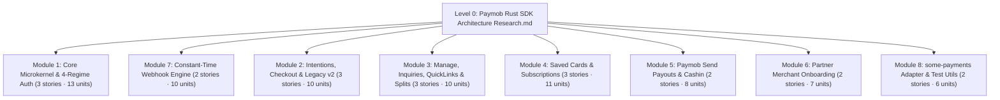
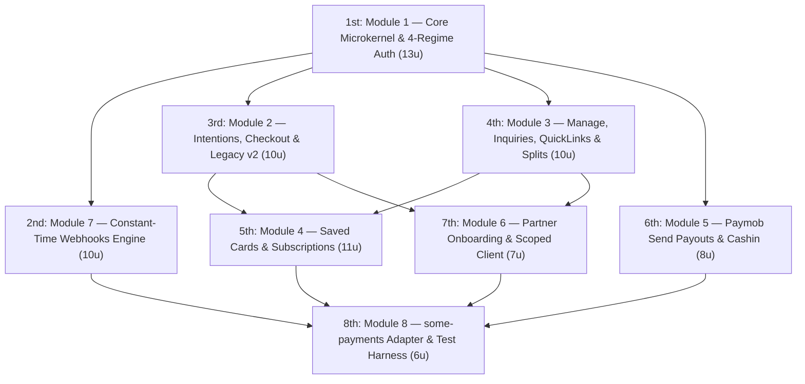

# `some-paymob` — Architecture Decomposition Roadmap

**Generated by:** `spec-decomposition` skill (`some-divide-and-conquer`)  
**Active Field Profile:** `software` (`engineering,security,testing` — [`.agents/field-profile.json`](../../.agents/field-profile.json))  
**Source Specification:** [`docs/Paymob Rust SDK Architecture Research.md`](../Paymob%20Rust%20SDK%20Architecture%20Research.md) (522 lines, 10 Paymob service domains, 4 authentication regimes, 5 regional host topologies, 5 HMAC-SHA512 webhook protocols)  
**Schema Version:** 1.1.0

---

## 1. Executive Summary & Four-Level Decomposition Hierarchy

`some-paymob` is an idiomatic, memory-safe, `#![forbid(unsafe_code)]`, zero-data-race Rust microkernel SDK and constant-time cryptographic webhook verification engine for the [Paymob API](https://developers.paymob.com/) across Egypt (`EGY`), Saudi Arabia (`KSA`), the United Arab Emirates (`UAE`), Oman (`OMN`), and Pakistan (`PAK`). Modeled after [`stripe-node`](https://github.com/stripe/stripe-node), [`some-stripe`](https://github.com/some-of-cs/some-stripe), and [`some-moyasar`](https://github.com/some-of-cs/some-moyasar), it serves both as a standalone crate and as the Egypt/MENA provider plugin inside the [`some-payments`](https://github.com/some-of-cs/some-payment) workspace.

| Hierarchy Level | Count | Naming & Branch Convention | Role in `some-divide-and-conquer` |
| :--- | :---: | :--- | :--- |
| **Level 0 — Monolithic Spec** | **1** | [`docs/Paymob Rust SDK Architecture Research.md`](../Paymob%20Rust%20SDK%20Architecture%20Research.md) | Authoritative Paymob API, auth-regime, and webhook specification |
| **Level 1 — Modules** | **8** | `feat/module-M-<slug>` (`M = 1..8`) | Major bounded contexts & Cargo feature tiers orchestrated by `module-leader` |
| **Level 2 — User Stories** | **20** | `feat/us-M.S.0-<slug>` | Cohesive end-to-end feature deliverables orchestrated in parallel by `story-leader` |
| **Level 3 — Implementation Units** | **75** | `feat/us-M.S.0/unit-K-<scope>` (`K ∈ [3, 5]`) | 100% parallel, non-blocking vertical production slices built by `unit-implementer` |

---

## 2. Module Overview & Strict Cross-Module Merge Order to `main`

To prevent merge conflicts in `Cargo.toml`, `src/lib.rs`, `src/resources/mod.rs`, and `src/prelude.rs` while maximizing parallel execution across isolated Git worktrees, all 8 Modules follow a **Strict Cross-Module Merge Order to `main`**:

> **Strict Merge Order to `main`**:  
> **`Module 1 -> Module 7 -> Module 2 -> Module 3 -> Module 4 -> Module 5 -> Module 6 -> Module 8`**

| Merge Order | Module ID & README Execution Prompt | Target Version | Module Branch | Cargo Feature Flag(s) | Stories | Parallel Units | Upstream Prerequisites |
| :---: | :--- | :---: | :--- | :--- | :---: | :---: | :--- |
| **1st** | [**Module 1: Core Microkernel, Multi-Region Routing & 4-Regime Auth Engine**](../user-stories/module-1-core-microkernel/README.md) | `v0.1.0` | `feat/module-1-core-microkernel` | `core` (implicit, always enabled), `rustls-tls` (default) | 3 | **13** | None (Base `main` branch) |
| **3rd** | [**Module 2: Payment Intentions, Checkout Experiences & Legacy Accept v2 Flow**](../user-stories/module-2-intentions-checkout/README.md) | `v0.2.0` | `feat/module-2-intentions-checkout` | `intentions` (default enabled), `legacy-v2` (opt-in) | 3 | **10** | Module 1 (`feat/module-1-core-microkernel`), Module 7 (`feat/module-7-webhooks-engine`) |
| **4th** | [**Module 3: Payment Lifecycle Management, Transaction Inquiries, QuickLinks & Split Models**](../user-stories/module-3-manage-inquiries-splits/README.md) | `v0.3.0` | `feat/module-3-manage-inquiries-splits` | `manage`, `inquiries`, `quicklinks`, `splits` (and `transactions` alias) | 3 | **10** | Module 1 (`feat/module-1-core-microkernel`), Module 7 (`feat/module-7-webhooks-engine`), Module 2 (`feat/module-2-intentions-checkout`) |
| **5th** | [**Module 4: Saved Cards (CIT/MIT), Headless Payments & Subscriptions Recurring Billing Engine**](../user-stories/module-4-saved-cards-subscriptions/README.md) | `v0.4.0` | `feat/module-4-saved-cards-subscriptions` | `saved-cards` (alias `tokens`), `subscriptions` | 3 | **11** | Module 1 (`feat/module-1-core-microkernel`), Module 7 (`feat/module-7-webhooks-engine`), Module 2 (`feat/module-2-intentions-checkout`), Module 3 (`feat/module-3-manage-inquiries-splits`) |
| **6th** | [**Module 5: Paymob Send — Payouts OAuth2, Instant/Bulk Cashin, Inquiries & Topups**](../user-stories/module-5-payouts-cashin/README.md) | `v0.5.0` | `feat/module-5-payouts-cashin` | `payouts` | 2 | **8** | Module 1 (`feat/module-1-core-microkernel` — Regime 3 OAuth2 & `PaymobRegion` Payouts host routing) |
| **7th** | [**Module 6: Partner Merchant Onboarding APIs & Multi-Tenant Client Scoping**](../user-stories/module-6-partner-onboarding/README.md) | `v0.6.0` | `feat/module-6-partner-onboarding` | `onboarding` (alias `partner-onboarding`) | 2 | **7** | Module 1 (`feat/module-1-core-microkernel`), Module 2 (`feat/module-2-intentions-checkout`), Module 3 (`feat/module-3-manage-inquiries-splits`) |
| **2nd** | [**Module 7: Constant-Time Cryptographic Webhook Verification Engine (Protocols A–E & Idempotency Guard)**](../user-stories/module-7-webhooks-engine/README.md) | `v0.7.0` | `feat/module-7-webhooks-engine` | `webhooks` (alias `webhook-engine`, default enabled) | 2 | **10** | Module 1 (`feat/module-1-core-microkernel`) |
| **8th** | [**Module 8: some-payments Cross-Gateway Unified Adapter & Deterministic Test Harness**](../user-stories/module-8-adapter-test-utils/README.md) | `v0.8.0` | `feat/module-8-adapter-test-utils` | `some-payments-adapter` (alias `some-payment-trait`), `test-utils`, `full` | 2 | **6** | Modules 1, 7, 2, 3, 4, 5, and 6 |

### Cross-Module Dependency DAG

- **Wave A (Foundation):** **Module 1** builds `PaymobClient`, `PaymobRegion`, credential newtypes, the 4-regime `AuthManager`, `HttpClient`, `PaymobError`, and `MinorUnitAmount` (`1st` merge to `main`).
- **Wave B (Parallel Core Domain Wave):** Once Module 1 merges, **Module 7** (`2nd` merge — Constant-Time Webhook Engine), **Module 2** (`3rd` merge — Intentions, Checkout & Legacy v2), **Module 3** (`4th` merge — Manage, Inquiries, QuickLinks & Splits), and **Module 5** (`6th` merge — Payouts & Cashin) can execute in parallel worktrees.
- **Wave C (Composite Domain Wave):** **Module 4** (`5th` merge — Saved Cards & Subscriptions, whose `refund_last_transaction` bridges Subscriptions with Module 3's `manage().refund`) and **Module 6** (`7th` merge — Partner Onboarding, whose `with_merchant` scopes Module 2/3 operations) merge after Modules 2 and 3.
- **Wave D (Cross-Gateway Unification & Conformance Suite):** **Module 8** (`8th` merge — `some-payments-adapter` and `test-utils` mock server) unifies all prior modules and completes `v0.8.0`.

---

## Module 1: Core Microkernel, Multi-Region Routing & 4-Regime Auth Engine

- **Module Directory & Execution Prompt:** [`docs/user-stories/module-1-core-microkernel/README.md`](../user-stories/module-1-core-microkernel/README.md)
- **Branch:** `feat/module-1-core-microkernel`
- **Feature Flags:** `core` (implicit, always enabled), `rustls-tls` (default)
- **Merge Order Position to `main`:** 1st (Foundation Module — merges to `main` first; zero upstream module prerequisites; required by Modules 2–8)
- **Architectural Scope:** Implements the foundational `some-paymob` microkernel (`src/core/`): multi-region dual-host URL routing (`PaymobRegion` across Egypt, Saudi Arabia, UAE, Oman, Pakistan, and Custom mock hosts for both Accept Acquiring and Payouts Disbursement), compile-time and builder-time credential isolation (`SecretKey`, `PublicKey`, `ApiKey`, `HmacSecret` wrapped in `secrecy::SecretString` with `ZeroizeOnDrop` and `[REDACTED]` `Debug` formatting), the lock-free 4-regime authentication state machine (`AuthManager` backed by `ArcSwapOption` and a single-flight `tokio::sync::Mutex<()>` refresh guard), resilient `reqwest` HTTP transport with exponential backoff and trailing-slash normalization, structured `PaymobError` diagnostics, and zero-float `MinorUnitAmount(u64)` money primitives.

### US-1.1.0 — Multi-Region Dual-Host Router, Credential Newtypes & ClientConfig
- **Specification Document:** [`docs/user-stories/module-1-core-microkernel/us-1.1.0-region-router-config.md`](../user-stories/module-1-core-microkernel/us-1.1.0-region-router-config.md)
- **Story Branch:** `feat/us-1.1.0-region-router-config`
- **Owned Paths:** `src/core/region.rs`, `src/core/credentials.rs`, `src/core/config.rs`, `src/core/client.rs`

| Dimension | Weight | Score | Rationale |
| :--- | :---: | :---: | :--- |
| **$D_1$ Functional Surface** | 35% | `3` | 4 core components: `PaymobRegion` dual-host router, credential newtypes (`SecretKey`, `PublicKey`, `ApiKey`, `HmacSecret`), `ClientConfig` builder, and `PaymobClient` handle |
| **$D_2$ Artifact Volume** | 25% | `2` | ~580 production LOC across 4 core files |
| **$D_3$ Logic Complexity** | 20% | `2` | Key-prefix region/environment inference (`egy_sk_test_`, `ksa_pk_live_`), Test vs. Live parity validation, per-endpoint trailing-slash normalization |
| **$D_4$ Orthogonal Boundaries** | 20% | `3` | 4 orthogonal files under `src/core/` (`region.rs`, `credentials.rs`, `config.rs`, `client.rs`) |

$$S_{\text{US-1.1.0}} = (0.35 \times 3) + (0.25 \times 2) + (0.20 \times 2) + (0.20 \times 3) = \mathbf{2.55} \longrightarrow \mathbf{4\text{ Parallel Units}}$$

| Unit | Unit Branch | Disjoint Owned File(s) | Primary Deliverables & Exports | Specialist Agent |
| :--- | :--- | :--- | :--- | :--- |
| `unit-1` | `feat/us-1.1.0/unit-1-region-router` | `src/core/region.rs` | `PaymobRegion` (`Egypt`, `SaudiArabia`, `Uae`, `Oman`, `Pakistan`, `Custom`), `RegionalEndpoints` resolver (Accept Acquiring, Unified Checkout, Payouts Prod, Payouts Staging), and endpoint trailing-slash policy normalizer (`/v1/intention/` vs `/api/secure/disburse/`) | `backend-architect` |
| `unit-2` | `feat/us-1.1.0/unit-2-credential-types` | `src/core/credentials.rs` | `SecretKey`, `PublicKey`, `ApiKey`, `HmacSecret`, `PayoutsCredentials`, and `PartnerCredentials` newtypes wrapping `secrecy::SecretString` with `ZeroizeOnDrop`, `[REDACTED]` `Debug` impls, `EnvironmentMode` (`Test` | `Live`), and static lookup table prefix parser (`CC <= 3`) | `security-engineer` |
| `unit-3` | `feat/us-1.1.0/unit-3-client-config` | `src/core/config.rs` | `ClientConfig` and `ClientConfigBuilder` validating key-prefix environment parity, rejecting `pk_*` in `secret_key`, configuring timeouts/retries, and exposing the legacy-v2 capture `Bearer` auth toggle | `backend-architect` |
| `unit-4` | `feat/us-1.1.0/unit-4-paymob-client` | `src/core/client.rs` | `PaymobClient` (`Arc<PaymobCore>`), cheap `Clone`, compile-time `Send + Sync` assertions, regional URL builders, and feature-gated service accessor methods | `backend-architect` |

### US-1.2.0 — Zero-Race 4-Regime Authentication State Machine & Single-Flight Token Cache
- **Specification Document:** [`docs/user-stories/module-1-core-microkernel/us-1.2.0-multi-regime-auth.md`](../user-stories/module-1-core-microkernel/us-1.2.0-multi-regime-auth.md)
- **Story Branch:** `feat/us-1.2.0-multi-regime-auth`
- **Owned Paths:** `src/core/auth/strategy.rs`, `src/core/auth/cache.rs`, `src/core/auth/accept_jwt.rs`, `src/core/auth/payouts_oauth.rs`, `src/core/auth/partner.rs`

| Dimension | Weight | Score | Rationale |
| :--- | :---: | :---: | :--- |
| **$D_1$ Functional Surface** | 35% | `3` | 5 distinct authentication components: `AuthStrategy` dispatcher, lock-free `ArcSwapOption` token cache, Regime 2 Accept JWT provider (Bearer + JSON body), Regime 3 Payouts OAuth2 provider, and Regime 4 Partner Delegated auth |
| **$D_2$ Artifact Volume** | 25% | `2` | ~660 production LOC across `src/core/auth/` |
| **$D_3$ Logic Complexity** | 20% | `4` | Lock-free atomic reads (`ArcSwapOption<CachedToken>`) paired with `tokio::sync::Mutex<()>` single-flight refresh coordination, 401 eviction & retry, and OAuth2 password/refresh_token grant transitions |
| **$D_4$ Orthogonal Boundaries** | 20% | `3` | 5 orthogonal files under `src/core/auth/` (`strategy.rs`, `cache.rs`, `accept_jwt.rs`, `payouts_oauth.rs`, `partner.rs`) |

$$S_{\text{US-1.2.0}} = (0.35 \times 3) + (0.25 \times 2) + (0.20 \times 4) + (0.20 \times 3) = \mathbf{2.95} \longrightarrow \mathbf{5\text{ Parallel Units}}$$

| Unit | Unit Branch | Disjoint Owned File(s) | Primary Deliverables & Exports | Specialist Agent |
| :--- | :--- | :--- | :--- | :--- |
| `unit-1` | `feat/us-1.2.0/unit-1-auth-strategy` | `src/core/auth/strategy.rs` | `AuthStrategy` enum (`SecretKeyToken`, `AcceptJwtBearer`, `AcceptJwtBody`, `PayoutsOAuth2`, `PartnerBearer`, `PartnerApiKey`, `PublicKeyOnly`), `EndpointAuthSpec`, and Regime 1 `Authorization: Token <secret_key>` header injector | `security-engineer` |
| `unit-2` | `feat/us-1.2.0/unit-2-lockfree-token-cache` | `src/core/auth/cache.rs` | `CachedToken` with 3600s TTL and 60s proactive refresh margin, lock-free `ArcSwapOption<CachedToken>` read fast-path, `tokio::sync::Mutex<()>` single-flight refresh lock, and `ZeroizeOnDrop` token scrubbing | `backend-architect` |
| `unit-3` | `feat/us-1.2.0/unit-3-accept-jwt-provider` | `src/core/auth/accept_jwt.rs` | Regime 2 Accept JWT provider (`POST /api/auth/tokens` with `{"api_key": "..."}`), `Authorization: Bearer <auth_token>` header attachment, JSON body `"auth_token"` field injector, and automatic single-flight retry on HTTP 401 `{"detail": "incorrect credentials"}` | `backend-architect` |
| `unit-4` | `feat/us-1.2.0/unit-4-payouts-oauth2-provider` | `src/core/auth/payouts_oauth.rs` | Regime 3 Payouts OAuth 2.0 state machine (`POST /api/secure/o/token/` with HTTP Basic Auth `{client_id}:{client_secret}` and `application/x-www-form-urlencoded` `grant_type=password` initial grant + `grant_type=refresh_token` renewal) | `security-engineer` |
| `unit-5` | `feat/us-1.2.0/unit-5-partner-delegated-auth` | `src/core/auth/partner.rs` | Regime 4 Partner Delegated authentication context (`PartnerBearer` header, `PartnerApiKey` header/query injector, and sub-merchant `merchant_id` delegation binding) | `backend-architect` |

### US-1.3.0 — HTTP Transport Pipeline, PaymobError Hierarchy, MinorUnitAmount & Prelude
- **Specification Document:** [`docs/user-stories/module-1-core-microkernel/us-1.3.0-http-error-primitives.md`](../user-stories/module-1-core-microkernel/us-1.3.0-http-error-primitives.md)
- **Story Branch:** `feat/us-1.3.0-http-error-primitives`
- **Owned Paths:** `src/core/error.rs`, `src/core/http.rs`, `src/core/types.rs`, `src/core/pagination.rs`, `src/prelude.rs`

| Dimension | Weight | Score | Rationale |
| :--- | :---: | :---: | :--- |
| **$D_1$ Functional Surface** | 35% | `3` | 4 core primitives: `PaymobError` hierarchy, `HttpClient` retry/backoff pipeline, `MinorUnitAmount`/`Currency` types, and `PaginatedResponse<T>`/`prelude` |
| **$D_2$ Artifact Volume** | 25% | `2` | ~500 production LOC across 4 files |
| **$D_3$ Logic Complexity** | 20% | `2` | Exponential backoff with jitter on HTTP 429/502/503/504, multi-shape Paymob error JSON deserialization (`detail`, `message`, field error maps), checked integer money math |
| **$D_4$ Orthogonal Boundaries** | 20% | `2` | 4 independent files (`src/core/error.rs`, `src/core/http.rs`, `src/core/types.rs`, `src/core/pagination.rs` + `src/prelude.rs`) |

$$S_{\text{US-1.3.0}} = (0.35 \times 3) + (0.25 \times 2) + (0.20 \times 2) + (0.20 \times 2) = \mathbf{2.35} \longrightarrow \mathbf{4\text{ Parallel Units}}$$

| Unit | Unit Branch | Disjoint Owned File(s) | Primary Deliverables & Exports | Specialist Agent |
| :--- | :--- | :--- | :--- | :--- |
| `unit-1` | `feat/us-1.3.0/unit-1-error-hierarchy` | `src/core/error.rs` | `PaymobError` enum (`ApiError`, `AuthenticationError`, `EnvironmentMismatch`, `RefundExceedsPermissibleAmount`, `RateLimited`, `WebhookError`, `ValidationError`, `TransportError`), multi-shape Paymob error JSON parser (`detail`, `message`, nested field maps), and PII/secret-redacted `Display`/`Debug` | `backend-architect` |
| `unit-2` | `feat/us-1.3.0/unit-2-http-transport` | `src/core/http.rs` | `HttpClient` wrapping `reqwest::Client` (TLS 1.3), exponential backoff with full jitter on HTTP `429` / `502` / `503` / `504`, `Retry-After` header parsing, request timeout enforcement, and correlation request ID logging | `backend-architect` |
| `unit-3` | `feat/us-1.3.0/unit-3-money-currency-types` | `src/core/types.rs` | `MinorUnitAmount(u64)` newtype (piasters/halalas/fils/paisas with checked `checked_add`/`checked_sub`, zero `f32`/`f64` floats), `Currency` enum (`EGP`, `SAR`, `AED`, `OMR`, `PKR`, `USD`, `EUR`, `Unknown(String)` via static lookup slice `CC <= 3`), and non-empty prefixed ID validators | `backend-architect` |
| `unit-4` | `feat/us-1.3.0/unit-4-pagination-prelude` | `src/core/pagination.rs, src/prelude.rs` | `PaginatedResponse<T>` (`count`, `next`, `previous`, `results`), `PageQuery` builder (`?page=N`), and `some_paymob::prelude::*` exporting core client, config, region, money, and error types | `backend-architect` |

---

## Module 2: Payment Intentions, Checkout Experiences & Legacy Accept v2 Flow

- **Module Directory & Execution Prompt:** [`docs/user-stories/module-2-intentions-checkout/README.md`](../user-stories/module-2-intentions-checkout/README.md)
- **Branch:** `feat/module-2-intentions-checkout`
- **Feature Flags:** `intentions` (default enabled), `legacy-v2` (opt-in)
- **Merge Order Position to `main`:** 3rd (Merges to `main` after Module 1 and Module 7; before Module 3, Module 4, Module 5, Module 6, and Module 8)
- **Architectural Scope:** Implements Paymob's primary payment initialization layer (`src/resources/intentions/`, `src/resources/checkout/`) and classic migration layer (`src/resources/legacy/`): `POST /v1/intention/` and `PUT /v1/intention/` under Regime 1 (`Authorization: Token <secret_key>`) with builder-time enforcement of Environment Parity, `IntentionItem` completeness (`name` + `amount`), and `BillingData` mandatory `phone_number`; local PCI-compliant builders for Unified Checkout redirect URLs (`unified_url`), embedded Pixel JS components (`pixel_config`), and bank installment Affordability Widgets (`affordability_widget`) using `PublicKey` (`pk_*`); plus the opt-in Legacy Accept v2 3-step flow (`POST /api/auth/tokens` -> `POST /api/ecommerce/orders` -> `POST /api/acceptance/payment_keys` -> `iframe_url`).

### US-2.1.0 — v1 Payment Intention Create & Update API (POST & PUT /v1/intention/)
- **Specification Document:** [`docs/user-stories/module-2-intentions-checkout/us-2.1.0-intention-create-update.md`](../user-stories/module-2-intentions-checkout/us-2.1.0-intention-create-update.md)
- **Story Branch:** `feat/us-2.1.0-intention-create-update`
- **Owned Paths:** `src/resources/intentions/billing.rs`, `src/resources/intentions/params.rs`, `src/resources/intentions/response.rs`, `src/resources/intentions/service.rs`

| Dimension | Weight | Score | Rationale |
| :--- | :---: | :---: | :--- |
| **$D_1$ Functional Surface** | 35% | `3` | 4 distinct domain components: `BillingData` + `IntentionItem` validated models, `CreateIntentionParams` + `UpdateIntentionParams` builders, `IntentionResponse` deserializer, and `IntentionsService` |
| **$D_2$ Artifact Volume** | 25% | `2` | ~620 production LOC across `src/resources/intentions/` |
| **$D_3$ Logic Complexity** | 20% | `3` | Builder-time validation of Test/Live integration parity, mandatory `phone_number` when `billing_data` is present, mandatory `name` + `amount` on every `IntentionItem`, untagged `PaymentMethodInput` integer/string serialization, and `/v1/intention/` trailing-slash enforcement |
| **$D_4$ Orthogonal Boundaries** | 20% | `2` | 4 independent files under `src/resources/intentions/` (`billing.rs`, `params.rs`, `response.rs`, `service.rs`) |

$$S_{\text{US-2.1.0}} = (0.35 \times 3) + (0.25 \times 2) + (0.20 \times 3) + (0.20 \times 2) = \mathbf{2.55} \longrightarrow \mathbf{4\text{ Parallel Units}}$$

| Unit | Unit Branch | Disjoint Owned File(s) | Primary Deliverables & Exports | Specialist Agent |
| :--- | :--- | :--- | :--- | :--- |
| `unit-1` | `feat/us-2.1.0/unit-1-billing-and-items` | `src/resources/intentions/billing.rs` | `BillingData` & `BillingDataBuilder` (enforcing non-empty `phone_number` at `.build()` time and redacting PII in `Debug`), `IntentionCustomer`, and `IntentionItem` (enforcing non-empty `name` and `amount` in minor units) | `backend-architect` |
| `unit-2` | `feat/us-2.1.0/unit-2-intention-params` | `src/resources/intentions/params.rs` | `PaymentMethodInput` untagged enum (`IntegrationId(u64)` | `MethodName(String)`), `CreateIntentionParams` & `UpdateIntentionParams` builders supporting `amount`, `currency`, `payment_methods`, `items`, `billing_data`, `customer`, `extras`, `special_reference`, `expiration`, `notification_url`, `redirection_url`, `pre_selected_plan`, and `card_tokens` | `backend-architect` |
| `unit-3` | `feat/us-2.1.0/unit-3-intention-response` | `src/resources/intentions/response.rs` | `IntentionResponse` (`id: String` `pi_*`, `intention_order_id: u64`, `client_secret: SecretString` `egy_csk_*`, `payment_keys: Vec<IntentionPaymentKey>`, `intention_detail`, `payment_methods: Vec<ConfiguredPaymentMethod>`, `special_reference`, `extras`, `confirmed`, `status`, `created`, `card_detail`, `card_tokens`, `object`) | `backend-architect` |
| `unit-4` | `feat/us-2.1.0/unit-4-intentions-service` | `src/resources/intentions/service.rs` | `IntentionsService` (`paymob.intentions().create(params)` `POST /v1/intention/` and `paymob.intentions().update(params)` `PUT /v1/intention/`) using Regime 1 `Authorization: Token <secret_key>` with pre-flight Test/Live parity validation | `api-tester` |

### US-2.2.0 — Unified Checkout URL, Embedded Pixel JS Config & Affordability Widget Builders
- **Specification Document:** [`docs/user-stories/module-2-intentions-checkout/us-2.2.0-checkout-pixel-affordability.md`](../user-stories/module-2-intentions-checkout/us-2.2.0-checkout-pixel-affordability.md)
- **Story Branch:** `feat/us-2.2.0-checkout-pixel-affordability`
- **Owned Paths:** `src/resources/checkout/unified.rs`, `src/resources/checkout/pixel.rs`, `src/resources/checkout/affordability.rs`

| Dimension | Weight | Score | Rationale |
| :--- | :---: | :---: | :--- |
| **$D_1$ Functional Surface** | 35% | `2` | 3 client-facing checkout builders: `unified_url`, `pixel_config`, and `affordability_widget` |
| **$D_2$ Artifact Volume** | 25% | `2` | ~380 production LOC across `src/resources/checkout/` |
| **$D_3$ Logic Complexity** | 20% | `2` | Strict `PublicKey` (`pk_*`) enforcement preventing `SecretKey` exposure in frontend URLs/configs, URL query encoding, and installment plan wiring into `CreateIntentionParams::pre_selected_plan` |
| **$D_4$ Orthogonal Boundaries** | 20% | `2` | 3 independent files under `src/resources/checkout/` (`unified.rs`, `pixel.rs`, `affordability.rs`) |

$$S_{\text{US-2.2.0}} = (0.35 \times 2) + (0.25 \times 2) + (0.20 \times 2) + (0.20 \times 2) = \mathbf{2.00} \longrightarrow \mathbf{3\text{ Parallel Units}}$$

| Unit | Unit Branch | Disjoint Owned File(s) | Primary Deliverables & Exports | Specialist Agent |
| :--- | :--- | :--- | :--- | :--- |
| `unit-1` | `feat/us-2.2.0/unit-1-unified-checkout-url` | `src/resources/checkout/unified.rs` | `CheckoutService::unified_url(&client_secret)` building `{checkout_host}/?publicKey={pk}&clientSecret={client_secret}` with URL-safe percent-encoding and compile/runtime `PublicKey` (`pk_*`) verification | `backend-architect` |
| `unit-2` | `feat/us-2.2.0/unit-2-pixel-config` | `src/resources/checkout/pixel.rs` | `PixelConfig` & `PixelConfigBuilder` (`paymob.checkout().pixel_config(...)`) generating typed JSON configuration for Paymob's embedded Pixel JS SDK (Cards, Apple Pay, Google Pay, domain verification, and Apple Pay certificate settings) | `backend-architect` |
| `unit-3` | `feat/us-2.2.0/unit-3-affordability-widget` | `src/resources/checkout/affordability.rs` | `AffordabilityWidgetConfig` (`paymob.checkout().affordability_widget(...)`) for bank installment plans and helper methods wiring selected installment plan IDs into `CreateIntentionParams::pre_selected_plan` | `backend-architect` |

### US-2.3.0 — Legacy Accept v2 3-Step Checkout Flow (Auth Token -> Order -> Payment Key -> Iframe)
- **Specification Document:** [`docs/user-stories/module-2-intentions-checkout/us-2.3.0-legacy-v2-checkout.md`](../user-stories/module-2-intentions-checkout/us-2.3.0-legacy-v2-checkout.md)
- **Story Branch:** `feat/us-2.3.0-legacy-v2-checkout`
- **Owned Paths:** `src/resources/legacy/orders.rs`, `src/resources/legacy/payment_keys.rs`, `src/resources/legacy/service.rs`

| Dimension | Weight | Score | Rationale |
| :--- | :---: | :---: | :--- |
| **$D_1$ Functional Surface** | 35% | `2` | 3 legacy endpoints + 2 helpers: `POST /api/auth/tokens`, `POST /api/ecommerce/orders`, `POST /api/acceptance/payment_keys`, `iframe_url`, and `create_checkout` composite flow |
| **$D_2$ Artifact Volume** | 25% | `2` | ~440 production LOC under `src/resources/legacy/` (`#[cfg(feature = "legacy-v2")]`) |
| **$D_3$ Logic Complexity** | 20% | `2` | Regime 2 JSON body `"auth_token"` injection, 3-step sequential orchestration, and URL-encoded `payment_token` iframe URL construction |
| **$D_4$ Orthogonal Boundaries** | 20% | `2` | 3 independent files under `src/resources/legacy/` (`orders.rs`, `payment_keys.rs`, `service.rs`) |

$$S_{\text{US-2.3.0}} = (0.35 \times 2) + (0.25 \times 2) + (0.20 \times 2) + (0.20 \times 2) = \mathbf{2.00} \longrightarrow \mathbf{3\text{ Parallel Units}}$$

| Unit | Unit Branch | Disjoint Owned File(s) | Primary Deliverables & Exports | Specialist Agent |
| :--- | :--- | :--- | :--- | :--- |
| `unit-1` | `feat/us-2.3.0/unit-1-legacy-orders` | `src/resources/legacy/orders.rs` | `CreateLegacyOrderParams` (`amount_cents`, `currency`, `merchant_order_id`, `items`, `delivery_needed`), `LegacyOrder` response model, and `POST /api/ecommerce/orders` using Regime 2 JSON body `"auth_token"` | `backend-architect` |
| `unit-2` | `feat/us-2.3.0/unit-2-legacy-payment-keys` | `src/resources/legacy/payment_keys.rs` | `CreatePaymentKeyParams` (`order_id`, `amount_cents`, `currency`, `integration_id`, `billing_data`, `expiration`, `lock_order_when_paid`), `PaymentKeyResponse` (`token: SecretString`), and `POST /api/acceptance/payment_keys` | `backend-architect` |
| `unit-3` | `feat/us-2.3.0/unit-3-legacy-checkout-facade` | `src/resources/legacy/service.rs` | `LegacyV2Service` (`generate_auth_token`, `create_order`, `create_payment_key`, `iframe_url(iframe_id, payment_token)`, and one-call `create_checkout(params)` composite orchestrator) | `api-tester` |

---

## Module 3: Payment Lifecycle Management, Transaction Inquiries, QuickLinks & Split Models

- **Module Directory & Execution Prompt:** [`docs/user-stories/module-3-manage-inquiries-splits/README.md`](../user-stories/module-3-manage-inquiries-splits/README.md)
- **Branch:** `feat/module-3-manage-inquiries-splits`
- **Feature Flags:** `manage`, `inquiries`, `quicklinks`, `splits` (and `transactions` alias)
- **Merge Order Position to `main`:** 4th (Merges to `main` after Modules 1, 7, and 2; before Modules 4, 5, 6, and 8)
- **Architectural Scope:** Implements post-authorization financial lifecycle operations (`src/resources/manage/`), reconciliation inquiries (`src/resources/inquiries/`), programmatic payment links (`src/resources/quicklinks/`), and marketplace split/convenience-fee models (`src/resources/splits/`): Refund (`POST /api/acceptance/void_refund/refund`), Void (`POST /api/acceptance/void_refund/void`), and Auth/Capture (`POST /api/acceptance/capture`); Transaction Inquiry by ID (`GET /api/acceptance/transactions/{id}`), Order/Reference Inquiry (`POST /api/ecommerce/orders/transaction_inquiry`), Order Card Tokens Inquiry (`POST /api/acceptance/order_card_tokens`), and Order Record Inquiry (`GET /api/ecommerce/orders/{id}`); QuickLinks create/cancel (`POST /api/ecommerce/payment-links`, `/cancel`); and Split Amount, Split Payment (up to 3 cards), and Convenience Fee configurations.

### US-3.1.0 — Payment Management — Full/Partial Refund, Unsettled Void & Auth/Capture
- **Specification Document:** [`docs/user-stories/module-3-manage-inquiries-splits/us-3.1.0-payment-refund-void-capture.md`](../user-stories/module-3-manage-inquiries-splits/us-3.1.0-payment-refund-void-capture.md)
- **Story Branch:** `feat/us-3.1.0-payment-refund-void-capture`
- **Owned Paths:** `src/resources/manage/models.rs`, `src/resources/manage/refund.rs`, `src/resources/manage/void_capture.rs`

| Dimension | Weight | Score | Rationale |
| :--- | :---: | :---: | :--- |
| **$D_1$ Functional Surface** | 35% | `2` | 3 core lifecycle operations: `refund` (`POST /api/acceptance/void_refund/refund`), `void` (`POST /api/acceptance/void_refund/void`), and `capture` (`POST /api/acceptance/capture`) + shared `Transaction` model |
| **$D_2$ Artifact Volume** | 25% | `2` | ~430 production LOC across `src/resources/manage/` |
| **$D_3$ Logic Complexity** | 20% | `2` | Regime 1 `Token <secret_key>` default with optional Regime 2 `Bearer` toggle for legacy v2 capture, string-or-integer `transaction_id`/`amount_cents` serialization, and structured parsing of over-refund 400 errors into `PaymobError::RefundExceedsPermissibleAmount` |
| **$D_4$ Orthogonal Boundaries** | 20% | `2` | 3 independent files under `src/resources/manage/` (`models.rs`, `refund.rs`, `void_capture.rs`) |

$$S_{\text{US-3.1.0}} = (0.35 \times 2) + (0.25 \times 2) + (0.20 \times 2) + (0.20 \times 2) = \mathbf{2.00} \longrightarrow \mathbf{3\text{ Parallel Units}}$$

| Unit | Unit Branch | Disjoint Owned File(s) | Primary Deliverables & Exports | Specialist Agent |
| :--- | :--- | :--- | :--- | :--- |
| `unit-1` | `feat/us-3.1.0/unit-1-transaction-models` | `src/resources/manage/models.rs` | `Transaction` and child transaction response structs (`id`, `pending`, `amount_cents`, `success`, `is_auth`, `is_capture`, `is_void`, `is_refund`, `is_voided`, `is_refunded`, `is_captured`, `parent_transaction`, `refunded_amount_cents`, `captured_amount`, `integration_id`, `currency`, `source_data`, `order`, `created_at`) | `backend-architect` |
| `unit-2` | `feat/us-3.1.0/unit-2-refund-operation` | `src/resources/manage/refund.rs` | `RefundParams` (`transaction_id: u64`, `amount_cents: u64`), `paymob.manage().refund(params)` (`POST /api/acceptance/void_refund/refund`), and parser mapping HTTP 400 `"Requested Refund Amount is greater than the maximum refund amount permissible..."` to `PaymobError::RefundExceedsPermissibleAmount` | `backend-architect` |
| `unit-3` | `feat/us-3.1.0/unit-3-void-and-capture` | `src/resources/manage/void_capture.rs` | `VoidParams` (`transaction_id: u64`), `CaptureParams` (`transaction_id: u64`, `amount_cents: u64`), `paymob.manage().void(params)` (`POST /api/acceptance/void_refund/void`), and `paymob.manage().capture(params)` (`POST /api/acceptance/capture`) with configurable Regime 1 Token / Regime 2 Bearer auth | `api-tester` |

### US-3.2.0 — Transaction, Order & Saved Card Token Reconciliation Inquiries
- **Specification Document:** [`docs/user-stories/module-3-manage-inquiries-splits/us-3.2.0-transaction-order-inquiries.md`](../user-stories/module-3-manage-inquiries-splits/us-3.2.0-transaction-order-inquiries.md)
- **Story Branch:** `feat/us-3.2.0-transaction-order-inquiries`
- **Owned Paths:** `src/resources/inquiries/by_id.rs`, `src/resources/inquiries/by_order.rs`, `src/resources/inquiries/card_tokens.rs`, `src/resources/inquiries/order_inquiry.rs`

| Dimension | Weight | Score | Rationale |
| :--- | :---: | :---: | :--- |
| **$D_1$ Functional Surface** | 35% | `2` | 4 inquiry endpoints: `by_transaction_id`, `by_order_or_reference`, `card_tokens_by_order`, and `order` |
| **$D_2$ Artifact Volume** | 25% | `2` | ~540 production LOC across `src/resources/inquiries/` |
| **$D_3$ Logic Complexity** | 20% | `3` | Dual Regime 2 authentication (`Bearer <auth_token>` header on GET endpoints vs. JSON body `"auth_token"` injection on POST inquiry endpoints), non-empty `order_id` or `merchant_order_id` invariant, and rich settlement/VAT/reconciliation deserialization |
| **$D_4$ Orthogonal Boundaries** | 20% | `2` | 4 independent files under `src/resources/inquiries/` (`by_id.rs`, `by_order.rs`, `card_tokens.rs`, `order_inquiry.rs`) |

$$S_{\text{US-3.2.0}} = (0.35 \times 2) + (0.25 \times 2) + (0.20 \times 3) + (0.20 \times 2) = \mathbf{2.20} \longrightarrow \mathbf{4\text{ Parallel Units}}$$

| Unit | Unit Branch | Disjoint Owned File(s) | Primary Deliverables & Exports | Specialist Agent |
| :--- | :--- | :--- | :--- | :--- |
| `unit-1` | `feat/us-3.2.0/unit-1-inquiry-by-tx-id` | `src/resources/inquiries/by_id.rs` | `paymob.inquiries().by_transaction_id(tx_id)` (`GET /api/acceptance/transactions/{transaction_id}`) under Regime 2 `Authorization: Bearer <auth_token>` | `backend-architect` |
| `unit-2` | `feat/us-3.2.0/unit-2-inquiry-by-order-ref` | `src/resources/inquiries/by_order.rs` | `TransactionInquiryParams` (requiring at least one of `order_id` or `merchant_order_id` / `special_reference`), `InquiredTransaction` (`paid_at`, `fees`, `vat`, `accept_fees_cents_int`, `vat_cents_int`, `settlement_amount_cents_int`, `is_settled`, `is_reconciled`, `reconciliation_id`, `cogs`, `installment_info`, `split_description`, `is_split_payment`, `allow_cardless_refund`, `public_customer_fingerprint`), and `POST /api/ecommerce/orders/transaction_inquiry` | `backend-architect` |
| `unit-3` | `feat/us-3.2.0/unit-3-order-card-tokens` | `src/resources/inquiries/card_tokens.rs` | `CardTokenEnvelope` (`type: "TOKEN"`, `obj: CardTokenObject` with `token: SecretString`, `masked_pan`, `card_subtype`, `merchant_id`, `order_id`, `email`, `next_payment_intention`) and `paymob.inquiries().card_tokens_by_order(order_id)` (`POST /api/acceptance/order_card_tokens` with body `"auth_token"`) | `backend-architect` |
| `unit-4` | `feat/us-3.2.0/unit-4-order-record-inquiry` | `src/resources/inquiries/order_inquiry.rs` | `OrderInquiryResponse` (order metadata + nested payment attempt transactions) and `paymob.inquiries().order(order_id)` (`GET /api/ecommerce/orders/{order_id}`) using Regime 2 `Bearer <auth_token>` | `api-tester` |

### US-3.3.0 — QuickLinks Payment Links API, Marketplace Split Rules & Convenience Fee Engine
- **Specification Document:** [`docs/user-stories/module-3-manage-inquiries-splits/us-3.3.0-quicklinks-splits-fees.md`](../user-stories/module-3-manage-inquiries-splits/us-3.3.0-quicklinks-splits-fees.md)
- **Story Branch:** `feat/us-3.3.0-quicklinks-splits-fees`
- **Owned Paths:** `src/resources/quicklinks.rs`, `src/resources/splits/models.rs`, `src/resources/splits/convenience_fees.rs`

| Dimension | Weight | Score | Rationale |
| :--- | :---: | :---: | :--- |
| **$D_1$ Functional Surface** | 35% | `2` | 2 QuickLinks endpoints (`POST /api/ecommerce/payment-links`, `POST /api/ecommerce/payment-links/cancel`) + 3 Split/Fee domain models (`SplitDescription`, `SplitPaymentConfig`, `ConvenienceFeeConfig`) |
| **$D_2$ Artifact Volume** | 25% | `2` | ~420 production LOC across `src/resources/quicklinks.rs` and `src/resources/splits/` |
| **$D_3$ Logic Complexity** | 20% | `2` | Up-to-3-card split payment boundary validation, checked integer convenience fee calculation (`Percentage`, `FixedCents`, `Combination` with `max_fee_cents` cap), and card-level fee rule matching |
| **$D_4$ Orthogonal Boundaries** | 20% | `2` | 3 independent files (`src/resources/quicklinks.rs`, `src/resources/splits/models.rs`, `src/resources/splits/convenience_fees.rs`) |

$$S_{\text{US-3.3.0}} = (0.35 \times 2) + (0.25 \times 2) + (0.20 \times 2) + (0.20 \times 2) = \mathbf{2.00} \longrightarrow \mathbf{3\text{ Parallel Units}}$$

| Unit | Unit Branch | Disjoint Owned File(s) | Primary Deliverables & Exports | Specialist Agent |
| :--- | :--- | :--- | :--- | :--- |
| `unit-1` | `feat/us-3.3.0/unit-1-quicklinks-service` | `src/resources/quicklinks.rs` | `CreateQuickLinkParams` (`amount_cents`, `currency`, `integrations: Vec<u64>`, optional `description`, `full_name`, `email`, `phone_number`, `redirection_url`), `QuickLinkResponse` (`id`, `url`, `client_url`), and `QuickLinksService` (`create` `POST /api/ecommerce/payment-links` & `cancel` `POST /api/ecommerce/payment-links/cancel` under Regime 2 `Bearer`) | `backend-architect` |
| `unit-2` | `feat/us-3.3.0/unit-2-split-models` | `src/resources/splits/models.rs` | `SplitRecipientRule` and `SplitDescription` (multi-recipient marketplace settlement rules) plus `SplitPaymentConfig` (multi-card customer checkout enforcing `1 <= cards.len() <= 3`) | `backend-architect` |
| `unit-3` | `feat/us-3.3.0/unit-3-convenience-fees` | `src/resources/splits/convenience_fees.rs` | `ConvenienceFeeConfig`, `FeeCalculationMode` (`PercentageBps(u32)`, `FixedCents(u64)`, `Combination { bps: u32, fixed_cents: u64 }`), `max_fee_cents: Option<u64>`, `is_refundable: bool`, `CardFeeRule` (`Uniform`, `DebitVsCredit`, `BinRange`, `DomesticVsInternational`), and checked integer fee calculator | `backend-architect` |

---

## Module 4: Saved Cards (CIT/MIT), Headless Payments & Subscriptions Recurring Billing Engine

- **Module Directory & Execution Prompt:** [`docs/user-stories/module-4-saved-cards-subscriptions/README.md`](../user-stories/module-4-saved-cards-subscriptions/README.md)
- **Branch:** `feat/module-4-saved-cards-subscriptions`
- **Feature Flags:** `saved-cards` (alias `tokens`), `subscriptions`
- **Merge Order Position to `main`:** 5th (Merges to `main` after Modules 1, 7, 2, and 3; before Modules 5, 6, and 8)
- **Architectural Scope:** Implements saved card tokenization and headless payment execution (`src/resources/saved_cards/`) alongside the complete 18-operation Subscriptions & Recurring Billing engine (`src/resources/subscriptions/`): Customer-Initiated Transactions (CIT via Intention `card_tokens`), Merchant-Initiated Transactions (MIT off-session MOTO charges), Mobile Wallet direct charges (`Vodafone Cash`, `Orange Cash`, `e& money`), and Kiosk reference payments (`Fawry`, `Aman`, `Masary`) via `POST /api/acceptance/payments/pay`; Subscription Plan CRUD & lifecycle (`POST/PUT/GET/suspend/resume /api/acceptance/subscription-plans`); Subscription enrollment, state transitions (`suspend`, `resume`, `cancel`, `update`), multi-card management (`list`, `add_secondary`, `change_primary`, `delete_secondary`), webhook registration, transaction history (`last-transaction`, `transactions`), and the composite `refund_last_transaction(sub_id, Option<u64>)` helper.

### US-4.1.0 — Saved Card Tokenization (CIT/MIT) & Headless Payments (MOTO, Mobile Wallet & Kiosk)
- **Specification Document:** [`docs/user-stories/module-4-saved-cards-subscriptions/us-4.1.0-saved-cards-headless-pay.md`](../user-stories/module-4-saved-cards-subscriptions/us-4.1.0-saved-cards-headless-pay.md)
- **Story Branch:** `feat/us-4.1.0-saved-cards-headless-pay`
- **Owned Paths:** `src/resources/saved_cards/sources.rs`, `src/resources/saved_cards/cit_mit.rs`, `src/resources/saved_cards/service.rs`

| Dimension | Weight | Score | Rationale |
| :--- | :---: | :---: | :--- |
| **$D_1$ Functional Surface** | 35% | `2` | 4 payment workflows on `POST /api/acceptance/payments/pay`: CIT `card_tokens` intention enrollment, MIT off-session saved-token MOTO charge, Mobile Wallet direct charge, and Kiosk aggregator bill reference generation |
| **$D_2$ Artifact Volume** | 25% | `2` | ~460 production LOC across `src/resources/saved_cards/` |
| **$D_3$ Logic Complexity** | 20% | `2` | Polymorphic `PaymentSource` serialization (`TOKEN`, `WALLET`, `AGGREGATOR`), `use_cvc_with_moto` validation, and response extraction for immediate `Transaction` vs. wallet `RedirectUrl` vs. kiosk bill reference |
| **$D_4$ Orthogonal Boundaries** | 20% | `2` | 3 independent files under `src/resources/saved_cards/` (`sources.rs`, `cit_mit.rs`, `service.rs`) |

$$S_{\text{US-4.1.0}} = (0.35 \times 2) + (0.25 \times 2) + (0.20 \times 2) + (0.20 \times 2) = \mathbf{2.00} \longrightarrow \mathbf{3\text{ Parallel Units}}$$

| Unit | Unit Branch | Disjoint Owned File(s) | Primary Deliverables & Exports | Specialist Agent |
| :--- | :--- | :--- | :--- | :--- |
| `unit-1` | `feat/us-4.1.0/unit-1-payment-sources` | `src/resources/saved_cards/sources.rs` | `PaymentSource` enum (`SavedToken { identifier: SecretString, subtype: "TOKEN", cvn: Option<SecretString> }`, `MobileWallet { identifier: String, subtype: "WALLET" }`, `KioskAggregator { identifier: "AGGREGATOR", subtype: "AGGREGATOR" }`) with `[REDACTED]` `Debug` formatting | `security-engineer` |
| `unit-2` | `feat/us-4.1.0/unit-2-cit-mit-workflows` | `src/resources/saved_cards/cit_mit.rs` | `CitCardTokenConfig` (wiring saved card tokens into `CreateIntentionParams::card_tokens`), `MitChargeParams` (`payment_token: SecretString`, `saved_token: SecretString`, `cvn: Option<SecretString>`), and `use_cvc_with_moto` validation guard | `backend-architect` |
| `unit-3` | `feat/us-4.1.0/unit-3-headless-pay-service` | `src/resources/saved_cards/service.rs` | `SavedCardsService` (`pay_with_token_mit`, `pay_with_wallet`, `pay_with_kiosk`, `pay_raw`) executing `POST /api/acceptance/payments/pay` under Regime 2 `Bearer <auth_token>` and returning `HeadlessPayResponse` (`transaction`, `redirect_url`, `kiosk_bill_reference`) | `api-tester` |

### US-4.2.0 — Subscription Plans CRUD & Plan Lifecycle (POST/PUT/GET/Suspend/Resume)
- **Specification Document:** [`docs/user-stories/module-4-saved-cards-subscriptions/us-4.2.0-subscription-plans.md`](../user-stories/module-4-saved-cards-subscriptions/us-4.2.0-subscription-plans.md)
- **Story Branch:** `feat/us-4.2.0-subscription-plans`
- **Owned Paths:** `src/resources/subscriptions/plan_models.rs`, `src/resources/subscriptions/plan_params.rs`, `src/resources/subscriptions/plans_service.rs`

| Dimension | Weight | Score | Rationale |
| :--- | :---: | :---: | :--- |
| **$D_1$ Functional Surface** | 35% | `2` | 5 Subscription Plan operations on `/api/acceptance/subscription-plans`: `create`, `update`, `list`, `suspend`, and `resume` |
| **$D_2$ Artifact Volume** | 25% | `2` | ~470 production LOC across `src/resources/subscriptions/` |
| **$D_3$ Logic Complexity** | 20% | `2` | Compile-time and builder-time enforcement of Paymob's exact allowed `PlanFrequency` values (`7, 15, 30, 60, 90, 180, 360` days), `name <= 200` chars check, and MIGS MOTO `integration` ID binding |
| **$D_4$ Orthogonal Boundaries** | 20% | `2` | 3 independent files under `src/resources/subscriptions/` (`plan_models.rs`, `plan_params.rs`, `plans_service.rs`) |

$$S_{\text{US-4.2.0}} = (0.35 \times 2) + (0.25 \times 2) + (0.20 \times 2) + (0.20 \times 2) = \mathbf{2.00} \longrightarrow \mathbf{3\text{ Parallel Units}}$$

| Unit | Unit Branch | Disjoint Owned File(s) | Primary Deliverables & Exports | Specialist Agent |
| :--- | :--- | :--- | :--- | :--- |
| `unit-1` | `feat/us-4.2.0/unit-1-plan-models-frequency` | `src/resources/subscriptions/plan_models.rs` | `PlanFrequency` enum (`Days7 = 7`, `Days15 = 15`, `Days30 = 30`, `Days60 = 60`, `Days90 = 90`, `Days180 = 180`, `Days360 = 360` mapped via static lookup table `CC <= 3`), `PlanType` (`Rent`), and `SubscriptionPlan` response struct | `backend-architect` |
| `unit-2` | `feat/us-4.2.0/unit-2-plan-params` | `src/resources/subscriptions/plan_params.rs` | `CreateSubscriptionPlanParams` (enforcing `1 <= name.len() <= 200`, required `frequency: PlanFrequency`, required `integration: u64` MIGS MOTO ID, optional `webhook_url`, `reminder_days`, `retrial_days`, `plan_type`, `number_of_deductions`, `amount_cents`, `use_transaction_amount`, `is_active`, `fee`) and `UpdateSubscriptionPlanParams` | `backend-architect` |
| `unit-3` | `feat/us-4.2.0/unit-3-plans-service` | `src/resources/subscriptions/plans_service.rs` | `SubscriptionPlansService` (`create` `POST /api/acceptance/subscription-plans`, `update` `PUT /api/acceptance/subscription-plans/{id}`, `list` `GET /api/acceptance/subscription-plans?page=N`, `suspend`, and `resume`) under Regime 2 `Bearer <auth_token>` | `api-tester` |

### US-4.3.0 — Subscription Lifecycle Actions, Card Vault Management, Transaction History & refund_last_transaction
- **Specification Document:** [`docs/user-stories/module-4-saved-cards-subscriptions/us-4.3.0-subscription-lifecycle-cards-refunds.md`](../user-stories/module-4-saved-cards-subscriptions/us-4.3.0-subscription-lifecycle-cards-refunds.md)
- **Story Branch:** `feat/us-4.3.0-subscription-lifecycle-cards-refunds`
- **Owned Paths:** `src/resources/subscriptions/models.rs`, `src/resources/subscriptions/lifecycle.rs`, `src/resources/subscriptions/cards.rs`, `src/resources/subscriptions/history.rs`, `src/resources/subscriptions/refund.rs`

| Dimension | Weight | Score | Rationale |
| :--- | :---: | :---: | :--- |
| **$D_1$ Functional Surface** | 35% | `3` | 5 cohesive sub-domains covering 13 operations + 1 composite helper: Subscription models/filters, lifecycle actions (`create`, `retrieve_or_list`, `update`, `suspend`, `resume`, `cancel`), card management (`list`, `add_secondary`, `change_primary`, `delete_secondary`), history/webhook registration (`register_webhook`, `last_transaction`, `list_transactions`), and `refund_last_transaction` |
| **$D_2$ Artifact Volume** | 25% | `2` | ~680 production LOC across 5 files under `src/resources/subscriptions/` |
| **$D_3$ Logic Complexity** | 20% | `3` | Cross-regime composite `refund_last_transaction(sub_id, Option<u64>)` chaining Regime 2 `GET /last-transaction` with `success && !is_refunded` verification and Regime 1 `POST /api/acceptance/void_refund/refund` |
| **$D_4$ Orthogonal Boundaries** | 20% | `3` | 5 independent files under `src/resources/subscriptions/` (`models.rs`, `lifecycle.rs`, `cards.rs`, `history.rs`, `refund.rs`) |

$$S_{\text{US-4.3.0}} = (0.35 \times 3) + (0.25 \times 2) + (0.20 \times 3) + (0.20 \times 3) = \mathbf{2.75} \longrightarrow \mathbf{5\text{ Parallel Units}}$$

| Unit | Unit Branch | Disjoint Owned File(s) | Primary Deliverables & Exports | Specialist Agent |
| :--- | :--- | :--- | :--- | :--- |
| `unit-1` | `feat/us-4.3.0/unit-1-subscription-models` | `src/resources/subscriptions/models.rs` | `Subscription` record (`id`, `plan_id`, `state`, `initial_transaction`, `amount_cents`, `starts_at`, `next_billing`, `reminder_date`, `ends_at`, `resumed_at`, `suspended_at`, `reactivated_at`, `created_at`), `SubscriptionState`, `SubscriptionListFilter` (`transaction`, `plan_id`, `state`), and `SubscriptionCard` (`id`, `card_data`, `token: SecretString`, `created_at`, `is_primary`, `masked_pan`, `failed_attempts`) | `backend-architect` |
| `unit-2` | `feat/us-4.3.0/unit-2-subscription-lifecycle` | `src/resources/subscriptions/lifecycle.rs` | `SubscriptionsService` lifecycle methods (`create` via Intention 3DS enrollment, `retrieve(sub_id)` `GET /api/acceptance/subscriptions/{id}`, `list(filters)`, `update(sub_id, params)`, `suspend(sub_id)` `POST /api/acceptance/subscriptions/{id}/suspend`, `resume(sub_id)`, `cancel(sub_id)`) under Regime 2 `Bearer <auth_token>` | `backend-architect` |
| `unit-3` | `feat/us-4.3.0/unit-3-subscription-cards` | `src/resources/subscriptions/cards.rs` | `SubscriptionCardsService` (`paymob.subscriptions().cards().list(sub_id)`, `.add_secondary(...)`, `.change_primary(sub_id, card_id)` `POST /api/acceptance/subscriptions/{id}/change-primary-card` with `{"card": card_id}`, and `.delete_secondary(sub_id, card_id)` `POST /api/acceptance/subscriptions/{id}/delete-card`) | `backend-architect` |
| `unit-4` | `feat/us-4.3.0/unit-4-subscription-history-webhook` | `src/resources/subscriptions/history.rs` | `register_webhook(sub_id, url)`, `last_transaction(sub_id)` (`GET /api/acceptance/subscriptions/{id}/last-transaction` returning full `Transaction` with `api_source: "SUBSCRIPTION"`), and `list_transactions(sub_id)` (`GET /api/acceptance/subscriptions/{id}/transactions`) | `backend-architect` |
| `unit-5` | `feat/us-4.3.0/unit-5-subscription-refund-helper` | `src/resources/subscriptions/refund.rs` | Composite `paymob.subscriptions().refund_last_transaction(sub_id, amount_cents: Option<u64>)` (`#[cfg(all(feature = "subscriptions", feature = "manage"))]`) fetching `last_transaction(sub_id)`, asserting `tx.success && !tx.is_refunded`, and delegating to `manage().refund(...)` for full or partial deduction amount | `api-tester` |

---

## Module 5: Paymob Send — Payouts OAuth2, Instant/Bulk Cashin, Inquiries & Topups

- **Module Directory & Execution Prompt:** [`docs/user-stories/module-5-payouts-cashin/README.md`](../user-stories/module-5-payouts-cashin/README.md)
- **Branch:** `feat/module-5-payouts-cashin`
- **Feature Flags:** `payouts`
- **Merge Order Position to `main`:** 6th (Merges to `main` after Modules 1, 7, 2, 3, and 4; before Modules 6 and 8)
- **Architectural Scope:** Implements the complete 17-operation Paymob Send Payouts & Disbursement API (`src/resources/payouts/`) routed to the regional Payouts host (`https://payouts.paymobsolutions.com/`, `https://payouts.paymob.sa/`, `https://payouts-uae.paymobsolutions.com/`): OAuth 2.0 `password` and `refresh_token` grants (`POST /api/secure/o/token/`); Instant Cashin (`POST /api/secure/disburse/`) across `vodafone`, `etisalat`, `orange`, `bank_wallet`, `bank_card` (`salary | credit_card | prepaid_card | cash_transfer`), `instant_bank`, and `egyptian_post`, plus Aman cancellation (`POST /api/secure/transaction/aman/cancel/`); Bulk Disbursements (`POST /disburse/api/v1/disburse/bulk_transaction/`); Transaction, Reference, User Budget (`GET /api/secure/budget/inquire/`), and Topup Inquiries (`GET /api/secure/topup/inquire/`); and Topup Requests (`POST /api/secure/topup/request/`) from Bank Transfers (`<= 2.8 MB` proof attachment guard) and Accept Balance.

### US-5.1.0 — Payouts OAuth 2.0 Token Facade & Instant Cashin Disbursements (7 Issuers + Aman Cancel)
- **Specification Document:** [`docs/user-stories/module-5-payouts-cashin/us-5.1.0-payouts-oauth-instant-cashin.md`](../user-stories/module-5-payouts-cashin/us-5.1.0-payouts-oauth-instant-cashin.md)
- **Story Branch:** `feat/us-5.1.0-payouts-oauth-instant-cashin`
- **Owned Paths:** `src/resources/payouts/auth.rs`, `src/resources/payouts/models.rs`, `src/resources/payouts/wallet_cashin.rs`, `src/resources/payouts/bank_cashin.rs`

| Dimension | Weight | Score | Rationale |
| :--- | :---: | :---: | :--- |
| **$D_1$ Functional Surface** | 35% | `3` | 4 functional slices covering 10 operations: OAuth2 `generate_token` & `refresh_token`, Disbursement models/enums, Mobile/Bank Wallet Cashin (`vodafone`, `etisalat`, `orange`, `bank_wallet`), and Bank/Post/Aman Cashin (`bank_card`, `bank_instant`, `egyptian_post`, `cancel_aman`) |
| **$D_2$ Artifact Volume** | 25% | `2` | ~620 production LOC across 4 files under `src/resources/payouts/` |
| **$D_3$ Logic Complexity** | 20% | `3` | Regime 3 OAuth2 Basic Auth + form grant integration, MSISDN & bank account validation, `BankTransactionType` lookup table (`CC <= 3`), and strict trailing-slash enforcement on `/api/secure/disburse/` |
| **$D_4$ Orthogonal Boundaries** | 20% | `2` | 4 independent files under `src/resources/payouts/` (`auth.rs`, `models.rs`, `wallet_cashin.rs`, `bank_cashin.rs`) |

$$S_{\text{US-5.1.0}} = (0.35 \times 3) + (0.25 \times 2) + (0.20 \times 3) + (0.20 \times 2) = \mathbf{2.55} \longrightarrow \mathbf{4\text{ Parallel Units}}$$

| Unit | Unit Branch | Disjoint Owned File(s) | Primary Deliverables & Exports | Specialist Agent |
| :--- | :--- | :--- | :--- | :--- |
| `unit-1` | `feat/us-5.1.0/unit-1-payouts-auth-facade` | `src/resources/payouts/auth.rs` | `PayoutsAuthService` (`payouts().auth().generate_token()`, `.refresh_token()`) wrapping `POST /api/secure/o/token/` (Basic Auth `{client_id}:{client_secret}` + form grants), returning `PayoutsTokenResponse` (`access_token: SecretString`, `refresh_token: SecretString`, `expires_in: 3600`, `scope`, `token_type`), and mapping `{"error": "invalid_grant"}` to `PaymobError::AuthenticationError` | `security-engineer` |
| `unit-2` | `feat/us-5.1.0/unit-2-disburse-models` | `src/resources/payouts/models.rs` | `DisburseIssuer` enum (`Vodafone`, `Etisalat`, `Orange`, `BankWallet`, `BankCard`, `InstantBank`, `EgyptianPost` via static lookup slice `CC <= 3`), `BankTransactionType` (`Salary`, `CreditCard`, `PrepaidCard`, `CashTransfer`), `DisbursementResponse` (`transaction_id`, `msisdn`, `issuer`, `amount`, `full_name`, `disbursement_status`, `status_code`, `status_description`, `aman_cashing_details`, `created_at`, `updated_at`), and `AmanCashingDetails` | `backend-architect` |
| `unit-3` | `feat/us-5.1.0/unit-3-mobile-wallet-cashin` | `src/resources/payouts/wallet_cashin.rs` | `PayoutsCashinService` mobile & bank wallet methods (`vodafone(params)`, `etisalat(params)`, `orange(params)`, `bank_wallet(params)`) dispatching `POST /api/secure/disburse/` with validated `msisdn`, `amount`, `client_reference_id`, and `customer_bears_fees` | `backend-architect` |
| `unit-4` | `feat/us-5.1.0/unit-4-bank-post-aman-cashin` | `src/resources/payouts/bank_cashin.rs` | `PayoutsCashinService` bank & cash methods (`bank_card(params)` with redacted `bank_card_number`, `bank_code`, `bank_transaction_type`; `bank_instant(params)`; `egyptian_post(params)`; and `cancel_aman(params)` on `POST /api/secure/transaction/aman/cancel/`) | `api-tester` |

### US-5.2.0 — Bulk Disbursements, Payout Inquiries, User Budget & Topup Requests
- **Specification Document:** [`docs/user-stories/module-5-payouts-cashin/us-5.2.0-payouts-bulk-inquiries-topups.md`](../user-stories/module-5-payouts-cashin/us-5.2.0-payouts-bulk-inquiries-topups.md)
- **Story Branch:** `feat/us-5.2.0-payouts-bulk-inquiries-topups`
- **Owned Paths:** `src/resources/payouts/bulk.rs`, `src/resources/payouts/inquiries.rs`, `src/resources/payouts/budget.rs`, `src/resources/payouts/topups.rs`

| Dimension | Weight | Score | Rationale |
| :--- | :---: | :---: | :--- |
| **$D_1$ Functional Surface** | 35% | `3` | 7 operations across 4 components: `cashin().bulk`, `inquiries().transactions` & `by_reference`, `inquiries().user_budget` & `topup`, and `topups().from_bank_transfer` & `from_accept_balance` |
| **$D_2$ Artifact Volume** | 25% | `2` | ~520 production LOC across 4 files under `src/resources/payouts/` |
| **$D_3$ Logic Complexity** | 20% | `2` | Pre-flight proof attachment size validation (`<= 2.8 MB` / `2,936,012` bytes) on `from_bank_transfer`, 429 rate-limit status mapping on `budget/inquire/`, and banking vs. non-banking bulk inquiry routing |
| **$D_4$ Orthogonal Boundaries** | 20% | `2` | 4 independent files under `src/resources/payouts/` (`bulk.rs`, `inquiries.rs`, `budget.rs`, `topups.rs`) |

$$S_{\text{US-5.2.0}} = (0.35 \times 3) + (0.25 \times 2) + (0.20 \times 2) + (0.20 \times 2) = \mathbf{2.35} \longrightarrow \mathbf{4\text{ Parallel Units}}$$

| Unit | Unit Branch | Disjoint Owned File(s) | Primary Deliverables & Exports | Specialist Agent |
| :--- | :--- | :--- | :--- | :--- |
| `unit-1` | `feat/us-5.2.0/unit-1-bulk-disbursement` | `src/resources/payouts/bulk.rs` | `BulkDisbursementParams`, `BulkDisbursementItem`, `BulkDisbursementResponse`, and `payouts().cashin().bulk(params)` (`POST /disburse/api/v1/disburse/bulk_transaction/`) under Regime 3 `Bearer <access_token>` | `backend-architect` |
| `unit-2` | `feat/us-5.2.0/unit-2-payout-tx-inquiries` | `src/resources/payouts/inquiries.rs` | `PayoutsInquiriesService` transaction lookup methods (`transactions(params)` covering `/api/secure/transaction/inquire/` and `/disburse/api/v1/bulk_transaction/inquire/` for banking & non-banking, plus `by_reference(params)` on `/disburse/api/v1/bulk_transaction/inquire_by_reference/`) | `backend-architect` |
| `unit-3` | `feat/us-5.2.0/unit-3-budget-and-topup-inquiry` | `src/resources/payouts/budget.rs` | `payouts().inquiries().user_budget()` (`GET /api/secure/budget/inquire/` returning `UserBudgetResponse { current_budget }` and mapping HTTP 429 `{ status_description, status_code }` to `PaymobError::RateLimited`) and `payouts().inquiries().topup(params)` (`GET /api/secure/topup/inquire/`) | `backend-architect` |
| `unit-4` | `feat/us-5.2.0/unit-4-topup-requests` | `src/resources/payouts/topups.rs` | `PayoutsTopupsService` (`from_bank_transfer(params)` enforcing `to_attach_proof.len() <= 2_936_012` bytes / 2.8 MB, and `from_accept_balance(params)` on `POST /api/secure/topup/request/` returning `TopupRecord` with redacted account numbers) | `api-tester` |

---

## Module 6: Partner Merchant Onboarding APIs & Multi-Tenant Client Scoping

- **Module Directory & Execution Prompt:** [`docs/user-stories/module-6-partner-onboarding/README.md`](../user-stories/module-6-partner-onboarding/README.md)
- **Branch:** `feat/module-6-partner-onboarding`
- **Feature Flags:** `onboarding` (alias `partner-onboarding`)
- **Merge Order Position to `main`:** 7th (Merges to `main` after Modules 1, 7, 2, 3, 4, and 5; before Module 8)
- **Architectural Scope:** Implements Paymob's 7 Partner Onboarding APIs (`src/resources/onboarding/`) and multi-tenant sub-merchant client scoping (`paymob.with_merchant(merchant_id)`): Partner Login (`onboarding().auth().login`), Partner API Key creation (`onboarding().auth().create_api_key`), and Partner HMAC Secret retrieval (`GET /api/auth/hmac_secret/get_hmac`); Sub-Merchant Registration (`register_merchant`), dynamic Onboarding Flow Schema discovery (`GET /api/onboarding/flow/schema?partner=...&resubmission=...&paymob_mid=...`), KYC Step Submission (`submit_step`), Partner Merchant Inquiry (`merchant_inquiry`), and the `MerchantScopedClient` wrapper that processes intentions, inquiries, and refunds on behalf of an onboarded sub-merchant using the Partner API Key + `merchant_id`.

### US-6.1.0 — Partner Authentication, Partner API Key Provisioning & Partner HMAC Secret Retrieval
- **Specification Document:** [`docs/user-stories/module-6-partner-onboarding/us-6.1.0-partner-auth-hmac.md`](../user-stories/module-6-partner-onboarding/us-6.1.0-partner-auth-hmac.md)
- **Story Branch:** `feat/us-6.1.0-partner-auth-hmac`
- **Owned Paths:** `src/resources/onboarding/auth_models.rs`, `src/resources/onboarding/login_apikey.rs`, `src/resources/onboarding/hmac_secret.rs`

| Dimension | Weight | Score | Rationale |
| :--- | :---: | :---: | :--- |
| **$D_1$ Functional Surface** | 35% | `2` | 3 Partner Auth operations: `login(creds)`, `create_api_key(...)`, and `retrieve_hmac_secret()` (`GET /api/auth/hmac_secret/get_hmac`) |
| **$D_2$ Artifact Volume** | 25% | `2` | ~360 production LOC across 3 files under `src/resources/onboarding/` |
| **$D_3$ Logic Complexity** | 20% | `2` | Regime 4 Partner Bearer token exchange, wrapping `hmac_secret` and `api_key` in `secrecy::SecretString` with `ZeroizeOnDrop` |
| **$D_4$ Orthogonal Boundaries** | 20% | `2` | 3 independent files under `src/resources/onboarding/` (`auth_models.rs`, `login_apikey.rs`, `hmac_secret.rs`) |

$$S_{\text{US-6.1.0}} = (0.35 \times 2) + (0.25 \times 2) + (0.20 \times 2) + (0.20 \times 2) = \mathbf{2.00} \longrightarrow \mathbf{3\text{ Parallel Units}}$$

| Unit | Unit Branch | Disjoint Owned File(s) | Primary Deliverables & Exports | Specialist Agent |
| :--- | :--- | :--- | :--- | :--- |
| `unit-1` | `feat/us-6.1.0/unit-1-partner-auth-models` | `src/resources/onboarding/auth_models.rs` | `PartnerLoginCredentials` (redacted `password`), `PartnerAuthTokenResponse` (`token: SecretString`), `CreatePartnerApiKeyParams`, `PartnerApiKeyResponse` (`api_key: SecretString`), and `PartnerHmacEnvelope` (`label`, `status: "Created"`, `code: 201`, `body: PartnerHmacBody { hmac_secret: SecretString }`) | `security-engineer` |
| `unit-2` | `feat/us-6.1.0/unit-2-partner-login-apikey` | `src/resources/onboarding/login_apikey.rs` | `PartnerAuthService::login(creds)` and `PartnerAuthService::create_api_key(params)` under Regime 4 Partner Authentication | `backend-architect` |
| `unit-3` | `feat/us-6.1.0/unit-3-retrieve-partner-hmac` | `src/resources/onboarding/hmac_secret.rs` | `PartnerAuthService::retrieve_hmac_secret()` (`GET /api/auth/hmac_secret/get_hmac` with `Authorization: Bearer <partner_auth_token>`) returning `PartnerHmacEnvelope` | `api-tester` |

### US-6.2.0 — Sub-Merchant Registration, Onboarding Flow Schema, Step Submission, Inquiry & with_merchant Scoping
- **Specification Document:** [`docs/user-stories/module-6-partner-onboarding/us-6.2.0-merchant-onboarding-flow.md`](../user-stories/module-6-partner-onboarding/us-6.2.0-merchant-onboarding-flow.md)
- **Story Branch:** `feat/us-6.2.0-merchant-onboarding-flow`
- **Owned Paths:** `src/resources/onboarding/flow_models.rs`, `src/resources/onboarding/schema_register.rs`, `src/resources/onboarding/step_inquiry.rs`, `src/resources/onboarding/scoped_client.rs`

| Dimension | Weight | Score | Rationale |
| :--- | :---: | :---: | :--- |
| **$D_1$ Functional Surface** | 35% | `3` | 4 onboarding flow operations (`register_merchant`, `get_schema`, `submit_step`, `merchant_inquiry`) + `paymob.with_merchant(merchant_id)` multi-tenant client wrapper |
| **$D_2$ Artifact Volume** | 25% | `2` | ~480 production LOC across 4 files under `src/resources/onboarding/` |
| **$D_3$ Logic Complexity** | 20% | `2` | Query parameter construction `?partner=KeyPartner&resubmission=true&paymob_mid=123`, KYC step payload validation, and `MerchantScopedClient` delegation binding Partner API Key + `merchant_id` |
| **$D_4$ Orthogonal Boundaries** | 20% | `2` | 4 independent files under `src/resources/onboarding/` (`flow_models.rs`, `schema_register.rs`, `step_inquiry.rs`, `scoped_client.rs`) |

$$S_{\text{US-6.2.0}} = (0.35 \times 3) + (0.25 \times 2) + (0.20 \times 2) + (0.20 \times 2) = \mathbf{2.35} \longrightarrow \mathbf{4\text{ Parallel Units}}$$

| Unit | Unit Branch | Disjoint Owned File(s) | Primary Deliverables & Exports | Specialist Agent |
| :--- | :--- | :--- | :--- | :--- |
| `unit-1` | `feat/us-6.2.0/unit-1-onboarding-flow-models` | `src/resources/onboarding/flow_models.rs` | `RegisterMerchantParams`, `RegisteredMerchantResponse`, `OnboardingSchemaQuery` (`partner: String`, `resubmission: Option<bool>`, `paymob_mid: Option<u64>`), `OnboardingFlowSchema`, `SubmitOnboardingStepParams`, and `PartnerMerchantInquiryResponse` | `backend-architect` |
| `unit-2` | `feat/us-6.2.0/unit-2-register-and-schema` | `src/resources/onboarding/schema_register.rs` | `PartnerFlowService::register_merchant(params)` and `PartnerFlowService::get_schema(query)` (`GET /api/onboarding/flow/schema?partner=...&resubmission=...&paymob_mid=...`) under Regime 4 `PartnerApiKey` | `backend-architect` |
| `unit-3` | `feat/us-6.2.0/unit-3-submit-step-and-inquiry` | `src/resources/onboarding/step_inquiry.rs` | `PartnerFlowService::submit_step(params)` and `PartnerFlowService::merchant_inquiry(mid)` checking merchant approval status and live integration IDs | `backend-architect` |
| `unit-4` | `feat/us-6.2.0/unit-4-scoped-merchant-client` | `src/resources/onboarding/scoped_client.rs` | `paymob.with_merchant(merchant_id)` returning `MerchantScopedClient` that binds the Partner API Key and target `merchant_id` across scoped `.intentions()`, `.inquiries()`, and `.manage()` operations | `api-tester` |

---

## Module 7: Constant-Time Cryptographic Webhook Verification Engine (Protocols A–E & Idempotency Guard)

- **Module Directory & Execution Prompt:** [`docs/user-stories/module-7-webhooks-engine/README.md`](../user-stories/module-7-webhooks-engine/README.md)
- **Branch:** `feat/module-7-webhooks-engine`
- **Feature Flags:** `webhooks` (alias `webhook-engine`, default enabled)
- **Merge Order Position to `main`:** 2nd (Merges to `main` immediately after Module 1; before Modules 2, 3, 4, 5, 6, and 8)
- **Architectural Scope:** Implements `some-paymob`'s fail-closed, constant-time `HMAC-SHA512` (`hmac` + `sha2` + `subtle::ConstantTimeEq`) webhook verification engine (`src/webhooks/`) across all 5 Paymob callback protocols: **Protocol A** (Transaction Processed POST JSON — 20 lexicographically sorted fields from `body.obj`, including `error_occured` with 1 `'r'`, verified against `?hmac=`), **Protocol B** (Transaction Response GET Query — 20 lexicographically sorted query keys with `order_id` / `order` fallback), **Protocol C** (Card Token POST JSON `{"type": "TOKEN", "obj": {...}}` — 8 lexicographical keys verified against `?hmac=`), **Protocol D** (Subscription Lifecycle POST JSON — `"{trigger_type}for{subscription_data.id}"` verified against body `"hmac"` across all 12 `SubscriptionTriggerType` variants including `"add_secondry_card"`), and **Protocol E** (Payouts Disbursement & Topup POST callbacks), plus the `IdempotentWebhookGuard` extracting `(obj.id, order.id)` and `(paymob_request_id, subscription_data.id)` for atomic database deduplication.

### US-7.1.0 — Constant-Time HMAC-SHA512 Core Verifier & Transaction Callbacks (Protocol A POST & Protocol B GET)
- **Specification Document:** [`docs/user-stories/module-7-webhooks-engine/us-7.1.0-webhook-verifier-transaction-protocols.md`](../user-stories/module-7-webhooks-engine/us-7.1.0-webhook-verifier-transaction-protocols.md)
- **Story Branch:** `feat/us-7.1.0-webhook-verifier-transaction-protocols`
- **Owned Paths:** `src/webhooks/verifier.rs`, `src/webhooks/tx_models.rs`, `src/webhooks/canonical_tx.rs`, `src/webhooks/protocol_a_post.rs`, `src/webhooks/protocol_b_get.rs`

| Dimension | Weight | Score | Rationale |
| :--- | :---: | :---: | :--- |
| **$D_1$ Functional Surface** | 35% | `3` | 5 cryptographic & protocol components: `PaymobWebhookEngine::verify_concatenated_str`, `TransactionProcessedEvent` models, Protocol A POST 20-key extractor, Protocol B GET 20-key query extractor, and canonical 20-key formatter |
| **$D_2$ Artifact Volume** | 25% | `2` | ~600 production LOC across 5 files under `src/webhooks/` |
| **$D_3$ Logic Complexity** | 20% | `4` | Branchless `O(1)` `subtle::ConstantTimeEq` 64-byte `HMAC-SHA512` comparison, exact 20-key lexicographical extraction (`amount_cents`..`success`), `error_occured` single-'r' field preservation, lowercase boolean formatting (`"true"`/`"false"`), and GET `order_id` vs `order` fallback |
| **$D_4$ Orthogonal Boundaries** | 20% | `3` | 5 independent files under `src/webhooks/` (`verifier.rs`, `tx_models.rs`, `canonical_tx.rs`, `protocol_a_post.rs`, `protocol_b_get.rs`) |

$$S_{\text{US-7.1.0}} = (0.35 \times 3) + (0.25 \times 2) + (0.20 \times 4) + (0.20 \times 3) = \mathbf{2.95} \longrightarrow \mathbf{5\text{ Parallel Units}}$$

| Unit | Unit Branch | Disjoint Owned File(s) | Primary Deliverables & Exports | Specialist Agent |
| :--- | :--- | :--- | :--- | :--- |
| `unit-1` | `feat/us-7.1.0/unit-1-webhook-error-and-core` | `src/webhooks/verifier.rs` | `WebhookError` enum (`MalformedSignatureHex`, `InvalidSecretKeyLength`, `SignatureMismatch`, `MissingQueryHmac`, `MissingBodyHmac`, `MissingRequiredField`, `InvalidJsonPayload`) and `PaymobWebhookEngine::verify_concatenated_str` computing `Hmac<Sha512>` and comparing digests via `subtle::ConstantTimeEq` | `security-engineer` |
| `unit-2` | `feat/us-7.1.0/unit-2-transaction-webhook-models` | `src/webhooks/tx_models.rs` | `TransactionProcessedEvent`, `TransactionWebhookObj` (all 20 signed fields + `payment_key_claims`, `order`, `is_refunded`, `is_voided`, `is_captured`, `refunded_amount_cents`, `captured_amount`), and `TransactionSourceData` (`pan`, `sub_type`, `type`) | `backend-architect` |
| `unit-3` | `feat/us-7.1.0/unit-3-canonical-20key-builder` | `src/webhooks/canonical_tx.rs` | Static `const TX_HMAC_KEYS: [&str; 20]` specification table and pre-sized `CanonicalTransactionConcatenator` (`CC <= 3`) formatting booleans as lowercase `"true"`/`"false"` without intermediate heap allocations | `security-engineer` |
| `unit-4` | `feat/us-7.1.0/unit-4-protocol-a-tx-post` | `src/webhooks/protocol_a_post.rs` | Protocol A `verify_transaction_post(raw_body, query_hmac)` extracting the 20 lexicographical fields from `body.obj` (`amount_cents`, `created_at`, `currency`, `error_occured`, `has_parent_transaction`, `obj.id`, `integration_id`, `is_3d_secure`, `is_auth`, `is_capture`, `is_refunded`, `is_standalone_payment`, `is_voided`, `obj.order.id`, `owner`, `pending`, `source_data.pan`, `source_data.sub_type`, `source_data.type`, `success`) and verifying against Official Test Vector `192036465` (`fa8ac0b7...`) | `security-engineer` |
| `unit-5` | `feat/us-7.1.0/unit-5-protocol-b-tx-get` | `src/webhooks/protocol_b_get.rs` | Protocol B `verify_transaction_get(query_params)` extracting the 20 query parameters with `params.get("order_id").or_else(|| params.get("order"))` fallback and verifying against Official Redirect Test Vector `316004` | `api-tester` |

### US-7.2.0 — Card Token (Protocol C), Subscription (Protocol D), Payouts (Protocol E), Auto-Dispatcher & IdempotentWebhookGuard
- **Specification Document:** [`docs/user-stories/module-7-webhooks-engine/us-7.2.0-webhook-token-subscription-payout-idempotency.md`](../user-stories/module-7-webhooks-engine/us-7.2.0-webhook-token-subscription-payout-idempotency.md)
- **Story Branch:** `feat/us-7.2.0-webhook-token-subscription-payout-idempotency`
- **Owned Paths:** `src/webhooks/protocol_c_token.rs`, `src/webhooks/protocol_d_subscription.rs`, `src/webhooks/protocol_e_payouts.rs`, `src/webhooks/dispatcher.rs`, `src/webhooks/idempotency.rs`

| Dimension | Weight | Score | Rationale |
| :--- | :---: | :---: | :--- |
| **$D_1$ Functional Surface** | 35% | `3` | 5 webhook components: Protocol C 8-key Card Token verifier, Protocol D `{trigger_type}for{id}` Subscription verifier + 12 `SubscriptionTriggerType` variants, Protocol E Payouts callbacks, `construct_event` auto-router, and `IdempotentWebhookGuard` |
| **$D_2$ Artifact Volume** | 25% | `2` | ~610 production LOC across 5 files under `src/webhooks/` |
| **$D_3$ Logic Complexity** | 20% | `3` | Auto-detection of callback protocol shape prior to deserializing untrusted payloads, body-embedded `hmac` verification for Subscriptions, static 12-variant `SubscriptionTriggerType` lookup table (`CC <= 3`, preserving `"add_secondry_card"`), and atomic `(idempotency_key, correlation_id)` extraction |
| **$D_4$ Orthogonal Boundaries** | 20% | `3` | 5 independent files under `src/webhooks/` (`protocol_c_token.rs`, `protocol_d_subscription.rs`, `protocol_e_payouts.rs`, `dispatcher.rs`, `idempotency.rs`) |

$$S_{\text{US-7.2.0}} = (0.35 \times 3) + (0.25 \times 2) + (0.20 \times 3) + (0.20 \times 3) = \mathbf{2.75} \longrightarrow \mathbf{5\text{ Parallel Units}}$$

| Unit | Unit Branch | Disjoint Owned File(s) | Primary Deliverables & Exports | Specialist Agent |
| :--- | :--- | :--- | :--- | :--- |
| `unit-1` | `feat/us-7.2.0/unit-1-protocol-c-card-token` | `src/webhooks/protocol_c_token.rs` | Protocol C `CardTokenWebhookEvent` (`type: "TOKEN"`, `obj`) and 8-key lexicographical concatenator (`card_subtype`, `created_at`, `email`, `id`, `masked_pan`, `merchant_id`, `order_id`, `token`), verified against Official Test Vector `15978654` (`4c0480c8c5afdba5...`) | `security-engineer` |
| `unit-2` | `feat/us-7.2.0/unit-2-protocol-d-subscription` | `src/webhooks/protocol_d_subscription.rs` | Protocol D `SubscriptionWebhookEvent`, 12-variant `SubscriptionTriggerType` enum backed by `const KNOWN_SUBSCRIPTION_TRIGGERS: &[(&str, SubscriptionTriggerType)]` (`CC <= 3`, preserving exact wire strings `"Subscription Created"`, `"add_secondry_card"`, `"Failed Overdue Transaction"`, etc.), and `"{trigger_type}for{subscription_data.id}"` body-`hmac` verifier tested against Official Test Vector `"suspendedfor1264"` (`dd5b3018888d9f98...`) | `security-engineer` |
| `unit-3` | `feat/us-7.2.0/unit-3-protocol-e-payouts` | `src/webhooks/protocol_e_payouts.rs` | Protocol E `DisbursementCallback` (`bank_card`, `bank_wallet`, `instant_bank`) and `TopupCallback` (`Approved` | `Rejected`) models plus configurable Payouts account-wide HMAC verifier hook | `backend-architect` |
| `unit-4` | `feat/us-7.2.0/unit-4-webhook-event-dispatcher` | `src/webhooks/dispatcher.rs` | `WebhookEvent` enum (`TransactionProcessed`, `TransactionResponseRedirect`, `CardTokenSaved`, `SubscriptionLifecycle`, `PayoutDisbursement`, `PayoutTopup`) and `PaymobWebhookEngine::construct_event(raw_body, query_hmac)` fail-closed auto-dispatcher | `security-engineer` |
| `unit-5` | `feat/us-7.2.0/unit-5-idempotent-webhook-guard` | `src/webhooks/idempotency.rs` | `IdempotentWebhookGuard` trait extracting `(idempotency_key, order_correlation_id)` (`(obj.id.to_string(), obj.order.id.to_string())` for transactions and `(paymob_request_id, subscription_data.id.to_string())` for subscriptions) plus thread-safe `InMemoryWebhookDeduplicator` | `api-tester` |

---

## Module 8: some-payments Cross-Gateway Unified Adapter & Deterministic Test Harness

- **Module Directory & Execution Prompt:** [`docs/user-stories/module-8-adapter-test-utils/README.md`](../user-stories/module-8-adapter-test-utils/README.md)
- **Branch:** `feat/module-8-adapter-test-utils`
- **Feature Flags:** `some-payments-adapter` (alias `some-payment-trait`), `test-utils`, `full`
- **Merge Order Position to `main`:** 8th (Final Module — merges to `main` last after Modules 1, 7, 2, 3, 4, 5, and 6 have all merged to `main`)
- **Architectural Scope:** Implements the northbound `some-payments` unified multi-gateway traits (`src/adapter/`) alongside the deterministic `wiremock` test harness and official Paymob test vector suite (`src/test_utils/`): implements `PaymentProvider`, `WebhookVerifier`, `SubscriptionProvider`, and `PayoutProvider` for `PaymobClient` with zero-copy type mapping and the `ProviderExt::Paymob(PaymobExt)` escape hatch (`pre_selected_plan`, `special_reference`, `split_description`, Kiosk/Wallet execution); embeds Paymob's verbatim official test vectors and a stateful `PaymobMockServer` simulating 1-hour JWT expiration (`401 {"detail": "incorrect credentials"}`) and Payouts `429 Too Many Requests`.

### US-8.1.0 — some-payments Unified Gateway Trait Implementations & PaymobExt Escape Hatch
- **Specification Document:** [`docs/user-stories/module-8-adapter-test-utils/us-8.1.0-some-payments-adapter.md`](../user-stories/module-8-adapter-test-utils/us-8.1.0-some-payments-adapter.md)
- **Story Branch:** `feat/us-8.1.0-some-payments-adapter`
- **Owned Paths:** `src/adapter/traits.rs`, `src/adapter/some_payments.rs`, `src/adapter/ext.rs`

| Dimension | Weight | Score | Rationale |
| :--- | :---: | :---: | :--- |
| **$D_1$ Functional Surface** | 35% | `2` | 4 unified gateway traits (`PaymentProvider`, `WebhookVerifier`, `SubscriptionProvider`, `PayoutProvider`) + `ProviderExt::Paymob(PaymobExt)` extension struct |
| **$D_2$ Artifact Volume** | 25% | `2` | ~450 production LOC under `src/adapter/` (`#[cfg(feature = "some-payments-adapter")]`) |
| **$D_3$ Logic Complexity** | 20% | `2` | Cross-gateway semantic normalization (`create_payment_session` -> `POST /v1/intention/` + `unified_url`, `refund_payment` -> `void_refund/refund` + subscription `last-transaction` refund, `charge_saved_method` -> `POST /api/acceptance/payments/pay`, idempotency key normalization) |
| **$D_4$ Orthogonal Boundaries** | 20% | `2` | 3 independent files under `src/adapter/` (`traits.rs`, `some_payments.rs`, `ext.rs`) |

$$S_{\text{US-8.1.0}} = (0.35 \times 2) + (0.25 \times 2) + (0.20 \times 2) + (0.20 \times 2) = \mathbf{2.00} \longrightarrow \mathbf{3\text{ Parallel Units}}$$

| Unit | Unit Branch | Disjoint Owned File(s) | Primary Deliverables & Exports | Specialist Agent |
| :--- | :--- | :--- | :--- | :--- |
| `unit-1` | `feat/us-8.1.0/unit-1-unified-gateway-traits` | `src/adapter/traits.rs` | `PaymentProvider`, `WebhookVerifier`, `SubscriptionProvider`, and `PayoutProvider` trait definitions and normalized request/response DTOs (`UnifiedPaymentSession`, `UnifiedRefundReceipt`, `UnifiedWebhookOutcome`, `UnifiedPayoutReceipt`) | `backend-architect` |
| `unit-2` | `feat/us-8.1.0/unit-2-paymob-provider-impl` | `src/adapter/some_payments.rs` | `impl PaymentProvider`, `WebhookVerifier`, `SubscriptionProvider`, and `PayoutProvider` for `PaymobClient` mapping `create_payment_session`, `capture_payment`, `refund_payment`, `void_payment`, `charge_saved_method`, and `verify_webhook` | `backend-architect` |
| `unit-3` | `feat/us-8.1.0/unit-3-paymob-provider-ext` | `src/adapter/ext.rs` | `PaymobExt` and `ProviderExt::Paymob(PaymobExt)` exposing `pre_selected_plan` (Affordability Widget), `special_reference`, `split_description`, and Kiosk/Mobile Wallet headless execution options | `api-tester` |

### US-8.2.0 — Official Paymob Test Vector Suite, wiremock Multi-Regime Mock Server & Sandbox Constraint Harness
- **Specification Document:** [`docs/user-stories/module-8-adapter-test-utils/us-8.2.0-test-vectors-mock-harness.md`](../user-stories/module-8-adapter-test-utils/us-8.2.0-test-vectors-mock-harness.md)
- **Story Branch:** `feat/us-8.2.0-test-vectors-mock-harness`
- **Owned Paths:** `src/test_utils/vectors.rs`, `src/test_utils/mock_server.rs`, `src/test_utils/sandbox.rs`

| Dimension | Weight | Score | Rationale |
| :--- | :---: | :---: | :--- |
| **$D_1$ Functional Surface** | 35% | `2` | 3 test-harness components: Verbatim official HMAC/JSON test vectors, stateful `PaymobMockServer`, and Sandbox constraint validators |
| **$D_2$ Artifact Volume** | 25% | `2` | ~460 production LOC under `src/test_utils/` (`#[cfg(feature = "test-utils")]`) |
| **$D_3$ Logic Complexity** | 20% | `2` | Stateful mock responder simulating 60-minute JWT expiration (`401 {"detail": "incorrect credentials"}`) for single-flight refresh testing and Payouts `429 Too Many Requests` backoff |
| **$D_4$ Orthogonal Boundaries** | 20% | `2` | 3 independent files under `src/test_utils/` (`vectors.rs`, `mock_server.rs`, `sandbox.rs`) |

$$S_{\text{US-8.2.0}} = (0.35 \times 2) + (0.25 \times 2) + (0.20 \times 2) + (0.20 \times 2) = \mathbf{2.00} \longrightarrow \mathbf{3\text{ Parallel Units}}$$

| Unit | Unit Branch | Disjoint Owned File(s) | Primary Deliverables & Exports | Specialist Agent |
| :--- | :--- | :--- | :--- | :--- |
| `unit-1` | `feat/us-8.2.0/unit-1-official-test-vectors` | `src/test_utils/vectors.rs` | Verbatim official Paymob JSON payloads and HMAC-SHA512 digests: Transaction Processed `192036465` (`fa8ac0b7...`), Transaction Response `316004`, Card Token `15978654` (`4c0480c8...`), and Subscription `1264` `"suspendedfor1264"` (`dd5b3018...`) | `api-tester` |
| `unit-2` | `feat/us-8.2.0/unit-2-multi-regime-mock-server` | `src/test_utils/mock_server.rs` | `PaymobMockServer` responder simulating Accept Acquiring & Payouts hosts, programmable 1-hour JWT 401 expiry (`{"detail": "incorrect credentials"}`), and Payouts 429 (`{ status_description, status_code }`) responses | `api-tester` |
| `unit-3` | `feat/us-8.2.0/unit-3-sandbox-constraint-helpers` | `src/test_utils/sandbox.rs` | Sandbox diagnostic helpers validating 30-day test credential age, flagging Kiosk/BNPL sandbox mode limitations, and generating signed payloads compatible with Paymob's Webhook Testing Tool | `api-tester` |

---

## 3. Complete Story & Implementation Unit Count Matrix

| Module | Story ID | Story Title | $D_1$ | $D_2$ | $D_3$ | $D_4$ | $S_{\text{story}}$ | Parallel Units ($K$) |
| :--- | :---: | :--- | :---: | :---: | :---: | :---: | :---: | :---: |
| Module 1 (`core-microkernel`) | [`US-1.1.0`](../user-stories/module-1-core-microkernel/us-1.1.0-region-router-config.md) | Multi-Region Dual-Host Router, Credential Newtypes & ClientConfig | 3 | 2 | 2 | 3 | **2.55** | **4** |
| Module 1 (`core-microkernel`) | [`US-1.2.0`](../user-stories/module-1-core-microkernel/us-1.2.0-multi-regime-auth.md) | Zero-Race 4-Regime Authentication State Machine & Single-Flight Token Cache | 3 | 2 | 4 | 3 | **2.95** | **5** |
| Module 1 (`core-microkernel`) | [`US-1.3.0`](../user-stories/module-1-core-microkernel/us-1.3.0-http-error-primitives.md) | HTTP Transport Pipeline, PaymobError Hierarchy, MinorUnitAmount & Prelude | 3 | 2 | 2 | 2 | **2.35** | **4** |
| **Module 1 Subtotal** | | **3 Stories** | | | | | | **13 Units** |
| Module 2 (`intentions-checkout`) | [`US-2.1.0`](../user-stories/module-2-intentions-checkout/us-2.1.0-intention-create-update.md) | v1 Payment Intention Create & Update API (POST & PUT /v1/intention/) | 3 | 2 | 3 | 2 | **2.55** | **4** |
| Module 2 (`intentions-checkout`) | [`US-2.2.0`](../user-stories/module-2-intentions-checkout/us-2.2.0-checkout-pixel-affordability.md) | Unified Checkout URL, Embedded Pixel JS Config & Affordability Widget Builders | 2 | 2 | 2 | 2 | **2.00** | **3** |
| Module 2 (`intentions-checkout`) | [`US-2.3.0`](../user-stories/module-2-intentions-checkout/us-2.3.0-legacy-v2-checkout.md) | Legacy Accept v2 3-Step Checkout Flow (Auth Token -> Order -> Payment Key -> Iframe) | 2 | 2 | 2 | 2 | **2.00** | **3** |
| **Module 2 Subtotal** | | **3 Stories** | | | | | | **10 Units** |
| Module 3 (`manage-inquiries-splits`) | [`US-3.1.0`](../user-stories/module-3-manage-inquiries-splits/us-3.1.0-payment-refund-void-capture.md) | Payment Management — Full/Partial Refund, Unsettled Void & Auth/Capture | 2 | 2 | 2 | 2 | **2.00** | **3** |
| Module 3 (`manage-inquiries-splits`) | [`US-3.2.0`](../user-stories/module-3-manage-inquiries-splits/us-3.2.0-transaction-order-inquiries.md) | Transaction, Order & Saved Card Token Reconciliation Inquiries | 2 | 2 | 3 | 2 | **2.20** | **4** |
| Module 3 (`manage-inquiries-splits`) | [`US-3.3.0`](../user-stories/module-3-manage-inquiries-splits/us-3.3.0-quicklinks-splits-fees.md) | QuickLinks Payment Links API, Marketplace Split Rules & Convenience Fee Engine | 2 | 2 | 2 | 2 | **2.00** | **3** |
| **Module 3 Subtotal** | | **3 Stories** | | | | | | **10 Units** |
| Module 4 (`saved-cards-subscriptions`) | [`US-4.1.0`](../user-stories/module-4-saved-cards-subscriptions/us-4.1.0-saved-cards-headless-pay.md) | Saved Card Tokenization (CIT/MIT) & Headless Payments (MOTO, Mobile Wallet & Kiosk) | 2 | 2 | 2 | 2 | **2.00** | **3** |
| Module 4 (`saved-cards-subscriptions`) | [`US-4.2.0`](../user-stories/module-4-saved-cards-subscriptions/us-4.2.0-subscription-plans.md) | Subscription Plans CRUD & Plan Lifecycle (POST/PUT/GET/Suspend/Resume) | 2 | 2 | 2 | 2 | **2.00** | **3** |
| Module 4 (`saved-cards-subscriptions`) | [`US-4.3.0`](../user-stories/module-4-saved-cards-subscriptions/us-4.3.0-subscription-lifecycle-cards-refunds.md) | Subscription Lifecycle Actions, Card Vault Management, Transaction History & refund_last_transaction | 3 | 2 | 3 | 3 | **2.75** | **5** |
| **Module 4 Subtotal** | | **3 Stories** | | | | | | **11 Units** |
| Module 5 (`payouts-cashin`) | [`US-5.1.0`](../user-stories/module-5-payouts-cashin/us-5.1.0-payouts-oauth-instant-cashin.md) | Payouts OAuth 2.0 Token Facade & Instant Cashin Disbursements (7 Issuers + Aman Cancel) | 3 | 2 | 3 | 2 | **2.55** | **4** |
| Module 5 (`payouts-cashin`) | [`US-5.2.0`](../user-stories/module-5-payouts-cashin/us-5.2.0-payouts-bulk-inquiries-topups.md) | Bulk Disbursements, Payout Inquiries, User Budget & Topup Requests | 3 | 2 | 2 | 2 | **2.35** | **4** |
| **Module 5 Subtotal** | | **2 Stories** | | | | | | **8 Units** |
| Module 6 (`partner-onboarding`) | [`US-6.1.0`](../user-stories/module-6-partner-onboarding/us-6.1.0-partner-auth-hmac.md) | Partner Authentication, Partner API Key Provisioning & Partner HMAC Secret Retrieval | 2 | 2 | 2 | 2 | **2.00** | **3** |
| Module 6 (`partner-onboarding`) | [`US-6.2.0`](../user-stories/module-6-partner-onboarding/us-6.2.0-merchant-onboarding-flow.md) | Sub-Merchant Registration, Onboarding Flow Schema, Step Submission, Inquiry & with_merchant Scoping | 3 | 2 | 2 | 2 | **2.35** | **4** |
| **Module 6 Subtotal** | | **2 Stories** | | | | | | **7 Units** |
| Module 7 (`webhooks-engine`) | [`US-7.1.0`](../user-stories/module-7-webhooks-engine/us-7.1.0-webhook-verifier-transaction-protocols.md) | Constant-Time HMAC-SHA512 Core Verifier & Transaction Callbacks (Protocol A POST & Protocol B GET) | 3 | 2 | 4 | 3 | **2.95** | **5** |
| Module 7 (`webhooks-engine`) | [`US-7.2.0`](../user-stories/module-7-webhooks-engine/us-7.2.0-webhook-token-subscription-payout-idempotency.md) | Card Token (Protocol C), Subscription (Protocol D), Payouts (Protocol E), Auto-Dispatcher & IdempotentWebhookGuard | 3 | 2 | 3 | 3 | **2.75** | **5** |
| **Module 7 Subtotal** | | **2 Stories** | | | | | | **10 Units** |
| Module 8 (`adapter-test-utils`) | [`US-8.1.0`](../user-stories/module-8-adapter-test-utils/us-8.1.0-some-payments-adapter.md) | some-payments Unified Gateway Trait Implementations & PaymobExt Escape Hatch | 2 | 2 | 2 | 2 | **2.00** | **3** |
| Module 8 (`adapter-test-utils`) | [`US-8.2.0`](../user-stories/module-8-adapter-test-utils/us-8.2.0-test-vectors-mock-harness.md) | Official Paymob Test Vector Suite, wiremock Multi-Regime Mock Server & Sandbox Constraint Harness | 2 | 2 | 2 | 2 | **2.00** | **3** |
| **Module 8 Subtotal** | | **2 Stories** | | | | | | **6 Units** |
| **GRAND TOTAL** | | **20 User Stories across 8 Modules** | | | | | | **75 Parallel Units** |

---

## 4. Non-Negotiable Hard Invariants

1. **Invariant A — Pure Deliverable Production Only (Zero Validation-Only Units):** Every single unit (`unit-1..K`) across all 75 units produces real production Rust source code paired with colocated `#[cfg(test)]` unit tests and runnable rustdoc examples. No unit exists solely to write integration tests or review sibling units; cross-unit integration testing belongs to the `story-leader` after all $K$ units merge into `feat/us-M.S.0-<slug>`.
2. **Invariant B — Zero Inter-Unit Blocking (100% Parallel Execution):** Every unit within a User Story owns a strictly disjoint file path. Shared `mod.rs` declarations and base traits/DTOs are pre-scaffolded on the module/story base branch in Wave 1 before spawning unit worktrees so all $K$ units compile and pass `Gate G0` independently in parallel.
