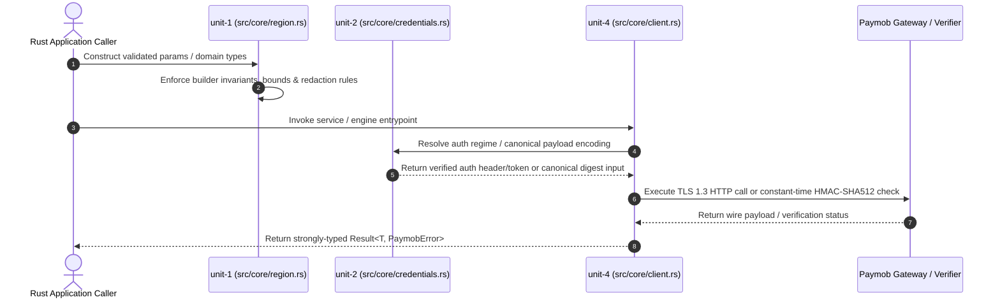

# User Story `US-1.1.0`: Multi-Region Dual-Host Router, Credential Newtypes & ClientConfig

- **Module**: `module-1` ([Core Microkernel, Multi-Region Routing & 4-Regime Auth Engine](./README.md))
- **Story Branch**: `feat/us-1.1.0-region-router-config`
- **Field Profile**: `software` (`engineering,security,testing`)
- **Story Decomposition Score ($S_{\text{story}}$)**: `2.55` $\to$ **`4` Parallel Implementation Units (`unit-1..4`)**

---

## 1. Spec Kit Specifications

### 1.1 User Story Narrative
> **As a** Rust Backend Engineer integrating Paymob across MENA & Pakistan,  
> **I want** a strongly-typed `PaymobClient` builder with automatic multi-region dual-host URL routing (`EGY`, `KSA`, `UAE`, `OMN`, `PAK`, `Custom`), secret-key vs. public-key compile-time isolation, and `ZeroizeOnDrop` memory hygiene,  
> **So that** misconfigured credentials (such as passing a `pk_*` public key where an `sk_*` secret key is required or mixing Test and Live credentials) are caught deterministically before any network request leaves the process.

This User Story belongs to **Module 1 (Core Microkernel, Multi-Region Routing & 4-Regime Auth Engine)** of [`some-paymob`](https://github.com/some-of-cs/some-paymob) as specified in [`docs/Paymob Rust SDK Architecture Research.md`](../../Paymob%20Rust%20SDK%20Architecture%20Research.md). It is decomposed into `4` strictly disjoint, 100% parallel Implementation Units (`unit-1..4`) that compile and verify independently inside isolated Git worktrees without inter-unit blocking.

#### 1.1.1 Preconditions
- Rust 2024 edition workspace (`#![forbid(unsafe_code)]`) initialized with `serde`, `secrecy`, `zeroize`, `thiserror`, and `url`.
- Target regional host topology known from [Paymob Developer Portal](https://developers.paymob.com/) and [Paymob API Changelog v0.6.3](https://developers.paymob.com/changelog/paymob-solutions-s-a-e/pak) across Egypt (`EGY`), Saudi Arabia (`KSA`), UAE (`UAE`), Oman (`OMN`), and Pakistan (`PAK`).

#### 1.1.2 Postconditions
- `PaymobRegion` resolves deterministic Accept Acquiring, Unified Checkout, Payouts Production, and Payouts Staging base URLs per country.
- All credentials (`SecretKey`, `PublicKey`, `ApiKey`, `HmacSecret`) are wrapped in `secrecy::SecretString` with `ZeroizeOnDrop` and emit `[REDACTED]` in `Debug`/`Display` logs.
- `ClientConfigBuilder::build()` rejects swapped `pk_*`/`sk_*` keys and mixed `Test`/`Live` credentials with `PaymobError::EnvironmentMismatch` before any network I/O.

### 1.2 Acceptance Criteria (Gherkin Scenarios)

```gherkin
Feature: US-1.1.0 — Multi-Region Dual-Host Router, Credential Newtypes & ClientConfig

  Scenario: AC-1 — Regional Dual-Host Routing & Trailing-Slash Normalization
    Given a `ClientConfig` configured with `PaymobRegion::Egypt`
    When the regional router resolves URLs for Accept Acquiring, Unified Checkout, and Payouts
    Then Accept routes to `https://accept.paymob.com/`, Checkout routes to `https://accept.paymob.com/unifiedcheckout/`, Payouts routes to `https://payouts.paymobsolutions.com/`, and `/v1/intention/` preserves its mandatory trailing slash

  Scenario: AC-2 — Prefix-Based Region Inference & Environment Parity Enforcement
    Given a secret key `"egy_sk_test_626xxx"` and a live public key `"egy_pk_live_999xxx"`
    When `ClientConfig::builder().secret_key(...).public_key(...).build()` is invoked
    Then builder validation fails closed with `Err(PaymobError::EnvironmentMismatch)` because `Test` and `Live` credentials cannot be mixed

  Scenario: AC-3 — Public Key Rejected in Server Secret Key Slot & Redacted Debug
    Given a publishable key `"egy_pk_test_12345"` passed into `.secret_key(...)`
    When the builder validates the credential prefix and formats the config with `{:?}`
    Then the builder returns `Err(PaymobError::ValidationError)` and any formatted credential outputs `"[REDACTED]"` with zero secret bytes leaked

  Scenario: AC-4 — Secret Redaction, Zero Float & Cyclomatic Complexity Compliance
    Given all public types and functions implemented across unit-1..4 of US-1.1.0
    When formatted via Debug/Display and analyzed by Gate G2 and Gate G-Complexity
    Then zero raw secrets, API keys, tokens, or PANs appear in Debug output (all emit "[REDACTED]")
    And every monetary value uses integer minor units (u64) with Cyclomatic Complexity CC <= 6 and nesting depth <= 2
```

### 1.3 Test Cases & Traceability Matrix

| Test Case ID | Mapped AC | Owning Unit | Test Level (Unit / Integration / Property / Security) | Description & Input Vector | Expected Result & Pass Threshold |
| :--- | :---: | :---: | :---: | :--- | :--- |
| `TC-1.1.1` | `AC-1` | `unit-1` | Unit + Doc-Test | Validate `PaymobRegion` (`Egypt`, `SaudiArabia`, `Uae`, `Oman`, `Pakistan`, `Custom`), `RegionalEndpoints` resolver (Accept Acquiring, Unified Checkout, Payouts Prod, Payouts Staging), and endpoint trailing-slash policy normalizer (`/v1/intention/` vs `/api/secure/disburse/`) in `src/core/region.rs` (positive, boundary, and malformed inputs) | 100% deterministic assertion pass; $\ge 90\%$ line & $\ge 85\%$ branch coverage |
| `TC-1.1.2` | `AC-2` | `unit-2` | Security / Negative | Validate `SecretKey`, `PublicKey`, `ApiKey`, `HmacSecret`, `PayoutsCredentials`, and `PartnerCredentials` newtypes wrapping `secrecy::SecretString` with `ZeroizeOnDrop`, `[REDACTED]` `Debug` impls, `EnvironmentMode` (`Test` | `Live`), and static lookup table prefix parser (`CC <= 3`) in `src/core/credentials.rs` (positive, boundary, and malformed inputs) | 100% deterministic assertion pass; $\ge 90\%$ line & $\ge 85\%$ branch coverage |
| `TC-1.1.3` | `AC-3` | `unit-3` | Unit + Doc-Test | Validate `ClientConfig` and `ClientConfigBuilder` validating key-prefix environment parity, rejecting `pk_*` in `secret_key`, configuring timeouts/retries, and exposing the legacy-v2 capture `Bearer` auth toggle in `src/core/config.rs` (positive, boundary, and malformed inputs) | 100% deterministic assertion pass; $\ge 90\%$ line & $\ge 85\%$ branch coverage |
| `TC-1.1.4` | `AC-3` | `unit-4` | Unit + Doc-Test | Validate `PaymobClient` (`Arc<PaymobCore>`), cheap `Clone`, compile-time `Send + Sync` assertions, `HttpClient` transport wiring (`http()`), and regional URL builders (`accept_url`, `checkout_url`, `payouts_url`) in `src/core/client.rs` (feature-gated service accessors are wired in downstream service modules) (positive, boundary, and malformed inputs) | 100% deterministic assertion pass; $\ge 90\%$ line & $\ge 85\%$ branch coverage |
| `TC-1.1.5` | `AC-4` | `unit-1..4` | Security / Property | Verify `[REDACTED]` `Debug` output, zero `f32`/`f64` floats, and `CC <= 6` across all units | 0 secret leaks in logs/panics; 0 Clippy warnings; all doctests pass |

---

## 2. Technical Implementation Plan

### 2.1 Domain Invariants & Storage Schema
- **Domain Invariants**:
  - **Dual-Host Regional Partitioning**: Paymob separates Accept Acquiring (`accept.paymob.com`, `ksa.paymob.com`, `uae.paymob.com`, `oman.paymob.com`, `pakistan.paymob.com`) from Payouts Disbursement (`payouts.paymobsolutions.com`, `payouts.paymob.sa`, `payouts-uae.paymobsolutions.com`).
  - **Trailing-Slash Contract**: Per [Paymob Changelog v0.6.3](https://developers.paymob.com/changelog/paymob-solutions-s-a-e/pak), `/v1/intention/` and Payouts paths (`/api/secure/disburse/`, `/api/secure/budget/inquire/`, `/api/secure/topup/request/`) enforce strict trailing slashes.
  - **Compile-Time & Builder-Time Credential Isolation**: `SecretKey` (`sk_*` / `egy_sk_*`) and `PublicKey` (`pk_*` / `egy_pk_*`) are distinct types; all secrets implement `ZeroizeOnDrop`.
- **Rust Type Definitions & Wire Protocol Schema**:

```rust
#![forbid(unsafe_code)]
use secrecy::SecretString;
use zeroize::ZeroizeOnDrop;

#[derive(Debug, Clone, PartialEq, Eq)]
pub enum PaymobRegion {
    Egypt,
    SaudiArabia,
    Uae,
    Oman,
    Pakistan,
    Custom {
        accept_base_url: String,
        checkout_base_url: String,
        payouts_base_url: String,
        payouts_staging_base_url: String,
    },
}

#[derive(Debug, Clone, Copy, PartialEq, Eq)]
pub enum EnvironmentMode {
    Test,
    Live,
}

#[derive(Clone, ZeroizeOnDrop)]
pub struct SecretKey {
    inner: SecretString,
    #[zeroize(skip)]
    mode: EnvironmentMode,
}
```

### 2.2 Sequence Diagram



---

## 3. Expected Folder Architecture at the Project

All `4` Implementation Units in `US-1.1.0` own **100% disjoint files** so they execute concurrently in isolated `.worktrees/` with zero merge conflicts:

```text
some-paymob/
├── Cargo.toml                                  # Seeded on Module/Story base branch
├── src/
│   ├── lib.rs                                  # Seeded on Module base branch
│   ├── src/core/region.rs                      # Owned exclusively by unit-1 (feat/us-1.1.0/unit-1-region-router)
│   ├── src/core/credentials.rs                 # Owned exclusively by unit-2 (feat/us-1.1.0/unit-2-credential-types)
│   ├── src/core/config.rs                      # Owned exclusively by unit-3 (feat/us-1.1.0/unit-3-client-config)
│   ├── src/core/client.rs                      # Owned exclusively by unit-4 (feat/us-1.1.0/unit-4-paymob-client)
└── tests/
    └── region_router_config_integration.rs         # Executed by story-leader after unit-1..4 merge
```

---

## 4. Implementation Units in Detail & Specialist Agent Assignment

### 4.1 Story Decomposition Score ($S_{\text{story}}$) & Dynamic Unit Count ($K$)
- **$D_1$ (35% Functional Surface)**: `3` — 4 core components: `PaymobRegion` dual-host router, credential newtypes (`SecretKey`, `PublicKey`, `ApiKey`, `HmacSecret`), `ClientConfig` builder, and `PaymobClient` handle
- **$D_2$ (25% Artifact Volume)**: `2` — ~580 production LOC across 4 core files
- **$D_3$ (20% Logic Complexity)**: `2` — Key-prefix region/environment inference (`egy_sk_test_`, `ksa_pk_live_`), Test vs. Live parity validation, per-endpoint trailing-slash normalization
- **$D_4$ (20% Orthogonal Boundaries)**: `3` — 4 orthogonal files under `src/core/` (`region.rs`, `credentials.rs`, `config.rs`, `client.rs`)
- **Calculated Score**: $S_{\text{story}} = 0.35(3) + 0.25(2) + 0.20(2) + 0.20(3) = \mathbf{2.55}$ $\to$ **`4` Parallel Units**

### 4.2 Detailed Unit Specifications (`unit-1..4`)

- **`unit-1` (`feat/us-1.1.0/unit-1-region-router`)**:
  - **Deliverable Scope**: `PaymobRegion` (`Egypt`, `SaudiArabia`, `Uae`, `Oman`, `Pakistan`, `Custom`), `RegionalEndpoints` resolver (Accept Acquiring, Unified Checkout, Payouts Prod, Payouts Staging), and endpoint trailing-slash policy normalizer (`/v1/intention/` vs `/api/secure/disburse/`)
  - **Owned Files**: `src/core/region.rs`
  - **Public Contract / Exports**: Public types, builders, and methods defined in `src/core/region.rs` re-exported via parent `mod.rs`
  - **Unit Verification & Target Complexity**: Colocated `#[cfg(test)] mod tests` + runnable rustdoc examples (`TC-1.1.1`), Max Cyclomatic Complexity $CC \le 6$ (cap $\le 10$, nesting $\le 2$)
- **`unit-2` (`feat/us-1.1.0/unit-2-credential-types`)**:
  - **Deliverable Scope**: `SecretKey`, `PublicKey`, `ApiKey`, `HmacSecret`, `PayoutsCredentials`, and `PartnerCredentials` newtypes wrapping `secrecy::SecretString` with `ZeroizeOnDrop`, `[REDACTED]` `Debug` impls, `EnvironmentMode` (`Test` | `Live`), and static lookup table prefix parser (`CC <= 3`)
  - **Owned Files**: `src/core/credentials.rs`
  - **Public Contract / Exports**: Public types, builders, and methods defined in `src/core/credentials.rs` re-exported via parent `mod.rs`
  - **Unit Verification & Target Complexity**: Colocated `#[cfg(test)] mod tests` + runnable rustdoc examples (`TC-1.1.2`), Max Cyclomatic Complexity $CC \le 6$ (cap $\le 10$, nesting $\le 2$)
- **`unit-3` (`feat/us-1.1.0/unit-3-client-config`)**:
  - **Deliverable Scope**: `ClientConfig` and `ClientConfigBuilder` validating key-prefix environment parity, rejecting `pk_*` in `secret_key`, configuring timeouts/retries, and exposing the legacy-v2 capture `Bearer` auth toggle
  - **Owned Files**: `src/core/config.rs`
  - **Public Contract / Exports**: Public types, builders, and methods defined in `src/core/config.rs` re-exported via parent `mod.rs`
  - **Unit Verification & Target Complexity**: Colocated `#[cfg(test)] mod tests` + runnable rustdoc examples (`TC-1.1.3`), Max Cyclomatic Complexity $CC \le 6$ (cap $\le 10$, nesting $\le 2$)
- **`unit-4` (`feat/us-1.1.0/unit-4-paymob-client`)**:
  - **Deliverable Scope**: `PaymobClient` (`Arc<PaymobCore>`), cheap `Clone`, compile-time `Send + Sync` assertions, `HttpClient` transport wiring (`http()`), and regional URL builders (`accept_url`, `checkout_url`, `payouts_url`)
  - **Owned Files**: `src/core/client.rs`
  - **Public Contract / Exports**: Public types, builders, and methods defined in `src/core/client.rs` re-exported via parent `mod.rs`
  - **Unit Verification & Target Complexity**: Colocated `#[cfg(test)] mod tests` + runnable rustdoc examples (`TC-1.1.4`), Max Cyclomatic Complexity $CC \le 6$ (cap $\le 10$, nesting $\le 2$)

### 4.3 Best-Fit Specialist Agents per Unit (`msitarzewski/agency-catalog` + Core Roster)

| Unit ID | Branch Name | Primary Implementer Agent(s) (`agency-catalog`) | Reviewing Council Agent(s) | Mandatory Skills Enforced |
| :--- | :--- | :--- | :--- | :--- |
| `unit-1` | `feat/us-1.1.0/unit-1-region-router` | `backend-architect` | `code-reviewer`, `security-engineer`, `api-tester` | `code-review-council`, `security-audit`, `cyclomatic-complexity` |
| `unit-2` | `feat/us-1.1.0/unit-2-credential-types` | `security-engineer` | `code-reviewer`, `security-engineer`, `api-tester` | `code-review-council`, `security-audit`, `cyclomatic-complexity` |
| `unit-3` | `feat/us-1.1.0/unit-3-client-config` | `backend-architect` | `code-reviewer`, `security-engineer`, `api-tester` | `code-review-council`, `security-audit`, `cyclomatic-complexity` |
| `unit-4` | `feat/us-1.1.0/unit-4-paymob-client` | `backend-architect` | `code-reviewer`, `security-engineer`, `api-tester` | `code-review-council`, `security-audit`, `cyclomatic-complexity` |
| **Story Remediation** | `patch/us-1.1.0-region-router-config` | `patch-implementer` + `backend-architect` | `code-reviewer-council-president` | Full 6-Gate Re-Verification |

### 4.4 Parallel Execution & Zero-Blocking Contract Seeding Plan
1. **Base Contract Seeding**: Commit `src/core/mod.rs` declaring `pub mod region; pub mod credentials; pub mod config; pub mod client;` plus the shared `EnvironmentMode` enum on `feat/us-1.1.0-region-router-config` before branching `unit-1..4`.
2. **Simultaneous Worktree Spawning**: All `4` units are provisioned in `.worktrees/feat-us-1.1.0-unit-1..4` and spawned simultaneously in Wave 2.
3. **Ordered Cascading Merge Sequence**: `unit-1` $\to$ `unit-2` $\to$ `unit-3` $\to$ `unit-4` into `feat/us-1.1.0-region-router-config` via `gh pr merge <PR> --merge`.

---

## 5. Security Gateway (Powered by `security-audit` Skill)

### 5.1 Trust Boundaries & Security Actors
- **Security Actors**: Merchant backend services (`PaymobClient` callers), customer browsers/mobile apps (redirected via Unified Checkout / Pixel / Legacy Iframe), Paymob Acquiring & Payouts servers, and untrusted external webhook senders.
- **Trust Boundaries**:
  1. **Caller Input Boundary**: Untrusted builder inputs (phone numbers, amounts, frequencies, proof attachments, integration IDs) crossing into SDK request serializers.
  2. **Network Ingress / Deserialization Boundary**: Raw JSON/HTTP responses and incoming webhook payloads crossing into typed Rust domain models.
  3. **Credential & Telemetry Boundary**: Secret keys (`sk_*`), API keys, JWT/OAuth2 bearer tokens, saved card tokens, and HMAC secrets crossing into memory caches, HTTP headers, or diagnostic logs.

### 5.2 Threat Modeling & Abuse Matrix (STRIDE / OWASP ASVS)

| Threat ID | STRIDE Category | ASVS / CWE Ref | Attack Vector / Abuse Scenario | Impact | Required Mitigation & Code/Deliverable Control |
| :--- | :---: | :---: | :--- | :---: | :--- |
| `TM-1` | **S**poofing | ASVS V2 / CWE-287 | Wrong auth scheme (`Bearer` vs `Token`), expired 60-min JWT reuse, or forged webhook signature | Critical | Explicit `AuthStrategy` per endpoint, single-flight JWT/OAuth2 refresh, and constant-time `Hmac<Sha512>` + `subtle::ConstantTimeEq` verification |
| `TM-2` | **T**ampering | ASVS V5 / CWE-20 | Floating-point rounding manipulation, 100x currency unit errors, or tampered webhook query/body fields | Critical | `MinorUnitAmount(u64)` integer minor units (zero `f32`/`f64`), builder-time field validation, and fail-closed 20-key/8-key/body-HMAC verification |
| `TM-3` | **R**epudiation | ASVS V7 / CWE-778 | Duplicate transaction fulfillment on retried webhooks or unlogged state mutations | High | `IdempotentWebhookGuard` extracting `(obj.id, order.id)` and `(paymob_request_id, subscription_data.id)` + correlation logging |
| `TM-4` | **I**nformation Disclosure | ASVS V8 / CWE-200 | Secret key (`sk_*`), `client_secret`, JWT `auth_token`, or PAN/CVV leaked in `Debug` logs or panic traces | Critical | `secrecy::SecretString` + `ZeroizeOnDrop` on all credentials/tokens and custom `[REDACTED]` `Debug` implementations |
| `TM-5` | **D**enial of Service | ASVS V11 / CWE-400 | Thundering-herd token refresh storms on 1-hour JWT expiry or oversized (>2.8 MB) topup proof payloads | High | Lock-free `ArcSwapOption` + single-flight `tokio::sync::Mutex<()>` refresh guard, bounded timeouts, and `MAX_TOPUP_PROOF_BYTES` check |
| `TM-6` | **E**levation of Privilege | ASVS V4 / CWE-285 | Cross-merchant IDOR in Partner Onboarding (`with_merchant`) or mixing Test and Live integration IDs | Critical | Immutable `MerchantScopedClient` per `merchant_id` and strict `EnvironmentMode` (`Test` vs `Live`) parity enforcement |

### 5.3 Cryptography & Global Data Protection Controls (Worldwide Legal & Regulatory Compliance)
1. **Cryptographic Standards**:
   - **In Transit**: TLS 1.3 (`reqwest` with `rustls-tls`) enforced for all Accept Acquiring and Payouts connections.
   - **Signatures & Constant-Time MACs**: `HMAC-SHA512` (`hmac` + `sha2`) verified exclusively via branchless constant-time comparison (`subtle::ConstantTimeEq::ct_eq`); zero `SHA-1`/`MD5` or early-exit byte comparisons.
   - **Memory Hygiene**: All secret keys, API keys, JWTs, OAuth2 refresh tokens, card tokens, and HMAC secrets use `secrecy::SecretString` and `zeroize::ZeroizeOnDrop`.
2. **Global Multi-Jurisdictional Privacy & Financial Compliance**:
   - **PCI-DSS v4.0**: Raw PANs and CVVs are never stored or logged; card tokenization uses `masked_pan` (`xxxx-xxxx-xxxx-2346`) for display and `SecretString` for tokens; frontend checkout helpers accept only `PublicKey` (`pk_*`).
   - **MENA & Regional Central Bank Regulations (CBE Egypt, SAMA Saudi Arabia, CBUAE UAE, CBO Oman, SBP Pakistan)**: Regional host isolation via `PaymobRegion` ensures transaction and disbursement payloads remain routed to the designated sovereign regional gateway.
   - **GDPR / UK GDPR / CCPA / Egypt PDPL (Law No. 151 of 2020) / KSA PDPL**: Strict PII minimization and automatic `[REDACTED]` scrubbing of customer emails, phone numbers (`msisdn`), and bank account numbers in diagnostic traces.

### 5.4 Automated Security Verification Checklist (`security-audit` Skill)
- [ ] Applicable security playbooks reviewed (`WEB-PROTOCOL-AND-AUTH.md`, `MEMORY-SAFETY-AND-BINARY.md`, `SUPPLY-CHAIN-AND-RELEASE.md`).
- [ ] `#![forbid(unsafe_code)]` enforced at the crate root; all untrusted inputs validated for bounds, non-empty prefixes, and encoding prior to network dispatch.
- [ ] Zero secrets, API keys, JWTs, card tokens, or raw PII emitted in `Debug` formatting, logs, or error messages.
- [ ] Zero `f32`/`f64` floating-point types used for monetary amounts or fee calculations.

### 5.5 Security Gateway (Gate G2) Sign-Off Checklist
- [ ] **0 Critical / High / Medium** vulnerabilities in `security-audit` scan.
- [ ] All STRIDE / ASVS threat mitigations (`TM-1..TM-6`) implemented and covered by security/negative tests in Section 1.3 (`TC-1.1.1..5`).
- [ ] Regional host partitioning, PCI-DSS token redaction, and `ZeroizeOnDrop` controls verified.
- [ ] Independent Security Reviewer agent sign-off posted to the GitHub PR conversation.

---

## 6. Validation Gates & Acceptance Sign-Off

Every Unit PR (`feat/us-1.1.0-region-router-config/unit-1..4`) and the parent Story PR (`feat/us-1.1.0-region-router-config`) MUST pass all 6 Quality Gates and post the evidence directly to the GitHub PR conversation before `gh pr merge`:

| Gate | Gate Name | Pass Criteria for `US-1.1.0` | Verification Command / Evidence | Status |
| :--- | :--- | :--- | :--- | :---: |
| **Gate G0** | **Build, Lint & Format** | 0 errors, 0 warnings, 100% `rustfmt` & `clippy` compliance | `CARGO_BUILD_JOBS=1 cargo fmt --check && CARGO_BUILD_JOBS=1 cargo clippy --all-targets --all-features -- -D warnings` | `[ ]` |
| **Gate G1** | **Tests, Coverage & Traceability** | 100% of `AC-1..4` and `TC-1.1.1..5` passing ($\ge 90\%$ line, $\ge 85\%$ branch coverage) | `CARGO_BUILD_JOBS=1 cargo test --all-features` | `[ ]` |
| **Gate G2** | **Security Gateway (`security-audit`)** | All Section 5 STRIDE, constant-time crypto, and `[REDACTED]` checks pass (0 findings) | `security-audit` report on PR | `[ ]` |
| **Gate G-Complexity** | **Cyclomatic Complexity** | Every function $CC \le 6$ target ($CC \le 10$ ceiling, $CC > 15$ blocker, nesting $\le 2$) | `cyclomatic-complexity` table on PR | `[ ]` |
| **Gate G-Docs** | **Documentation & Examples** | 100% public symbols documented + runnable doc-tests + this spec synced | `CARGO_BUILD_JOBS=1 cargo test --doc --all-features` | `[ ]` |
| **Gate G-Review** | **Council President Sign-Off** | Independent Reviewing Council posts `GATE G-REVIEW APPROVED` on GitHub PR | `gh pr comment <PR>` | `[ ]` |

### Final Acceptance Sign-Off Block
- **Story Leader Verification**: All `4` units (`unit-1..4`) merged via cascading `gh pr merge`, story integration suite green, and zero unaddressed findings (or remediated via dedicated `patch-implementer` PRs).
- **Reviewing Council Verdict**: `PENDING` $\to$ `GATE G-REVIEW APPROVED`
