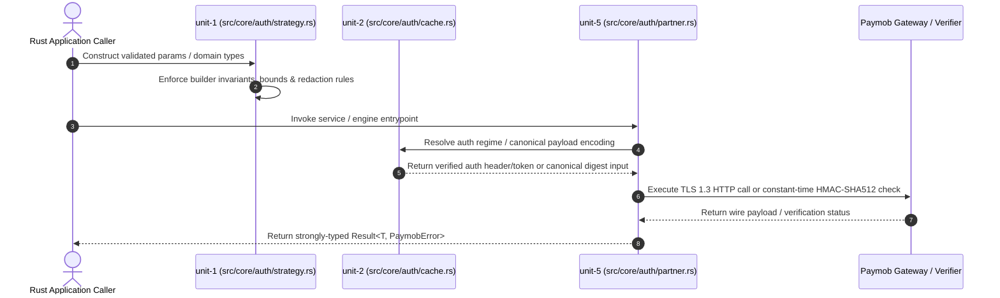

# User Story `US-1.2.0`: Zero-Race 4-Regime Authentication State Machine & Single-Flight Token Cache

- **Module**: `module-1` ([Core Microkernel, Multi-Region Routing & 4-Regime Auth Engine](./README.md))
- **Story Branch**: `feat/us-1.2.0-multi-regime-auth`
- **Field Profile**: `software` (`engineering,security,testing`)
- **Story Decomposition Score ($S_{\text{story}}$)**: `2.95` $\to$ **`5` Parallel Implementation Units (`unit-1..5`)**

---

## 1. Spec Kit Specifications

### 1.1 User Story Narrative
> **As a** High-Concurrency Systems Engineer running Paymob under multi-threaded Tokio workloads,  
> **I want** a zero-data-race authentication engine that automatically binds each Paymob endpoint to its exact required authentication regime (Regime 1 `Token <secret_key>`, Regime 2 60-minute JWT `Bearer` or JSON body `auth_token`, Regime 3 Payouts OAuth 2.0 Basic + form grants, and Regime 4 Partner Delegated tokens) with single-flight token refresh,  
> **So that** concurrent requests never send the wrong `Authorization` header scheme (preventing 401 errors on `/v1/intention/`) and never trigger thundering-herd token refreshes when the 60-minute JWT or OAuth2 access token expires.

This User Story belongs to **Module 1 (Core Microkernel, Multi-Region Routing & 4-Regime Auth Engine)** of [`some-paymob`](https://github.com/some-of-cs/some-paymob) as specified in [`docs/Paymob Rust SDK Architecture Research.md`](../../Paymob%20Rust%20SDK%20Architecture%20Research.md). It is decomposed into `5` strictly disjoint, 100% parallel Implementation Units (`unit-1..5`) that compile and verify independently inside isolated Git worktrees without inter-unit blocking.

#### 1.1.1 Preconditions
- `US-1.1.0` credential newtypes (`SecretKey`, `ApiKey`, `PayoutsCredentials`, `PartnerCredentials`) and `PaymobRegion` are available on the module base.
- Paymob's 4 authentication regimes documented in [Create Intention](https://developers.paymob.com/paymob-docs/intention-apis/create-intention), [Paymob Orders API](https://apis.apievangelist.com/store/paymob-orders-api/), [Payouts Refresh Token](https://developers.paymob.com/paymob-docs/developers/payouts-apis/auth/refresh-token), and [Retrieve Partner HMAC Secret](https://developers.paymob.com/paymob-docs/developers/partner-onboarding-apis-1/auth/retrieve-partner-hmac-secret).

#### 1.1.2 Postconditions
- Every `EndpointSpec` is bound to an explicit `AuthStrategy` (`SecretKeyToken`, `AcceptJwtBearer`, `AcceptJwtBody`, `PayoutsOAuth2`, `PartnerBearer`, `PartnerApiKey`).
- Concurrent tasks sharing a `PaymobClient` read cached 60-minute JWT and OAuth2 tokens lock-free via `ArcSwapOption<CachedToken>` and coordinate refreshes through a single-flight `tokio::sync::Mutex<()>`.
- An HTTP 401 `{"detail": "incorrect credentials"}` response triggers exactly one token eviction and refresh cycle before transparently retrying the request.

### 1.2 Acceptance Criteria (Gherkin Scenarios)

```gherkin
Feature: US-1.2.0 — Zero-Race 4-Regime Authentication State Machine & Single-Flight Token Cache

  Scenario: AC-1 — Regime 1 Token Header vs. Regime 2 Bearer/Body Segregation
    Given an endpoint bound to `AuthStrategy::SecretKeyToken` (`/v1/intention/`) and an endpoint bound to `AuthStrategy::AcceptJwtBody` (`/api/ecommerce/orders/transaction_inquiry`)
    When the authentication middleware prepares both requests
    Then `/v1/intention/` receives `Authorization: Token <secret_key>` while `/transaction_inquiry` receives a valid 60-minute JWT injected into the JSON body field `"auth_token"`

  Scenario: AC-2 — Zero-Race Single-Flight Refresh on 60-Minute JWT Expiry
    Given 50 concurrent Tokio tasks invoking Subscription or Inquiry endpoints when the cached Accept JWT is within 60 seconds of expiry (or returns HTTP 401 `{"detail": "incorrect credentials"}`)
    When the `AuthManager` refreshes the token
    Then exactly 1 `POST /api/auth/tokens` network call is dispatched while the remaining 49 tasks await the updated `ArcSwapOption<CachedToken>`

  Scenario: AC-3 — Regime 3 Payouts OAuth 2.0 Password & Refresh Grant Lifecycle
    Given valid `PayoutsCredentials` (`client_id`, `client_secret`, `username`, `password`)
    When initial token acquisition and subsequent 60-minute renewal execute against `POST /api/secure/o/token/`
    Then initial auth sends HTTP Basic Auth + `grant_type=password`, caches `access_token` (`expires_in: 3600`) and `refresh_token`, and subsequent renewals send `grant_type=refresh_token`

  Scenario: AC-4 — Secret Redaction, Zero Float & Cyclomatic Complexity Compliance
    Given all public types and functions implemented across unit-1..5 of US-1.2.0
    When formatted via Debug/Display and analyzed by Gate G2 and Gate G-Complexity
    Then zero raw secrets, API keys, tokens, or PANs appear in Debug output (all emit "[REDACTED]")
    And every monetary value uses integer minor units (u64) with Cyclomatic Complexity CC <= 6 and nesting depth <= 2
```

### 1.3 Test Cases & Traceability Matrix

| Test Case ID | Mapped AC | Owning Unit | Test Level (Unit / Integration / Property / Security) | Description & Input Vector | Expected Result & Pass Threshold |
| :--- | :---: | :---: | :---: | :--- | :--- |
| `TC-1.2.1` | `AC-1` | `unit-1` | Security / Negative | Validate `AuthStrategy` enum (`SecretKeyToken`, `AcceptJwtBearer`, `AcceptJwtBody`, `PayoutsOAuth2`, `PartnerBearer`, `PartnerApiKey`, `PublicKeyOnly`), `EndpointAuthSpec`, and Regime 1 `Authorization: Token <secret_key>` header injector in `src/core/auth/strategy.rs` (positive, boundary, and malformed inputs) | 100% deterministic assertion pass; $\ge 90\%$ line & $\ge 85\%$ branch coverage |
| `TC-1.2.2` | `AC-2` | `unit-2` | Unit + Doc-Test | Validate `CachedToken` with 3600s TTL and 60s proactive refresh margin, lock-free `ArcSwapOption<CachedToken>` read fast-path, `tokio::sync::Mutex<()>` single-flight refresh lock, and `ZeroizeOnDrop` token scrubbing in `src/core/auth/cache.rs` (positive, boundary, and malformed inputs) | 100% deterministic assertion pass; $\ge 90\%$ line & $\ge 85\%$ branch coverage |
| `TC-1.2.3` | `AC-3` | `unit-3` | Unit + Doc-Test | Validate Regime 2 Accept JWT provider (`POST /api/auth/tokens` with `{"api_key": "..."}`), `Authorization: Bearer <auth_token>` header attachment, JSON body `"auth_token"` field injector, and automatic single-flight retry on HTTP 401 `{"detail": "incorrect credentials"}` in `src/core/auth/accept_jwt.rs` (positive, boundary, and malformed inputs) | 100% deterministic assertion pass; $\ge 90\%$ line & $\ge 85\%$ branch coverage |
| `TC-1.2.4` | `AC-3` | `unit-4` | Security / Negative | Validate Regime 3 Payouts OAuth 2.0 state machine (`POST /api/secure/o/token/` with HTTP Basic Auth `{client_id}:{client_secret}` and `application/x-www-form-urlencoded` `grant_type=password` initial grant + `grant_type=refresh_token` renewal) in `src/core/auth/payouts_oauth.rs` (positive, boundary, and malformed inputs) | 100% deterministic assertion pass; $\ge 90\%$ line & $\ge 85\%$ branch coverage |
| `TC-1.2.5` | `AC-3` | `unit-5` | Unit + Doc-Test | Validate Regime 4 Partner Delegated authentication context (`PartnerBearer` header, `PartnerApiKey` header/query injector, and sub-merchant `merchant_id` delegation binding) in `src/core/auth/partner.rs` (positive, boundary, and malformed inputs) | 100% deterministic assertion pass; $\ge 90\%$ line & $\ge 85\%$ branch coverage |
| `TC-1.2.6` | `AC-4` | `unit-1..5` | Security / Property | Verify `[REDACTED]` `Debug` output, zero `f32`/`f64` floats, and `CC <= 6` across all units | 0 secret leaks in logs/panics; 0 Clippy warnings; all doctests pass |

---

## 2. Technical Implementation Plan

### 2.1 Domain Invariants & Storage Schema
- **Domain Invariants**:
  - **Never Mix Bearer and Token Schemes**: Sending `Authorization: Bearer <secret_key>` on `/v1/intention/` causes HTTP 401; `AuthStrategy::SecretKeyToken` always emits `Authorization: Token <secret_key>`.
  - **Lock-Free Read Path + Single-Flight Write Path**: Active tokens reside in `ArcSwapOption<CachedToken>`; refreshes acquire `tokio::sync::Mutex<()>` and re-verify token freshness after lock acquisition (double-checked locking).
  - **Zeroized Token Eviction**: Replaced or expired JWT and OAuth2 tokens are zeroized on drop (`ZeroizeOnDrop`).
- **Rust Type Definitions & Wire Protocol Schema**:

```rust
#![forbid(unsafe_code)]
use arc_swap::ArcSwapOption;
use secrecy::SecretString;
use std::time::Instant;
use tokio::sync::Mutex;
use zeroize::ZeroizeOnDrop;

#[derive(Debug, Clone, Copy, PartialEq, Eq)]
pub enum AuthStrategy {
    SecretKeyToken,
    AcceptJwtBearer,
    AcceptJwtBody,
    PayoutsOAuth2,
    PartnerBearer,
    PartnerApiKey,
    PublicKeyOnly,
}

#[derive(Clone, ZeroizeOnDrop)]
pub struct CachedToken {
    pub access_token: SecretString,
    pub refresh_token: Option<SecretString>,
    #[zeroize(skip)]
    pub expires_at: Instant,
}

pub struct AuthManager {
    accept_jwt: ArcSwapOption<CachedToken>,
    accept_refresh_lock: Mutex<()>,
    payouts_oauth: ArcSwapOption<CachedToken>,
    payouts_refresh_lock: Mutex<()>,
}
```

### 2.2 Sequence Diagram



---

## 3. Expected Folder Architecture at the Project

All `5` Implementation Units in `US-1.2.0` own **100% disjoint files** so they execute concurrently in isolated `.worktrees/` with zero merge conflicts:

```text
some-paymob/
├── Cargo.toml                                  # Seeded on Module/Story base branch
├── src/
│   ├── lib.rs                                  # Seeded on Module base branch
│   └── core/
│       └── auth/
│           ├── mod.rs                          # Shared auth helpers, re-exports, and PaymobError conversions
│           ├── strategy.rs                     # Owned exclusively by unit-1 (feat/us-1.2.0/unit-1-auth-strategy)
│           ├── cache.rs                        # Owned exclusively by unit-2 (feat/us-1.2.0/unit-2-lockfree-token-cache)
│           ├── accept_jwt.rs                   # Owned exclusively by unit-3 (feat/us-1.2.0/unit-3-accept-jwt-provider)
│           ├── payouts_oauth.rs                # Owned exclusively by unit-4 (feat/us-1.2.0/unit-4-payouts-oauth2-provider)
│           └── partner.rs                      # Owned exclusively by unit-5 (feat/us-1.2.0/unit-5-partner-delegated-auth)
└── tests/
    └── multi_regime_auth_integration/          # Executed by story-leader after unit-1..5 merge
        ├── main.rs
        ├── common.rs
        ├── strategy.rs
        ├── cache.rs
        ├── accept_jwt.rs
        ├── payouts_oauth.rs
        └── partner.rs
```

---

## 4. Implementation Units in Detail & Specialist Agent Assignment

### 4.1 Story Decomposition Score ($S_{\text{story}}$) & Dynamic Unit Count ($K$)
- **$D_1$ (35% Functional Surface)**: `3` — 5 distinct authentication components: `AuthStrategy` dispatcher, lock-free `ArcSwapOption` token cache, Regime 2 Accept JWT provider (Bearer + JSON body), Regime 3 Payouts OAuth2 provider, and Regime 4 Partner Delegated auth
- **$D_2$ (25% Artifact Volume)**: `2` — ~660 production LOC across `src/core/auth/`
- **$D_3$ (20% Logic Complexity)**: `4` — Lock-free atomic reads (`ArcSwapOption<CachedToken>`) paired with `tokio::sync::Mutex<()>` single-flight refresh coordination, 401 eviction & retry, and OAuth2 password/refresh_token grant transitions
- **$D_4$ (20% Orthogonal Boundaries)**: `3` — 5 orthogonal files under `src/core/auth/` (`strategy.rs`, `cache.rs`, `accept_jwt.rs`, `payouts_oauth.rs`, `partner.rs`)
- **Calculated Score**: $S_{\text{story}} = 0.35(3) + 0.25(2) + 0.20(4) + 0.20(3) = \mathbf{2.95}$ $\to$ **`5` Parallel Units**

### 4.2 Detailed Unit Specifications (`unit-1..5`)

- **`unit-1` (`feat/us-1.2.0/unit-1-auth-strategy`)**:
  - **Deliverable Scope**: `AuthStrategy` enum (`SecretKeyToken`, `AcceptJwtBearer`, `AcceptJwtBody`, `PayoutsOAuth2`, `PartnerBearer`, `PartnerApiKey`, `PublicKeyOnly`), `EndpointAuthSpec`, and Regime 1 `Authorization: Token <secret_key>` header injector
  - **Owned Files**: `src/core/auth/strategy.rs`
  - **Public Contract / Exports**: Public types, builders, and methods defined in `src/core/auth/strategy.rs` re-exported via parent `mod.rs`
  - **Unit Verification & Target Complexity**: Colocated `#[cfg(test)] mod tests` + runnable rustdoc examples (`TC-1.2.1`), Max Cyclomatic Complexity $CC \le 6$ (cap $\le 10$, nesting $\le 2$)
- **`unit-2` (`feat/us-1.2.0/unit-2-lockfree-token-cache`)**:
  - **Deliverable Scope**: `CachedToken` with 3600s TTL and 60s proactive refresh margin, lock-free `ArcSwapOption<CachedToken>` read fast-path, `tokio::sync::Mutex<()>` single-flight refresh lock, and `ZeroizeOnDrop` token scrubbing
  - **Owned Files**: `src/core/auth/cache.rs`
  - **Public Contract / Exports**: Public types, builders, and methods defined in `src/core/auth/cache.rs` re-exported via parent `mod.rs`
  - **Unit Verification & Target Complexity**: Colocated `#[cfg(test)] mod tests` + runnable rustdoc examples (`TC-1.2.2`), Max Cyclomatic Complexity $CC \le 6$ (cap $\le 10$, nesting $\le 2$)
- **`unit-3` (`feat/us-1.2.0/unit-3-accept-jwt-provider`)**:
  - **Deliverable Scope**: Regime 2 Accept JWT provider (`POST /api/auth/tokens` with `{"api_key": "..."}`), `Authorization: Bearer <auth_token>` header attachment, JSON body `"auth_token"` field injector, and automatic single-flight retry on HTTP 401 `{"detail": "incorrect credentials"}`
  - **Owned Files**: `src/core/auth/accept_jwt.rs`
  - **Public Contract / Exports**: Public types, builders, and methods defined in `src/core/auth/accept_jwt.rs` re-exported via parent `mod.rs`
  - **Unit Verification & Target Complexity**: Colocated `#[cfg(test)] mod tests` + runnable rustdoc examples (`TC-1.2.3`), Max Cyclomatic Complexity $CC \le 6$ (cap $\le 10$, nesting $\le 2$)
- **`unit-4` (`feat/us-1.2.0/unit-4-payouts-oauth2-provider`)**:
  - **Deliverable Scope**: Regime 3 Payouts OAuth 2.0 state machine (`POST /api/secure/o/token/` with HTTP Basic Auth `{client_id}:{client_secret}` and `application/x-www-form-urlencoded` `grant_type=password` initial grant + `grant_type=refresh_token` renewal)
  - **Owned Files**: `src/core/auth/payouts_oauth.rs`
  - **Public Contract / Exports**: Public types, builders, and methods defined in `src/core/auth/payouts_oauth.rs` re-exported via parent `mod.rs`
  - **Unit Verification & Target Complexity**: Colocated `#[cfg(test)] mod tests` + runnable rustdoc examples (`TC-1.2.4`), Max Cyclomatic Complexity $CC \le 6$ (cap $\le 10$, nesting $\le 2$)
- **`unit-5` (`feat/us-1.2.0/unit-5-partner-delegated-auth`)**:
  - **Deliverable Scope**: Regime 4 Partner Delegated authentication context (`PartnerBearer` header, `PartnerApiKey` header/query injector, and sub-merchant `merchant_id` delegation binding)
  - **Owned Files**: `src/core/auth/partner.rs`
  - **Public Contract / Exports**: Public types, builders, and methods defined in `src/core/auth/partner.rs` re-exported via parent `mod.rs`
  - **Unit Verification & Target Complexity**: Colocated `#[cfg(test)] mod tests` + runnable rustdoc examples (`TC-1.2.5`), Max Cyclomatic Complexity $CC \le 6$ (cap $\le 10$, nesting $\le 2$)

### 4.3 Best-Fit Specialist Agents per Unit (`msitarzewski/agency-catalog` + Core Roster)

| Unit ID | Branch Name | Primary Implementer Agent(s) (`agency-catalog`) | Reviewing Council Agent(s) | Mandatory Skills Enforced |
| :--- | :--- | :--- | :--- | :--- |
| `unit-1` | `feat/us-1.2.0/unit-1-auth-strategy` | `security-engineer` | `code-reviewer`, `security-engineer`, `api-tester` | `code-review-council`, `security-audit`, `cyclomatic-complexity` |
| `unit-2` | `feat/us-1.2.0/unit-2-lockfree-token-cache` | `backend-architect` | `code-reviewer`, `security-engineer`, `api-tester` | `code-review-council`, `security-audit`, `cyclomatic-complexity` |
| `unit-3` | `feat/us-1.2.0/unit-3-accept-jwt-provider` | `backend-architect` | `code-reviewer`, `security-engineer`, `api-tester` | `code-review-council`, `security-audit`, `cyclomatic-complexity` |
| `unit-4` | `feat/us-1.2.0/unit-4-payouts-oauth2-provider` | `security-engineer` | `code-reviewer`, `security-engineer`, `api-tester` | `code-review-council`, `security-audit`, `cyclomatic-complexity` |
| `unit-5` | `feat/us-1.2.0/unit-5-partner-delegated-auth` | `backend-architect` | `code-reviewer`, `security-engineer`, `api-tester` | `code-review-council`, `security-audit`, `cyclomatic-complexity` |
| **Story Remediation** | `patch/us-1.2.0-multi-regime-auth` | `patch-implementer` + `backend-architect` | `code-reviewer-council-president` | Full 6-Gate Re-Verification |

### 4.4 Parallel Execution & Zero-Blocking Contract Seeding Plan
1. **Base Contract Seeding**: Commit `src/core/auth/mod.rs` with the shared `AuthStrategy` enum and `CachedToken` struct stub on `feat/us-1.2.0-multi-regime-auth` before branching `unit-1..5`.
2. **Simultaneous Worktree Spawning**: All `5` units are provisioned in `.worktrees/feat-us-1.2.0-unit-1..5` and spawned simultaneously in Wave 2.
3. **Ordered Cascading Merge Sequence**: `unit-1` $\to$ `unit-2` $\to$ `unit-3` $\to$ `unit-4` $\to$ `unit-5` into `feat/us-1.2.0-multi-regime-auth` via `gh pr merge <PR> --merge`.

---

## 5. Security Gateway (Powered by `security-audit` Skill)

### 5.1 Trust Boundaries & Security Actors
- **Security Actors**: Merchant backend services (`PaymobClient` callers), customer browsers/mobile apps (redirected via Unified Checkout / Pixel / Legacy Iframe), Paymob Acquiring & Payouts servers, and untrusted external webhook senders.
- **Trust Boundaries**:
  1. **Caller Input Boundary**: Untrusted builder inputs (phone numbers, amounts, frequencies, proof attachments, integration IDs) crossing into SDK request serializers.
  2. **Network Ingress / Deserialization Boundary**: Raw JSON/HTTP responses and incoming webhook payloads crossing into typed Rust domain models.
  3. **Credential & Telemetry Boundary**: Secret keys (`sk_*`), API keys, JWT/OAuth2 bearer tokens, saved card tokens, and HMAC secrets crossing into memory caches, HTTP headers, or diagnostic logs.

### 5.2 Threat Modeling & Abuse Matrix (STRIDE / OWASP ASVS)

| Threat ID | STRIDE Category | ASVS / CWE Ref | Attack Vector / Abuse Scenario | Impact | Required Mitigation & Code/Deliverable Control |
| :--- | :---: | :---: | :--- | :---: | :--- |
| `TM-1` | **S**poofing | ASVS V2 / CWE-287 | Wrong auth scheme (`Bearer` vs `Token`), expired 60-min JWT reuse, or forged webhook signature | Critical | Explicit `AuthStrategy` per endpoint, single-flight JWT/OAuth2 refresh, and constant-time `Hmac<Sha512>` + `subtle::ConstantTimeEq` verification |
| `TM-2` | **T**ampering | ASVS V5 / CWE-20 | Floating-point rounding manipulation, 100x currency unit errors, or tampered webhook query/body fields | Critical | `MinorUnitAmount(u64)` integer minor units (zero `f32`/`f64`), builder-time field validation, and fail-closed 20-key/8-key/body-HMAC verification |
| `TM-3` | **R**epudiation | ASVS V7 / CWE-778 | Duplicate transaction fulfillment on retried webhooks or unlogged state mutations | High | `IdempotentWebhookGuard` extracting `(obj.id, order.id)` and `(paymob_request_id, subscription_data.id)` + correlation logging |
| `TM-4` | **I**nformation Disclosure | ASVS V8 / CWE-200 | Secret key (`sk_*`), `client_secret`, JWT `auth_token`, or PAN/CVV leaked in `Debug` logs or panic traces | Critical | `secrecy::SecretString` + `ZeroizeOnDrop` on all credentials/tokens and custom `[REDACTED]` `Debug` implementations |
| `TM-5` | **D**enial of Service | ASVS V11 / CWE-400 | Thundering-herd token refresh storms on 1-hour JWT expiry or oversized (>2.8 MB) topup proof payloads | High | Lock-free `ArcSwapOption` + single-flight `tokio::sync::Mutex<()>` refresh guard, bounded timeouts, and `MAX_TOPUP_PROOF_BYTES` check |
| `TM-6` | **E**levation of Privilege | ASVS V4 / CWE-285 | Cross-merchant IDOR in Partner Onboarding (`with_merchant`) or mixing Test and Live integration IDs | Critical | Immutable `MerchantScopedClient` per `merchant_id` and strict `EnvironmentMode` (`Test` vs `Live`) parity enforcement |

### 5.3 Cryptography & Global Data Protection Controls (Worldwide Legal & Regulatory Compliance)
1. **Cryptographic Standards**:
   - **In Transit**: TLS 1.3 (`reqwest` with `rustls-tls`) enforced for all Accept Acquiring and Payouts connections.
   - **Signatures & Constant-Time MACs**: `HMAC-SHA512` (`hmac` + `sha2`) verified exclusively via branchless constant-time comparison (`subtle::ConstantTimeEq::ct_eq`); zero `SHA-1`/`MD5` or early-exit byte comparisons.
   - **Memory Hygiene**: All secret keys, API keys, JWTs, OAuth2 refresh tokens, card tokens, and HMAC secrets use `secrecy::SecretString` and `zeroize::ZeroizeOnDrop`.
2. **Global Multi-Jurisdictional Privacy & Financial Compliance**:
   - **PCI-DSS v4.0**: Raw PANs and CVVs are never stored or logged; card tokenization uses `masked_pan` (`xxxx-xxxx-xxxx-2346`) for display and `SecretString` for tokens; frontend checkout helpers accept only `PublicKey` (`pk_*`).
   - **MENA & Regional Central Bank Regulations (CBE Egypt, SAMA Saudi Arabia, CBUAE UAE, CBO Oman, SBP Pakistan)**: Regional host isolation via `PaymobRegion` ensures transaction and disbursement payloads remain routed to the designated sovereign regional gateway.
   - **GDPR / UK GDPR / CCPA / Egypt PDPL (Law No. 151 of 2020) / KSA PDPL**: Strict PII minimization and automatic `[REDACTED]` scrubbing of customer emails, phone numbers (`msisdn`), and bank account numbers in diagnostic traces.

### 5.4 Automated Security Verification Checklist (`security-audit` Skill)
- [ ] Applicable security playbooks reviewed (`WEB-PROTOCOL-AND-AUTH.md`, `MEMORY-SAFETY-AND-BINARY.md`, `SUPPLY-CHAIN-AND-RELEASE.md`).
- [ ] `#![forbid(unsafe_code)]` enforced at the crate root; all untrusted inputs validated for bounds, non-empty prefixes, and encoding prior to network dispatch.
- [ ] Zero secrets, API keys, JWTs, card tokens, or raw PII emitted in `Debug` formatting, logs, or error messages.
- [ ] Zero `f32`/`f64` floating-point types used for monetary amounts or fee calculations.

### 5.5 Security Gateway (Gate G2) Sign-Off Checklist
- [ ] **0 Critical / High / Medium** vulnerabilities in `security-audit` scan.
- [ ] All STRIDE / ASVS threat mitigations (`TM-1..TM-6`) implemented and covered by security/negative tests in Section 1.3 (`TC-1.2.1..6`).
- [ ] Regional host partitioning, PCI-DSS token redaction, and `ZeroizeOnDrop` controls verified.
- [ ] Independent Security Reviewer agent sign-off posted to the GitHub PR conversation.

---

## 6. Validation Gates & Acceptance Sign-Off

Every Unit PR (`feat/us-1.2.0-multi-regime-auth/unit-1..5`) and the parent Story PR (`feat/us-1.2.0-multi-regime-auth`) MUST pass all 6 Quality Gates and post the evidence directly to the GitHub PR conversation before `gh pr merge`:

| Gate | Gate Name | Pass Criteria for `US-1.2.0` | Verification Command / Evidence | Status |
| :--- | :--- | :--- | :--- | :---: |
| **Gate G0** | **Build, Lint & Format** | 0 errors, 0 warnings, 100% `rustfmt` & `clippy` compliance | `CARGO_BUILD_JOBS=1 cargo fmt --check && CARGO_BUILD_JOBS=1 cargo clippy --all-targets --all-features -- -D warnings` | `[ ]` |
| **Gate G1** | **Tests, Coverage & Traceability** | 100% of `AC-1..4` and `TC-1.2.1..6` passing ($\ge 90\%$ line, $\ge 85\%$ branch coverage) | `CARGO_BUILD_JOBS=1 cargo test --all-features` | `[ ]` |
| **Gate G2** | **Security Gateway (`security-audit`)** | All Section 5 STRIDE, constant-time crypto, and `[REDACTED]` checks pass (0 findings) | `security-audit` report on PR | `[ ]` |
| **Gate G-Complexity** | **Cyclomatic Complexity** | Every function $CC \le 6$ target ($CC \le 10$ ceiling, $CC > 15$ blocker, nesting $\le 2$) | `cyclomatic-complexity` table on PR | `[ ]` |
| **Gate G-Docs** | **Documentation & Examples** | 100% public symbols documented + runnable doc-tests + this spec synced | `CARGO_BUILD_JOBS=1 cargo test --doc --all-features` | `[ ]` |
| **Gate G-Review** | **Council President Sign-Off** | Independent Reviewing Council posts `GATE G-REVIEW APPROVED` on GitHub PR | `gh pr comment <PR>` | `[ ]` |

### Final Acceptance Sign-Off Block
- **Story Leader Verification**: All `5` units (`unit-1..5`) merged via cascading `gh pr merge`, story integration suite green, and zero unaddressed findings (or remediated via dedicated `patch-implementer` PRs).
- **Reviewing Council Verdict**: `PENDING` $\to$ `GATE G-REVIEW APPROVED`
