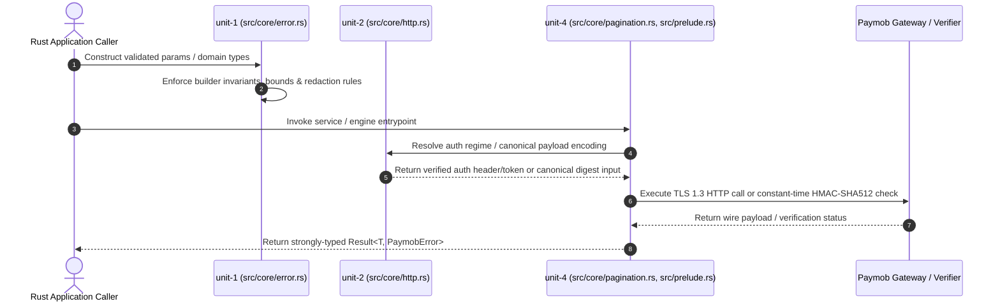

# User Story `US-1.3.0`: HTTP Transport Pipeline, PaymobError Hierarchy, MinorUnitAmount & Prelude

- **Module**: `module-1` ([Core Microkernel, Multi-Region Routing & 4-Regime Auth Engine](./README.md))
- **Story Branch**: `feat/us-1.3.0-http-error-primitives`
- **Field Profile**: `software` (`engineering,security,testing`)
- **Story Decomposition Score ($S_{\text{story}}$)**: `2.35` $\to$ **`4` Parallel Implementation Units (`unit-1..4`)**

---

## 1. Spec Kit Specifications

### 1.1 User Story Narrative
> **As a** Full Stack Product Engineer building financial workflows with `some-paymob`,  
> **I want** a resilient HTTP transport pipeline with automatic retry/backoff on transient gateway errors (`429`/`502`/`503`/`504`), a strongly-typed `PaymobError` enum, and a zero-float `MinorUnitAmount(u64)` money type,  
> **So that** 100x currency unit-scaling bugs are impossible at compile time, transient Paymob rate limits recover transparently, and API failures map to actionable Rust error variants without leaking secrets.

This User Story belongs to **Module 1 (Core Microkernel, Multi-Region Routing & 4-Regime Auth Engine)** of [`some-paymob`](https://github.com/some-of-cs/some-paymob) as specified in [`docs/Paymob Rust SDK Architecture Research.md`](../../Paymob%20Rust%20SDK%20Architecture%20Research.md). It is decomposed into `4` strictly disjoint, 100% parallel Implementation Units (`unit-1..4`) that compile and verify independently inside isolated Git worktrees without inter-unit blocking.

#### 1.1.1 Preconditions
- `ClientConfig`, `PaymobRegion`, and `AuthManager` contracts defined in Module 1.
- Paymob error shapes (`detail`, `message`, field-level validation maps, Payouts `status_description`/`status_code` on HTTP 429) documented in [`docs/Paymob Rust SDK Architecture Research.md`](https://github.com/some-of-cs/some-paymob/blob/main/docs/Paymob%20Rust%20SDK%20Architecture%20Research.md).

#### 1.1.2 Postconditions
- `HttpClient` executes requests over TLS 1.3 (`rustls`) with exponential backoff + jitter on HTTP `429`, `502`, `503`, and `504`.
- `MinorUnitAmount(u64)` guarantees 100% integer minor-unit arithmetic (piasters/halalas/fils/paisas) with zero `f32`/`f64` floats.
- `PaymobError` normalizes all Accept, Intention, Subscription, Payouts, and Webhook failures without exposing secrets or raw stack traces.

### 1.2 Acceptance Criteria (Gherkin Scenarios)

```gherkin
Feature: US-1.3.0 — HTTP Transport Pipeline, PaymobError Hierarchy, MinorUnitAmount & Prelude

  Scenario: AC-1 — Exponential Backoff & Retry-After on HTTP 429 / 503
    Given a Paymob endpoint returning HTTP 429 Too Many Requests (`{"status_description": "Rate limit exceeded", "status_code": 429}`) on attempt 1 and HTTP 200 OK on attempt 2
    When `HttpClient::execute` dispatches an idempotent request
    Then the client backs off with jitter, retries automatically, and returns the parsed 200 OK response

  Scenario: AC-2 — Checked Integer Minor-Unit Money Arithmetic
    Given two `MinorUnitAmount` values (`MinorUnitAmount::from_major_checked(1000, 2)` -> `100_000` piasters)
    When `checked_add` and `checked_sub` are called
    Then exact integer piasters are returned and overflow/underflow returns `Err(PaymobError::ValidationError)` with zero floating-point conversion

  Scenario: AC-3 — Multi-Shape API Error Normalization
    Given Paymob 400/401/404 error payloads (`{"detail": "incorrect credentials"}`, `{"billing_data": {"phone_number": ["This field is required."]}}`, `{"message": "Requested Refund Amount is greater than the maximum refund amount permissible..."}`)
    When the response error parser runs
    Then each payload maps deterministically to `AuthenticationError`, `ValidationError`, or `RefundExceedsPermissibleAmount`

  Scenario: AC-4 — Secret Redaction, Zero Float & Cyclomatic Complexity Compliance
    Given all public types and functions implemented across unit-1..4 of US-1.3.0
    When formatted via Debug/Display and analyzed by Gate G2 and Gate G-Complexity
    Then zero raw secrets, API keys, tokens, or PANs appear in Debug output (all emit "[REDACTED]")
    And every monetary value uses integer minor units (u64) with Cyclomatic Complexity CC <= 6 and nesting depth <= 2
```

### 1.3 Test Cases & Traceability Matrix

| Test Case ID | Mapped AC | Owning Unit | Test Level (Unit / Integration / Property / Security) | Description & Input Vector | Expected Result & Pass Threshold |
| :--- | :---: | :---: | :---: | :--- | :--- |
| `TC-1.3.1` | `AC-1` | `unit-1` | Unit + Doc-Test | Validate `PaymobError` enum (`ApiError`, `AuthenticationError`, `EnvironmentMismatch`, `RefundExceedsPermissibleAmount`, `RateLimited`, `WebhookError`, `ValidationError`, `TransportError`), multi-shape Paymob error JSON parser (`detail`, `message`, nested field maps), and PII/secret-redacted `Display`/`Debug` in `src/core/error.rs` (positive, boundary, and malformed inputs) | 100% deterministic assertion pass; $\ge 90\%$ line & $\ge 85\%$ branch coverage |
| `TC-1.3.2` | `AC-2` | `unit-2` | Unit + Doc-Test | Validate `HttpClient` wrapping `reqwest::Client` (TLS 1.3), exponential backoff with full jitter on HTTP `429` / `502` / `503` / `504`, `Retry-After` header parsing, request timeout enforcement, and correlation request ID logging in `src/core/http.rs` (positive, boundary, and malformed inputs) | 100% deterministic assertion pass; $\ge 90\%$ line & $\ge 85\%$ branch coverage |
| `TC-1.3.3` | `AC-3` | `unit-3` | Unit + Doc-Test | Validate `MinorUnitAmount(u64)` newtype (piasters/halalas/fils/paisas with checked `checked_add`/`checked_sub`, zero `f32`/`f64` floats), `Currency` enum (`EGP`, `SAR`, `AED`, `OMR`, `PKR`, `USD`, `EUR`, `Unknown(String)` via static lookup slice `CC <= 3`), and non-empty prefixed ID validators in `src/core/types.rs` (positive, boundary, and malformed inputs) | 100% deterministic assertion pass; $\ge 90\%$ line & $\ge 85\%$ branch coverage |
| `TC-1.3.4` | `AC-3` | `unit-4` | Unit + Doc-Test | Validate `PaginatedResponse<T>` (`count`, `next`, `previous`, `results`), `PageQuery` builder (`?page=N`), and `some_paymob::prelude::*` exporting core client, config, region, money, and error types in `src/core/pagination.rs, src/prelude.rs` (positive, boundary, and malformed inputs) | 100% deterministic assertion pass; $\ge 90\%$ line & $\ge 85\%$ branch coverage |
| `TC-1.3.5` | `AC-4` | `unit-1..4` | Security / Property | Verify `[REDACTED]` `Debug` output, zero `f32`/`f64` floats, and `CC <= 6` across all units | 0 secret leaks in logs/panics; 0 Clippy warnings; all doctests pass |

---

## 2. Technical Implementation Plan

### 2.1 Domain Invariants & Storage Schema
- **Domain Invariants**:
  - **Zero Floating-Point Monetary Representation**: All monetary fields across `some-paymob` use `MinorUnitAmount(u64)` or `u64` cents/piasters (`G-Law`).
  - **Static Lookup Table for Currency Mapping**: `Currency` string parsing uses `const KNOWN_CURRENCIES: &[(&str, Currency)]` (`CC <= 3`).
  - **Bounded Payload & Timeout Enforcement**: Every HTTP request enforces connect/read timeouts and maximum response body byte limits.
  - **Retry-After Header Parsing**: Integer-seconds `Retry-After` values are supported; HTTP-date `Retry-After` values are unsupported and ignored (returning `None`, falling back to exponential backoff with full jitter).
- **Rust Type Definitions & Wire Protocol Schema**:

```rust
#![forbid(unsafe_code)]
use serde::{Deserialize, Serialize};
use thiserror::Error;

#[derive(Debug, Clone, Copy, PartialEq, Eq, PartialOrd, Ord, Serialize, Deserialize)]
#[serde(transparent)]
pub struct MinorUnitAmount(pub u64);

#[derive(Debug, Clone, PartialEq, Eq, Serialize, Deserialize)]
pub enum Currency {
    EGP,
    SAR,
    AED,
    OMR,
    PKR,
    USD,
    EUR,
    Unknown(String),
}

#[derive(Debug, Error)]
pub enum PaymobError {
    #[error("Paymob API error (HTTP {status}): {message}")]
    ApiError { status: u16, message: String, code: Option<String> },
    #[error("Authentication failed: {0}")]
    AuthenticationError(String),
    #[error("Environment mismatch between Test and Live credentials or integration IDs: {0}")]
    EnvironmentMismatch(String),
    #[error("Refund amount exceeds maximum permissible balance: {message}")]
    RefundExceedsPermissibleAmount { message: String },
    #[error("Rate limited by Paymob gateway (HTTP 429): {message}")]
    RateLimited { message: String, retry_after_secs: Option<u64> },
    #[error("Validation error on field `{field}`: {reason}")]
    ValidationError { field: &'static str, reason: String },
}
```

### 2.2 Sequence Diagram



---

## 3. Expected Folder Architecture at the Project

All `4` Implementation Units in `US-1.3.0` own **100% disjoint files** so they execute concurrently in isolated `.worktrees/` with zero merge conflicts:

```text
some-paymob/
├── Cargo.toml                                  # Seeded on Module/Story base branch
├── src/
│   ├── lib.rs                                  # Seeded on Module base branch
│   ├── src/core/error.rs                       # Owned exclusively by unit-1 (feat/us-1.3.0/unit-1-error-hierarchy)
│   ├── src/core/http.rs                        # Owned exclusively by unit-2 (feat/us-1.3.0/unit-2-http-transport)
│   ├── src/core/types.rs                       # Owned exclusively by unit-3 (feat/us-1.3.0/unit-3-money-currency-types)
│   ├── src/core/pagination.rs, src/prelude.rs  # Owned exclusively by unit-4 (feat/us-1.3.0/unit-4-pagination-prelude)
└── tests/
    └── http_error_primitives_integration.rs         # Executed by story-leader after unit-1..4 merge
```

---

## 4. Implementation Units in Detail & Specialist Agent Assignment

### 4.1 Story Decomposition Score ($S_{\text{story}}$) & Dynamic Unit Count ($K$)
- **$D_1$ (35% Functional Surface)**: `3` — 4 core primitives: `PaymobError` hierarchy, `HttpClient` retry/backoff pipeline, `MinorUnitAmount`/`Currency` types, and `PaginatedResponse<T>`/`prelude`
- **$D_2$ (25% Artifact Volume)**: `2` — ~500 production LOC across 4 files
- **$D_3$ (20% Logic Complexity)**: `2` — Exponential backoff with jitter on HTTP 429/502/503/504, multi-shape Paymob error JSON deserialization (`detail`, `message`, field error maps), checked integer money math
- **$D_4$ (20% Orthogonal Boundaries)**: `2` — 4 independent files (`src/core/error.rs`, `src/core/http.rs`, `src/core/types.rs`, `src/core/pagination.rs` + `src/prelude.rs`)
- **Calculated Score**: $S_{\text{story}} = 0.35(3) + 0.25(2) + 0.20(2) + 0.20(2) = \mathbf{2.35}$ $\to$ **`4` Parallel Units**

### 4.2 Detailed Unit Specifications (`unit-1..4`)

- **`unit-1` (`feat/us-1.3.0/unit-1-error-hierarchy`)**:
  - **Deliverable Scope**: `PaymobError` enum (`ApiError`, `AuthenticationError`, `EnvironmentMismatch`, `RefundExceedsPermissibleAmount`, `RateLimited`, `WebhookError`, `ValidationError`, `TransportError`), multi-shape Paymob error JSON parser (`detail`, `message`, nested field maps), and PII/secret-redacted `Display`/`Debug`
  - **Owned Files**: `src/core/error.rs`
  - **Public Contract / Exports**: Public types, builders, and methods defined in `src/core/error.rs` re-exported via parent `mod.rs`
  - **Unit Verification & Target Complexity**: Colocated `#[cfg(test)] mod tests` + runnable rustdoc examples (`TC-1.3.1`), Max Cyclomatic Complexity $CC \le 6$ (cap $\le 10$, nesting $\le 2$)
- **`unit-2` (`feat/us-1.3.0/unit-2-http-transport`)**:
  - **Deliverable Scope**: `HttpClient` wrapping `reqwest::Client` (TLS 1.3), exponential backoff with full jitter on HTTP `429` / `502` / `503` / `504`, `Retry-After` header parsing, request timeout enforcement, and correlation request ID logging
  - **Owned Files**: `src/core/http.rs`
  - **Public Contract / Exports**: Public types, builders, and methods defined in `src/core/http.rs` re-exported via parent `mod.rs`
  - **Unit Verification & Target Complexity**: Colocated `#[cfg(test)] mod tests` + runnable rustdoc examples (`TC-1.3.2`), Max Cyclomatic Complexity $CC \le 6$ (cap $\le 10$, nesting $\le 2$)
- **`unit-3` (`feat/us-1.3.0/unit-3-money-currency-types`)**:
  - **Deliverable Scope**: `MinorUnitAmount(u64)` newtype (piasters/halalas/fils/paisas with checked `checked_add`/`checked_sub`, zero `f32`/`f64` floats), `Currency` enum (`EGP`, `SAR`, `AED`, `OMR`, `PKR`, `USD`, `EUR`, `Unknown(String)` via static lookup slice `CC <= 3`), and non-empty prefixed ID validators
  - **Owned Files**: `src/core/types.rs`
  - **Public Contract / Exports**: Public types, builders, and methods defined in `src/core/types.rs` re-exported via parent `mod.rs`
  - **Unit Verification & Target Complexity**: Colocated `#[cfg(test)] mod tests` + runnable rustdoc examples (`TC-1.3.3`), Max Cyclomatic Complexity $CC \le 6$ (cap $\le 10$, nesting $\le 2$)
- **`unit-4` (`feat/us-1.3.0/unit-4-pagination-prelude`)**:
  - **Deliverable Scope**: `PaginatedResponse<T>` (`count`, `next`, `previous`, `results`), `PageQuery` builder (`?page=N`), and `some_paymob::prelude::*` exporting core client, config, region, money, and error types
  - **Owned Files**: `src/core/pagination.rs, src/prelude.rs`
  - **Public Contract / Exports**: Public types, builders, and methods defined in `src/core/pagination.rs, src/prelude.rs` re-exported via parent `mod.rs`
  - **Unit Verification & Target Complexity**: Colocated `#[cfg(test)] mod tests` + runnable rustdoc examples (`TC-1.3.4`), Max Cyclomatic Complexity $CC \le 6$ (cap $\le 10$, nesting $\le 2$)

### 4.3 Best-Fit Specialist Agents per Unit (`msitarzewski/agency-catalog` + Core Roster)

| Unit ID | Branch Name | Primary Implementer Agent(s) (`agency-catalog`) | Reviewing Council Agent(s) | Mandatory Skills Enforced |
| :--- | :--- | :--- | :--- | :--- |
| `unit-1` | `feat/us-1.3.0/unit-1-error-hierarchy` | `backend-architect` | `code-reviewer`, `security-engineer`, `api-tester` | `code-review-council`, `security-audit`, `cyclomatic-complexity` |
| `unit-2` | `feat/us-1.3.0/unit-2-http-transport` | `backend-architect` | `code-reviewer`, `security-engineer`, `api-tester` | `code-review-council`, `security-audit`, `cyclomatic-complexity` |
| `unit-3` | `feat/us-1.3.0/unit-3-money-currency-types` | `backend-architect` | `code-reviewer`, `security-engineer`, `api-tester` | `code-review-council`, `security-audit`, `cyclomatic-complexity` |
| `unit-4` | `feat/us-1.3.0/unit-4-pagination-prelude` | `backend-architect` | `code-reviewer`, `security-engineer`, `api-tester` | `code-review-council`, `security-audit`, `cyclomatic-complexity` |
| **Story Remediation** | `patch/us-1.3.0-http-error-primitives` | `patch-implementer` + `backend-architect` | `code-reviewer-council-president` | Full 6-Gate Re-Verification |

### 4.4 Parallel Execution & Zero-Blocking Contract Seeding Plan
1. **Base Contract Seeding**: Commit `src/core/error.rs`, `src/core/http.rs`, `src/core/types.rs`, `src/core/pagination.rs`, and `src/prelude.rs` empty module stubs in `src/lib.rs` on `feat/us-1.3.0-http-error-primitives` before branching `unit-1..4`.
2. **Simultaneous Worktree Spawning**: All `4` units are provisioned in `.worktrees/feat-us-1.3.0-unit-1..4` and spawned simultaneously in Wave 2.
3. **Ordered Cascading Merge Sequence**: `unit-1` $\to$ `unit-2` $\to$ `unit-3` $\to$ `unit-4` into `feat/us-1.3.0-http-error-primitives` via `gh pr merge <PR> --merge`.

---

## 5. Security Gateway (Powered by `security-audit` Skill)

### 5.1 Trust Boundaries & Security Actors
- **Security Actors**: Merchant backend services (`PaymobClient` callers), customer browsers/mobile apps (redirected via Unified Checkout / Pixel / Legacy Iframe), Paymob Acquiring & Payouts servers, and untrusted external webhook senders.
- **Trust Boundaries**:
  1. **Caller Input Boundary**: Untrusted builder inputs (phone numbers, amounts, frequencies, proof attachments, integration IDs) crossing into SDK request serializers.
  2. **Network Ingress / Deserialization Boundary**: Raw JSON/HTTP responses and incoming webhook payloads crossing into typed Rust domain models.
  3. **Credential & Telemetry Boundary**: Secret keys (`sk_*`), API keys, JWT/OAuth2 bearer tokens, saved card tokens, and HMAC secrets crossing into memory caches, HTTP headers, or diagnostic logs.

### 5.2 Threat Modeling & Abuse Matrix (STRIDE / OWASP ASVS)

| Threat ID | STRIDE Category | ASVS / CWE Ref | Attack Vector / Abuse Scenario | Impact | Required Mitigation & Code/Deliverable Control |
| :--- | :---: | :---: | :--- | :---: | :--- |
| `TM-1` | **S**poofing | ASVS V2 / CWE-287 | Wrong auth scheme (`Bearer` vs `Token`), expired 60-min JWT reuse, or forged webhook signature | Critical | Explicit `AuthStrategy` per endpoint, single-flight JWT/OAuth2 refresh, and constant-time `Hmac<Sha512>` + `subtle::ConstantTimeEq` verification |
| `TM-2` | **T**ampering | ASVS V5 / CWE-20 | Floating-point rounding manipulation, 100x currency unit errors, or tampered webhook query/body fields | Critical | `MinorUnitAmount(u64)` integer minor units (zero `f32`/`f64`), builder-time field validation, and fail-closed 20-key/8-key/body-HMAC verification |
| `TM-3` | **R**epudiation | ASVS V7 / CWE-778 | Duplicate transaction fulfillment on retried webhooks or unlogged state mutations | High | `IdempotentWebhookGuard` extracting `(obj.id, order.id)` and `(paymob_request_id, subscription_data.id)` + correlation logging |
| `TM-4` | **I**nformation Disclosure | ASVS V8 / CWE-200 | Secret key (`sk_*`), `client_secret`, JWT `auth_token`, or PAN/CVV leaked in `Debug` logs or panic traces | Critical | `secrecy::SecretString` + `ZeroizeOnDrop` on all credentials/tokens and custom `[REDACTED]` `Debug` implementations |
| `TM-5` | **D**enial of Service | ASVS V11 / CWE-400 | Thundering-herd token refresh storms on 1-hour JWT expiry or oversized (>2.8 MB) topup proof payloads | High | Lock-free `ArcSwapOption` + single-flight `tokio::sync::Mutex<()>` refresh guard, bounded timeouts, and `MAX_TOPUP_PROOF_BYTES` check |
| `TM-6` | **E**levation of Privilege | ASVS V4 / CWE-285 | Cross-merchant IDOR in Partner Onboarding (`with_merchant`) or mixing Test and Live integration IDs | Critical | Immutable `MerchantScopedClient` per `merchant_id` and strict `EnvironmentMode` (`Test` vs `Live`) parity enforcement |

### 5.3 Cryptography & Global Data Protection Controls (Worldwide Legal & Regulatory Compliance)
1. **Cryptographic Standards**:
   - **In Transit**: TLS 1.3 (`reqwest` with `rustls-tls`) enforced for all Accept Acquiring and Payouts connections.
   - **Signatures & Constant-Time MACs**: `HMAC-SHA512` (`hmac` + `sha2`) verified exclusively via branchless constant-time comparison (`subtle::ConstantTimeEq::ct_eq`); zero `SHA-1`/`MD5` or early-exit byte comparisons.
   - **Memory Hygiene**: All secret keys, API keys, JWTs, OAuth2 refresh tokens, card tokens, and HMAC secrets use `secrecy::SecretString` and `zeroize::ZeroizeOnDrop`.
2. **Global Multi-Jurisdictional Privacy & Financial Compliance**:
   - **PCI-DSS v4.0**: Raw PANs and CVVs are never stored or logged; card tokenization uses `masked_pan` (`xxxx-xxxx-xxxx-2346`) for display and `SecretString` for tokens; frontend checkout helpers accept only `PublicKey` (`pk_*`).
   - **MENA & Regional Central Bank Regulations (CBE Egypt, SAMA Saudi Arabia, CBUAE UAE, CBO Oman, SBP Pakistan)**: Regional host isolation via `PaymobRegion` ensures transaction and disbursement payloads remain routed to the designated sovereign regional gateway.
   - **GDPR / UK GDPR / CCPA / Egypt PDPL (Law No. 151 of 2020) / KSA PDPL**: Strict PII minimization and automatic `[REDACTED]` scrubbing of customer emails, phone numbers (`msisdn`), and bank account numbers in diagnostic traces.

### 5.4 Automated Security Verification Checklist (`security-audit` Skill)
- [ ] Applicable security playbooks reviewed (`WEB-PROTOCOL-AND-AUTH.md`, `MEMORY-SAFETY-AND-BINARY.md`, `SUPPLY-CHAIN-AND-RELEASE.md`).
- [ ] `#![forbid(unsafe_code)]` enforced at the crate root; all untrusted inputs validated for bounds, non-empty prefixes, and encoding prior to network dispatch.
- [ ] Zero secrets, API keys, JWTs, card tokens, or raw PII emitted in `Debug` formatting, logs, or error messages.
- [ ] Zero `f32`/`f64` floating-point types used for monetary amounts or fee calculations.

### 5.5 Security Gateway (Gate G2) Sign-Off Checklist
- [ ] **0 Critical / High / Medium** vulnerabilities in `security-audit` scan.
- [ ] All STRIDE / ASVS threat mitigations (`TM-1..TM-6`) implemented and covered by security/negative tests in Section 1.3 (`TC-1.3.1..5`).
- [ ] Regional host partitioning, PCI-DSS token redaction, and `ZeroizeOnDrop` controls verified.
- [ ] Independent Security Reviewer agent sign-off posted to the GitHub PR conversation.

---

## 6. Validation Gates & Acceptance Sign-Off

Every Unit PR (`feat/us-1.3.0-http-error-primitives/unit-1..4`) and the parent Story PR (`feat/us-1.3.0-http-error-primitives`) MUST pass all 6 Quality Gates and post the evidence directly to the GitHub PR conversation before `gh pr merge`:

| Gate | Gate Name | Pass Criteria for `US-1.3.0` | Verification Command / Evidence | Status |
| :--- | :--- | :--- | :--- | :---: |
| **Gate G0** | **Build, Lint & Format** | 0 errors, 0 warnings, 100% `rustfmt` & `clippy` compliance | `CARGO_BUILD_JOBS=1 cargo fmt --check && CARGO_BUILD_JOBS=1 cargo clippy --all-targets --all-features -- -D warnings` | `[ ]` |
| **Gate G1** | **Tests, Coverage & Traceability** | 100% of `AC-1..4` and `TC-1.3.1..5` passing ($\ge 90\%$ line, $\ge 85\%$ branch coverage) | `CARGO_BUILD_JOBS=1 cargo test --all-features` | `[ ]` |
| **Gate G2** | **Security Gateway (`security-audit`)** | All Section 5 STRIDE, constant-time crypto, and `[REDACTED]` checks pass (0 findings) | `security-audit` report on PR | `[ ]` |
| **Gate G-Complexity** | **Cyclomatic Complexity** | Every function $CC \le 6$ target ($CC \le 10$ ceiling, $CC > 15$ blocker, nesting $\le 2$) | `cyclomatic-complexity` table on PR | `[ ]` |
| **Gate G-Docs** | **Documentation & Examples** | 100% public symbols documented + runnable doc-tests + this spec synced | `CARGO_BUILD_JOBS=1 cargo test --doc --all-features` | `[ ]` |
| **Gate G-Review** | **Council President Sign-Off** | Independent Reviewing Council posts `GATE G-REVIEW APPROVED` on GitHub PR | `gh pr comment <PR>` | `[ ]` |

### Final Acceptance Sign-Off Block
- **Story Leader Verification**: All `4` units (`unit-1..4`) merged via cascading `gh pr merge`, story integration suite green, and zero unaddressed findings (or remediated via dedicated `patch-implementer` PRs).
- **Reviewing Council Verdict**: `PENDING` $\to$ `GATE G-REVIEW APPROVED`
