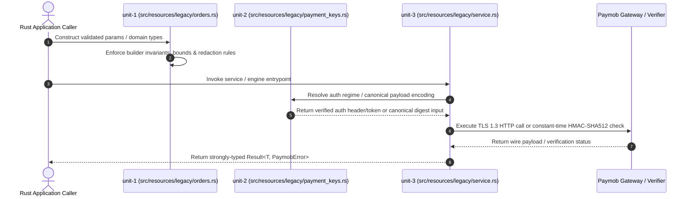

# User Story `US-2.3.0`: Legacy Accept v2 3-Step Checkout Flow (Auth Token -> Order -> Payment Key -> Iframe)

- **Module**: `module-2` ([Payment Intentions, Checkout Experiences & Legacy Accept v2 Flow](./README.md))
- **Story Branch**: `feat/us-2.3.0-legacy-v2-checkout`
- **Field Profile**: `software` (`engineering,security,testing`)
- **Story Decomposition Score ($S_{\text{story}}$)**: `2.00` $\to$ **`3` Parallel Implementation Units (`unit-1..3`)**

---

## 1. Spec Kit Specifications

### 1.1 User Story Narrative
> **As a** Backend Engineer migrating an existing Paymob Accept v2 integration to Rust,  
> **I want** full support for the classic 3-step Accept v2 flow (`generate_auth_token`, `create_order`, `create_payment_key`, `iframe_url`, and one-call `create_checkout`) behind `feature = "legacy-v2"`,  
> **So that** legacy iframe-based merchants can migrate to `some-paymob` without rewriting their frontend checkout iframes before adopting v1 Intentions.

This User Story belongs to **Module 2 (Payment Intentions, Checkout Experiences & Legacy Accept v2 Flow)** of [`some-paymob`](https://github.com/some-of-cs/some-paymob) as specified in [`docs/Paymob Rust SDK Architecture Research.md`](../../Paymob%20Rust%20SDK%20Architecture%20Research.md). It is decomposed into `3` strictly disjoint, 100% parallel Implementation Units (`unit-1..3`) that compile and verify independently inside isolated Git worktrees without inter-unit blocking.

#### 1.1.1 Preconditions
- Feature flag `legacy-v2` enabled in `Cargo.toml`.
- Module 1 Regime 2 (`AuthStrategy::AcceptJwtBody`) available for `POST /api/auth/tokens`, `POST /api/ecommerce/orders`, and `POST /api/acceptance/payment_keys` per [Paymob Orders API](https://apis.apievangelist.com/store/paymob-orders-api/) and [Paymob.Net](https://github.com/SENESO/Paymob.Net).

#### 1.1.2 Postconditions
- `paymob.legacy().create_order(params)` registers an order and returns `LegacyOrder` (`id`, `amount_cents`, `currency`, `merchant_order_id`).
- `paymob.legacy().create_payment_key(params)` exchanges `order_id`, `integration_id`, and `billing_data` for a `PaymentKeyResponse` (`token: SecretString`).
- `paymob.legacy().create_checkout(params)` executes the complete 3-step sequence and returns the ready-to-render iframe URL.

### 1.2 Acceptance Criteria (Gherkin Scenarios)

```gherkin
Feature: US-2.3.0 — Legacy Accept v2 3-Step Checkout Flow (Auth Token -> Order -> Payment Key -> Iframe)

  Scenario: AC-1 — 3-Step Legacy Checkout Orchestration (create_checkout)
    Given valid `LegacyCheckoutParams` with `amount_cents: 50_000`, `currency: "EGP"`, `integration_id: 4097558`, `iframe_id: 812345`, and `billing_data`
    When `paymob.legacy().create_checkout(params).await` is called
    Then the SDK reuses/fetches the 60-minute `auth_token`, creates the order via `POST /api/ecommerce/orders`, generates the `payment_token` via `POST /api/acceptance/payment_keys`, and returns `https://accept.paymob.com/api/acceptance/iframes/812345?payment_token=...`

  Scenario: AC-2 — URL-Encoded Iframe Payment Token Builder
    Given a `payment_token` containing base64/JWT characters (`+`, `/`, `=`)
    When `paymob.legacy().iframe_url(812345, &payment_token)` is called
    Then the `payment_token` query parameter is percent-encoded so the iframe URL never breaks in browser redirects

  Scenario: AC-3 — Transparent 401 JWT Recovery Mid-Flow
    Given an expired cached `auth_token` when `create_order` is invoked
    When Paymob returns HTTP 401 `{"detail": "incorrect credentials"}`
    Then the kernel refreshes the JWT once via single-flight lock and retries `create_order` automatically

  Scenario: AC-4 — Secret Redaction, Zero Float & Cyclomatic Complexity Compliance
    Given all public types and functions implemented across unit-1..3 of US-2.3.0
    When formatted via Debug/Display and analyzed by Gate G2 and Gate G-Complexity
    Then zero raw secrets, API keys, tokens, or PANs appear in Debug output (all emit "[REDACTED]")
    And every monetary value uses integer minor units (u64) with Cyclomatic Complexity CC <= 6 and nesting depth <= 2
```

### 1.3 Test Cases & Traceability Matrix

| Test Case ID | Mapped AC | Owning Unit | Test Level (Unit / Integration / Property / Security) | Description & Input Vector | Expected Result & Pass Threshold |
| :--- | :---: | :---: | :---: | :--- | :--- |
| `TC-2.3.1` | `AC-1` | `unit-1` | Unit + Doc-Test | Validate `CreateLegacyOrderParams` (`amount_cents`, `currency`, `merchant_order_id`, `items`, `delivery_needed`), `LegacyOrder` response model, and `POST /api/ecommerce/orders` using Regime 2 JSON body `"auth_token"` in `src/resources/legacy/orders.rs` (positive, boundary, and malformed inputs) | 100% deterministic assertion pass; $\ge 90\%$ line & $\ge 85\%$ branch coverage |
| `TC-2.3.2` | `AC-2` | `unit-2` | Unit + Doc-Test | Validate `CreatePaymentKeyParams` (`order_id`, `amount_cents`, `currency`, `integration_id`, `billing_data`, `expiration`, `lock_order_when_paid`), `PaymentKeyResponse` (`token: SecretString`), and `POST /api/acceptance/payment_keys` in `src/resources/legacy/payment_keys.rs` (positive, boundary, and malformed inputs) | 100% deterministic assertion pass; $\ge 90\%$ line & $\ge 85\%$ branch coverage |
| `TC-2.3.3` | `AC-3` | `unit-3` | Integration / Wire | Validate `LegacyV2Service` (`generate_auth_token`, `create_order`, `create_payment_key`, `iframe_url(iframe_id, payment_token)`, and one-call `create_checkout(params)` composite orchestrator) in `src/resources/legacy/service.rs` (positive, boundary, and malformed inputs) | 100% deterministic assertion pass; $\ge 90\%$ line & $\ge 85\%$ branch coverage |
| `TC-2.3.4` | `AC-4` | `unit-1..3` | Security / Property | Verify `[REDACTED]` `Debug` output, zero `f32`/`f64` floats, and `CC <= 6` across all units | 0 secret leaks in logs/panics; 0 Clippy warnings; all doctests pass |

---

## 2. Technical Implementation Plan

### 2.1 Domain Invariants & Storage Schema
- **Domain Invariants**:
  - **Feature-Gated Zero Bloat**: All `src/resources/legacy/` types compile only when `#[cfg(feature = "legacy-v2")]` (or `full`) is enabled.
  - **Body-Injected `auth_token` Hygiene**: `auth_token` is injected into the outbound JSON body during serialization and redacted in `Debug`.
- **Rust Type Definitions & Wire Protocol Schema**:

```rust
#![forbid(unsafe_code)]
use secrecy::SecretString;
use serde::{Deserialize, Serialize};

#[derive(Debug, Clone, Serialize)]
pub struct CreateLegacyOrderParams {
    pub amount_cents: u64,
    pub currency: String,
    pub delivery_needed: bool,
    pub merchant_order_id: Option<String>,
}

#[derive(Debug, Clone, Deserialize)]
pub struct LegacyOrder {
    pub id: u64,
    pub amount_cents: u64,
    pub currency: String,
    pub merchant_order_id: Option<String>,
}

#[derive(Clone, Deserialize)]
pub struct PaymentKeyResponse {
    pub token: SecretString,
}
```

### 2.2 Sequence Diagram



---

## 3. Expected Folder Architecture at the Project

All `3` Implementation Units in `US-2.3.0` own **100% disjoint files** so they execute concurrently in isolated `.worktrees/` with zero merge conflicts:

```text
some-paymob/
├── Cargo.toml                                  # Seeded on Module/Story base branch
├── src/
│   ├── lib.rs                                  # Seeded on Module base branch
│   ├── src/resources/legacy/orders.rs          # Owned exclusively by unit-1 (feat/us-2.3.0/unit-1-legacy-orders)
│   ├── src/resources/legacy/payment_keys.rs    # Owned exclusively by unit-2 (feat/us-2.3.0/unit-2-legacy-payment-keys)
│   ├── src/resources/legacy/service.rs         # Owned exclusively by unit-3 (feat/us-2.3.0/unit-3-legacy-checkout-facade)
└── tests/
    └── legacy_v2_checkout_integration.rs         # Executed by story-leader after unit-1..3 merge
```

---

## 4. Implementation Units in Detail & Specialist Agent Assignment

### 4.1 Story Decomposition Score ($S_{\text{story}}$) & Dynamic Unit Count ($K$)
- **$D_1$ (35% Functional Surface)**: `2` — 3 legacy endpoints + 2 helpers: `POST /api/auth/tokens`, `POST /api/ecommerce/orders`, `POST /api/acceptance/payment_keys`, `iframe_url`, and `create_checkout` composite flow
- **$D_2$ (25% Artifact Volume)**: `2` — ~440 production LOC under `src/resources/legacy/` (`#[cfg(feature = "legacy-v2")]`)
- **$D_3$ (20% Logic Complexity)**: `2` — Regime 2 JSON body `"auth_token"` injection, 3-step sequential orchestration, and URL-encoded `payment_token` iframe URL construction
- **$D_4$ (20% Orthogonal Boundaries)**: `2` — 3 independent files under `src/resources/legacy/` (`orders.rs`, `payment_keys.rs`, `service.rs`)
- **Calculated Score**: $S_{\text{story}} = 0.35(2) + 0.25(2) + 0.20(2) + 0.20(2) = \mathbf{2.00}$ $\to$ **`3` Parallel Units**

### 4.2 Detailed Unit Specifications (`unit-1..3`)

- **`unit-1` (`feat/us-2.3.0/unit-1-legacy-orders`)**:
  - **Deliverable Scope**: `CreateLegacyOrderParams` (`amount_cents`, `currency`, `merchant_order_id`, `items`, `delivery_needed`), `LegacyOrder` response model, and `POST /api/ecommerce/orders` using Regime 2 JSON body `"auth_token"`
  - **Owned Files**: `src/resources/legacy/orders.rs`
  - **Public Contract / Exports**: Public types, builders, and methods defined in `src/resources/legacy/orders.rs` re-exported via parent `mod.rs`
  - **Unit Verification & Target Complexity**: Colocated `#[cfg(test)] mod tests` + runnable rustdoc examples (`TC-2.3.1`), Max Cyclomatic Complexity $CC \le 6$ (cap $\le 10$, nesting $\le 2$)
- **`unit-2` (`feat/us-2.3.0/unit-2-legacy-payment-keys`)**:
  - **Deliverable Scope**: `CreatePaymentKeyParams` (`order_id`, `amount_cents`, `currency`, `integration_id`, `billing_data`, `expiration`, `lock_order_when_paid`), `PaymentKeyResponse` (`token: SecretString`), and `POST /api/acceptance/payment_keys`
  - **Owned Files**: `src/resources/legacy/payment_keys.rs`
  - **Public Contract / Exports**: Public types, builders, and methods defined in `src/resources/legacy/payment_keys.rs` re-exported via parent `mod.rs`
  - **Unit Verification & Target Complexity**: Colocated `#[cfg(test)] mod tests` + runnable rustdoc examples (`TC-2.3.2`), Max Cyclomatic Complexity $CC \le 6$ (cap $\le 10$, nesting $\le 2$)
- **`unit-3` (`feat/us-2.3.0/unit-3-legacy-checkout-facade`)**:
  - **Deliverable Scope**: `LegacyV2Service` (`generate_auth_token`, `create_order`, `create_payment_key`, `iframe_url(iframe_id, payment_token)`, and one-call `create_checkout(params)` composite orchestrator)
  - **Owned Files**: `src/resources/legacy/service.rs`
  - **Public Contract / Exports**: Public types, builders, and methods defined in `src/resources/legacy/service.rs` re-exported via parent `mod.rs`
  - **Unit Verification & Target Complexity**: Colocated `#[cfg(test)] mod tests` + runnable rustdoc examples (`TC-2.3.3`), Max Cyclomatic Complexity $CC \le 6$ (cap $\le 10$, nesting $\le 2$)

### 4.3 Best-Fit Specialist Agents per Unit (`msitarzewski/agency-catalog` + Core Roster)

| Unit ID | Branch Name | Primary Implementer Agent(s) (`agency-catalog`) | Reviewing Council Agent(s) | Mandatory Skills Enforced |
| :--- | :--- | :--- | :--- | :--- |
| `unit-1` | `feat/us-2.3.0/unit-1-legacy-orders` | `backend-architect` | `code-reviewer`, `security-engineer`, `api-tester` | `code-review-council`, `security-audit`, `cyclomatic-complexity` |
| `unit-2` | `feat/us-2.3.0/unit-2-legacy-payment-keys` | `backend-architect` | `code-reviewer`, `security-engineer`, `api-tester` | `code-review-council`, `security-audit`, `cyclomatic-complexity` |
| `unit-3` | `feat/us-2.3.0/unit-3-legacy-checkout-facade` | `api-tester` | `code-reviewer`, `security-engineer`, `api-tester` | `code-review-council`, `security-audit`, `cyclomatic-complexity` |
| **Story Remediation** | `patch/us-2.3.0-legacy-v2-checkout` | `patch-implementer` + `backend-architect` | `code-reviewer-council-president` | Full 6-Gate Re-Verification |

### 4.4 Parallel Execution & Zero-Blocking Contract Seeding Plan
1. **Base Contract Seeding**: Commit `src/resources/legacy/mod.rs` and `LegacyV2Service` struct stub on `feat/us-2.3.0-legacy-v2-checkout` before branching `unit-1..3`.
2. **Simultaneous Worktree Spawning**: All `3` units are provisioned in `.worktrees/feat-us-2.3.0-unit-1..3` and spawned simultaneously in Wave 2.
3. **Ordered Cascading Merge Sequence**: `unit-1` $\to$ `unit-2` $\to$ `unit-3` into `feat/us-2.3.0-legacy-v2-checkout` via `gh pr merge <PR> --merge`.

---

## 5. Security Gateway (Powered by `security-audit` Skill)

### 5.1 Trust Boundaries & Security Actors
- **Security Actors**: Merchant backend services (`PaymobClient` callers), customer browsers/mobile apps (redirected via Unified Checkout / Pixel / Legacy Iframe), Paymob Acquiring & Payouts servers, and untrusted external webhook senders.
- **Trust Boundaries**:
  1. **Caller Input Boundary**: Untrusted builder inputs (phone numbers, amounts, frequencies, proof attachments, integration IDs) crossing into SDK request serializers.
  2. **Network Ingress / Deserialization Boundary**: Raw JSON/HTTP responses and incoming webhook payloads crossing into typed Rust domain models.
  3. **Credential & Telemetry Boundary**: Secret keys (`sk_*`), API keys, JWT/OAuth2 bearer tokens, saved card tokens, and HMAC secrets crossing into memory caches, HTTP headers, or diagnostic logs.

### 5.2 Threat Modeling & Abuse Matrix (STRIDE / OWASP ASVS)

| Threat ID | STRIDE Category | ASVS / CWE Ref | Attack Vector / Abuse Scenario | Impact | Required Mitigation & Code/Deliverable Control |
| :--- | :---: | :---: | :--- | :---: | :--- |
| `TM-1` | **S**poofing | ASVS V2 / CWE-287 | Wrong auth scheme (`Bearer` vs `Token`), expired 60-min JWT reuse, or forged webhook signature | Critical | Explicit `AuthStrategy` per endpoint, single-flight JWT/OAuth2 refresh, and constant-time `Hmac<Sha512>` + `subtle::ConstantTimeEq` verification |
| `TM-2` | **T**ampering | ASVS V5 / CWE-20 | Floating-point rounding manipulation, 100x currency unit errors, or tampered webhook query/body fields | Critical | `MinorUnitAmount(u64)` integer minor units (zero `f32`/`f64`), builder-time field validation, and fail-closed 20-key/8-key/body-HMAC verification |
| `TM-3` | **R**epudiation | ASVS V7 / CWE-778 | Duplicate transaction fulfillment on retried webhooks or unlogged state mutations | High | `IdempotentWebhookGuard` extracting `(obj.id, order.id)` and `(paymob_request_id, subscription_data.id)` + correlation logging |
| `TM-4` | **I**nformation Disclosure | ASVS V8 / CWE-200 | Secret key (`sk_*`), `client_secret`, JWT `auth_token`, or PAN/CVV leaked in `Debug` logs or panic traces | Critical | `secrecy::SecretString` + `ZeroizeOnDrop` on all credentials/tokens and custom `[REDACTED]` `Debug` implementations |
| `TM-5` | **D**enial of Service | ASVS V11 / CWE-400 | Thundering-herd token refresh storms on 1-hour JWT expiry or oversized (>2.8 MB) topup proof payloads | High | Lock-free `ArcSwapOption` + single-flight `tokio::sync::Mutex<()>` refresh guard, bounded timeouts, and `MAX_TOPUP_PROOF_BYTES` check |
| `TM-6` | **E**levation of Privilege | ASVS V4 / CWE-285 | Cross-merchant IDOR in Partner Onboarding (`with_merchant`) or mixing Test and Live integration IDs | Critical | Immutable `MerchantScopedClient` per `merchant_id` and strict `EnvironmentMode` (`Test` vs `Live`) parity enforcement |

### 5.3 Cryptography & Global Data Protection Controls (Worldwide Legal & Regulatory Compliance)
1. **Cryptographic Standards**:
   - **In Transit**: TLS 1.3 (`reqwest` with `rustls-tls`) enforced for all Accept Acquiring and Payouts connections.
   - **Signatures & Constant-Time MACs**: `HMAC-SHA512` (`hmac` + `sha2`) verified exclusively via branchless constant-time comparison (`subtle::ConstantTimeEq::ct_eq`); zero `SHA-1`/`MD5` or early-exit byte comparisons.
   - **Memory Hygiene**: All secret keys, API keys, JWTs, OAuth2 refresh tokens, card tokens, and HMAC secrets use `secrecy::SecretString` and `zeroize::ZeroizeOnDrop`.
2. **Global Multi-Jurisdictional Privacy & Financial Compliance**:
   - **PCI-DSS v4.0**: Raw PANs and CVVs are never stored or logged; card tokenization uses `masked_pan` (`xxxx-xxxx-xxxx-2346`) for display and `SecretString` for tokens; frontend checkout helpers accept only `PublicKey` (`pk_*`).
   - **MENA & Regional Central Bank Regulations (CBE Egypt, SAMA Saudi Arabia, CBUAE UAE, CBO Oman, SBP Pakistan)**: Regional host isolation via `PaymobRegion` ensures transaction and disbursement payloads remain routed to the designated sovereign regional gateway.
   - **GDPR / UK GDPR / CCPA / Egypt PDPL (Law No. 151 of 2020) / KSA PDPL**: Strict PII minimization and automatic `[REDACTED]` scrubbing of customer emails, phone numbers (`msisdn`), and bank account numbers in diagnostic traces.

### 5.4 Automated Security Verification Checklist (`security-audit` Skill)
- [ ] Applicable security playbooks reviewed (`WEB-PROTOCOL-AND-AUTH.md`, `MEMORY-SAFETY-AND-BINARY.md`, `SUPPLY-CHAIN-AND-RELEASE.md`).
- [ ] `#![forbid(unsafe_code)]` enforced at the crate root; all untrusted inputs validated for bounds, non-empty prefixes, and encoding prior to network dispatch.
- [ ] Zero secrets, API keys, JWTs, card tokens, or raw PII emitted in `Debug` formatting, logs, or error messages.
- [ ] Zero `f32`/`f64` floating-point types used for monetary amounts or fee calculations.

### 5.5 Security Gateway (Gate G2) Sign-Off Checklist
- [ ] **0 Critical / High / Medium** vulnerabilities in `security-audit` scan.
- [ ] All STRIDE / ASVS threat mitigations (`TM-1..TM-6`) implemented and covered by security/negative tests in Section 1.3 (`TC-2.3.1..4`).
- [ ] Regional host partitioning, PCI-DSS token redaction, and `ZeroizeOnDrop` controls verified.
- [ ] Independent Security Reviewer agent sign-off posted to the GitHub PR conversation.

---

## 6. Validation Gates & Acceptance Sign-Off

Every Unit PR (`feat/us-2.3.0-legacy-v2-checkout/unit-1..3`) and the parent Story PR (`feat/us-2.3.0-legacy-v2-checkout`) MUST pass all 6 Quality Gates and post the evidence directly to the GitHub PR conversation before `gh pr merge`:

| Gate | Gate Name | Pass Criteria for `US-2.3.0` | Verification Command / Evidence | Status |
| :--- | :--- | :--- | :--- | :---: |
| **Gate G0** | **Build, Lint & Format** | 0 errors, 0 warnings, 100% `rustfmt` & `clippy` compliance | `CARGO_BUILD_JOBS=1 cargo fmt --check && CARGO_BUILD_JOBS=1 cargo clippy --all-targets --all-features -- -D warnings` | `[ ]` |
| **Gate G1** | **Tests, Coverage & Traceability** | 100% of `AC-1..4` and `TC-2.3.1..4` passing ($\ge 90\%$ line, $\ge 85\%$ branch coverage) | `CARGO_BUILD_JOBS=1 cargo test --all-features` | `[ ]` |
| **Gate G2** | **Security Gateway (`security-audit`)** | All Section 5 STRIDE, constant-time crypto, and `[REDACTED]` checks pass (0 findings) | `security-audit` report on PR | `[ ]` |
| **Gate G-Complexity** | **Cyclomatic Complexity** | Every function $CC \le 6$ target ($CC \le 10$ ceiling, $CC > 15$ blocker, nesting $\le 2$) | `cyclomatic-complexity` table on PR | `[ ]` |
| **Gate G-Docs** | **Documentation & Examples** | 100% public symbols documented + runnable doc-tests + this spec synced | `CARGO_BUILD_JOBS=1 cargo test --doc --all-features` | `[ ]` |
| **Gate G-Review** | **Council President Sign-Off** | Independent Reviewing Council posts `GATE G-REVIEW APPROVED` on GitHub PR | `gh pr comment <PR>` | `[ ]` |

### Final Acceptance Sign-Off Block
- **Story Leader Verification**: All `3` units (`unit-1..3`) merged via cascading `gh pr merge`, story integration suite green, and zero unaddressed findings (or remediated via dedicated `patch-implementer` PRs).
- **Reviewing Council Verdict**: `PENDING` $\to$ `GATE G-REVIEW APPROVED`
