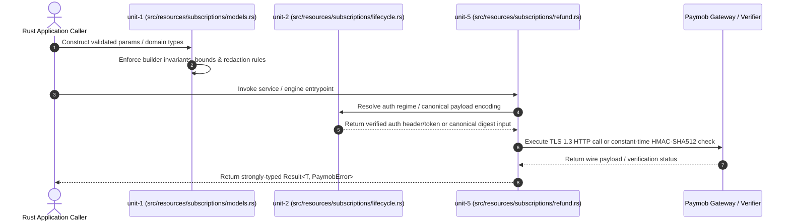

# User Story `US-4.3.0`: Subscription Lifecycle Actions, Card Vault Management, Transaction History & refund_last_transaction

- **Module**: `module-4` ([Saved Cards (CIT/MIT), Headless Payments & Subscriptions Recurring Billing Engine](./README.md))
- **Story Branch**: `feat/us-4.3.0-subscription-lifecycle-cards-refunds`
- **Field Profile**: `software` (`engineering,security,testing`)
- **Story Decomposition Score ($S_{\text{story}}$)**: `2.75` $\to$ **`5` Parallel Implementation Units (`unit-1..5`)**

---

## 1. Spec Kit Specifications

### 1.1 User Story Narrative
> **As a** SaaS Subscription Lifecycle Engineer managing customer upgrades, card rotations, and recurring deduction refunds,  
> **I want** complete subscription lifecycle control (`suspend`, `resume`, `cancel`, `update`), secondary/primary card management (`change-primary-card`, `delete-card`), deduction history lookup (`last-transaction`, `transactions`), and a one-call `refund_last_transaction(sub_id, amount_cents)` helper,  
> **So that** customer support and billing services can rotate expiring cards, inspect recurring deduction attempts (`api_source: "SUBSCRIPTION"`), and refund the latest subscription deduction safely without manual two-step transaction lookups.

This User Story belongs to **Module 4 (Saved Cards (CIT/MIT), Headless Payments & Subscriptions Recurring Billing Engine)** of [`some-paymob`](https://github.com/some-of-cs/some-paymob) as specified in [`docs/Paymob Rust SDK Architecture Research.md`](../../Paymob%20Rust%20SDK%20Architecture%20Research.md). It is decomposed into `5` strictly disjoint, 100% parallel Implementation Units (`unit-1..5`) that compile and verify independently inside isolated Git worktrees without inter-unit blocking.

#### 1.1.1 Preconditions
- Feature flag `subscriptions` (and `manage` for `refund_last_transaction`) enabled.
- Paymob Subscription Action specifications ([List Subscription Details](https://developers.paymob.com/paymob-docs/developers/subscription/subscription-actions/list-subscription-details), [Subscription Actions](https://developers.paymob.com/paymob-docs/developers/subscription/subscription-actions), [Change Subscription Primary Card](https://developers.paymob.com/paymob-docs/developers/subscription/subscription-actions/change-subscription-primary-card), and [Last Transaction Subscription](https://developers.paymob.com/paymob-docs/developers/subscription/subscription-actions/last-transaction-subscription)) loaded.

#### 1.1.2 Postconditions
- All 13 Subscription lifecycle, card management, webhook registration, and transaction history operations execute under Regime 2 (`Authorization: Bearer <auth_token>`).
- `paymob.subscriptions().refund_last_transaction(sub_id, amount_cents)` fetches `GET /api/acceptance/subscriptions/{id}/last-transaction`, verifies `tx.success && !tx.is_refunded`, and invokes `POST /api/acceptance/void_refund/refund`.

### 1.2 Acceptance Criteria (Gherkin Scenarios)

```gherkin
Feature: US-4.3.0 — Subscription Lifecycle Actions, Card Vault Management, Transaction History & refund_last_transaction

  Scenario: AC-1 — Subscription Lifecycle Transitions (Retrieve, List, Suspend, Resume, Cancel, Update)
    Given an enrolled subscription ID `1264`
    When `retrieve(1264)`, `suspend(1264)`, `resume(1264)`, and `cancel(1264)` are invoked
    Then `GET /api/acceptance/subscriptions/1264` and `POST /api/acceptance/subscriptions/1264/suspend` (plus resume/cancel/update) execute with `Bearer <auth_token>`

  Scenario: AC-2 — Subscription Card Vault Rotation (List, Add Secondary, Change Primary, Delete Secondary)
    Given a subscription `1264` with listed card ID `374`
    When `paymob.subscriptions().cards().change_primary(1264, 374).await` and `.delete_secondary(1264, 375).await` are called
    Then `POST /api/acceptance/subscriptions/1264/change-primary-card` sends `{"card": 374}` and returns `SubscriptionCard` with `is_primary: true` (mapping 404 `{"message": "Card not found."}` to `PaymobError::ApiError`)

  Scenario: AC-3 — Composite Subscription Deduction Refund (refund_last_transaction)
    Given an active subscription `1264` whose latest transaction `998877` succeeded (`success: true`, `is_refunded: false`, `amount_cents: 50_000`)
    When `paymob.subscriptions().refund_last_transaction(1264, Some(20_000)).await` is executed
    Then the SDK fetches `GET /api/acceptance/subscriptions/1264/last-transaction`, validates `tx.success && !tx.is_refunded`, and refunds `20_000` piasters on `transaction_id: 998877` via `POST /api/acceptance/void_refund/refund`

  Scenario: AC-4 — Secret Redaction, Zero Float & Cyclomatic Complexity Compliance
    Given all public types and functions implemented across unit-1..5 of US-4.3.0
    When formatted via Debug/Display and analyzed by Gate G2 and Gate G-Complexity
    Then zero raw secrets, API keys, tokens, or PANs appear in Debug output (all emit "[REDACTED]")
    And every monetary value uses integer minor units (u64) with Cyclomatic Complexity CC <= 6 and nesting depth <= 2
```

### 1.3 Test Cases & Traceability Matrix

| Test Case ID | Mapped AC | Owning Unit | Test Level (Unit / Integration / Property / Security) | Description & Input Vector | Expected Result & Pass Threshold |
| :--- | :---: | :---: | :---: | :--- | :--- |
| `TC-4.3.1` | `AC-1` | `unit-1` | Unit + Doc-Test | Validate `Subscription` record (`id`, `plan_id`, `state`, `initial_transaction`, `amount_cents`, `starts_at`, `next_billing`, `reminder_date`, `ends_at`, `resumed_at`, `suspended_at`, `reactivated_at`, `created_at`), `SubscriptionState`, `SubscriptionListFilter` (`transaction`, `plan_id`, `state`), and `SubscriptionCard` (`id`, `card_data`, `token: SecretString`, `created_at`, `is_primary`, `masked_pan`, `failed_attempts`) in `src/resources/subscriptions/models.rs` (positive, boundary, and malformed inputs) | 100% deterministic assertion pass; $\ge 90\%$ line & $\ge 85\%$ branch coverage |
| `TC-4.3.2` | `AC-2` | `unit-2` | Unit + Doc-Test | Validate `SubscriptionsService` lifecycle methods (`create` via Intention 3DS enrollment, `retrieve(sub_id)` `GET /api/acceptance/subscriptions/{id}`, `list(filters)`, `update(sub_id, params)`, `suspend(sub_id)` `POST /api/acceptance/subscriptions/{id}/suspend`, `resume(sub_id)`, `cancel(sub_id)`) under Regime 2 `Bearer <auth_token>` in `src/resources/subscriptions/lifecycle.rs` (positive, boundary, and malformed inputs) | 100% deterministic assertion pass; $\ge 90\%$ line & $\ge 85\%$ branch coverage |
| `TC-4.3.3` | `AC-3` | `unit-3` | Unit + Doc-Test | Validate `SubscriptionCardsService` (`paymob.subscriptions().cards().list(sub_id)`, `.add_secondary(...)`, `.change_primary(sub_id, card_id)` `POST /api/acceptance/subscriptions/{id}/change-primary-card` with `{"card": card_id}`, and `.delete_secondary(sub_id, card_id)` `POST /api/acceptance/subscriptions/{id}/delete-card`) in `src/resources/subscriptions/cards.rs` (positive, boundary, and malformed inputs) | 100% deterministic assertion pass; $\ge 90\%$ line & $\ge 85\%$ branch coverage |
| `TC-4.3.4` | `AC-3` | `unit-4` | Unit + Doc-Test | Validate `register_webhook(sub_id, url)`, `last_transaction(sub_id)` (`GET /api/acceptance/subscriptions/{id}/last-transaction` returning full `Transaction` with `api_source: "SUBSCRIPTION"`), and `list_transactions(sub_id)` (`GET /api/acceptance/subscriptions/{id}/transactions`) in `src/resources/subscriptions/history.rs` (positive, boundary, and malformed inputs) | 100% deterministic assertion pass; $\ge 90\%$ line & $\ge 85\%$ branch coverage |
| `TC-4.3.5` | `AC-3` | `unit-5` | Integration / Wire | Validate Composite `paymob.subscriptions().refund_last_transaction(sub_id, amount_cents: Option<u64>)` (`#[cfg(all(feature = "subscriptions", feature = "manage"))]`) fetching `last_transaction(sub_id)`, asserting `tx.success && !tx.is_refunded`, and delegating to `manage().refund(...)` for full or partial deduction amount in `src/resources/subscriptions/refund.rs` (positive, boundary, and malformed inputs) | 100% deterministic assertion pass; $\ge 90\%$ line & $\ge 85\%$ branch coverage |
| `TC-4.3.6` | `AC-4` | `unit-1..5` | Security / Property | Verify `[REDACTED]` `Debug` output, zero `f32`/`f64` floats, and `CC <= 6` across all units | 0 secret leaks in logs/panics; 0 Clippy warnings; all doctests pass |

---

## 2. Technical Implementation Plan

### 2.1 Domain Invariants & Storage Schema
- **Domain Invariants**:
  - **Fail-Closed Deduction Refund Guard**: `refund_last_transaction` refuses to issue a refund if the latest subscription transaction has `success == false`, `pending == true`, or `is_refunded == true`.
  - **Card Token Redaction**: `SubscriptionCard::token` is wrapped in `SecretString` (`ZeroizeOnDrop`).
- **Rust Type Definitions & Wire Protocol Schema**:

```rust
#![forbid(unsafe_code)]
use secrecy::SecretString;
use serde::{Deserialize, Serialize};

#[derive(Clone, Deserialize)]
pub struct SubscriptionCard {
    pub id: u64,
    pub token: SecretString,
    pub created_at: String,
    pub is_primary: bool,
    pub masked_pan: String,
    pub failed_attempts: u32,
}

#[derive(Debug, Clone, Serialize)]
pub struct ChangePrimaryCardParams {
    pub card: u64,
}
```

### 2.2 Sequence Diagram



---

## 3. Expected Folder Architecture at the Project

All `5` Implementation Units in `US-4.3.0` own **100% disjoint files** so they execute concurrently in isolated `.worktrees/` with zero merge conflicts:

```text
some-paymob/
├── Cargo.toml                                  # Seeded on Module/Story base branch
├── src/
│   ├── lib.rs                                  # Seeded on Module base branch
│   ├── src/resources/subscriptions/models.rs   # Owned exclusively by unit-1 (feat/us-4.3.0/unit-1-subscription-models)
│   ├── src/resources/subscriptions/lifecycle.rs # Owned exclusively by unit-2 (feat/us-4.3.0/unit-2-subscription-lifecycle)
│   ├── src/resources/subscriptions/cards.rs    # Owned exclusively by unit-3 (feat/us-4.3.0/unit-3-subscription-cards)
│   ├── src/resources/subscriptions/history.rs  # Owned exclusively by unit-4 (feat/us-4.3.0/unit-4-subscription-history-webhook)
│   ├── src/resources/subscriptions/refund.rs   # Owned exclusively by unit-5 (feat/us-4.3.0/unit-5-subscription-refund-helper)
└── tests/
    └── subscription_lifecycle_cards_refunds_integration.rs         # Executed by story-leader after unit-1..5 merge
```

---

## 4. Implementation Units in Detail & Specialist Agent Assignment

### 4.1 Story Decomposition Score ($S_{\text{story}}$) & Dynamic Unit Count ($K$)
- **$D_1$ (35% Functional Surface)**: `3` — 5 cohesive sub-domains covering 13 operations + 1 composite helper: Subscription models/filters, lifecycle actions (`create`, `retrieve_or_list`, `update`, `suspend`, `resume`, `cancel`), card management (`list`, `add_secondary`, `change_primary`, `delete_secondary`), history/webhook registration (`register_webhook`, `last_transaction`, `list_transactions`), and `refund_last_transaction`
- **$D_2$ (25% Artifact Volume)**: `2` — ~680 production LOC across 5 files under `src/resources/subscriptions/`
- **$D_3$ (20% Logic Complexity)**: `3` — Cross-regime composite `refund_last_transaction(sub_id, Option<u64>)` chaining Regime 2 `GET /last-transaction` with `success && !is_refunded` verification and Regime 1 `POST /api/acceptance/void_refund/refund`
- **$D_4$ (20% Orthogonal Boundaries)**: `3` — 5 independent files under `src/resources/subscriptions/` (`models.rs`, `lifecycle.rs`, `cards.rs`, `history.rs`, `refund.rs`)
- **Calculated Score**: $S_{\text{story}} = 0.35(3) + 0.25(2) + 0.20(3) + 0.20(3) = \mathbf{2.75}$ $\to$ **`5` Parallel Units**

### 4.2 Detailed Unit Specifications (`unit-1..5`)

- **`unit-1` (`feat/us-4.3.0/unit-1-subscription-models`)**:
  - **Deliverable Scope**: `Subscription` record (`id`, `plan_id`, `state`, `initial_transaction`, `amount_cents`, `starts_at`, `next_billing`, `reminder_date`, `ends_at`, `resumed_at`, `suspended_at`, `reactivated_at`, `created_at`), `SubscriptionState`, `SubscriptionListFilter` (`transaction`, `plan_id`, `state`), and `SubscriptionCard` (`id`, `card_data`, `token: SecretString`, `created_at`, `is_primary`, `masked_pan`, `failed_attempts`)
  - **Owned Files**: `src/resources/subscriptions/models.rs`
  - **Public Contract / Exports**: Public types, builders, and methods defined in `src/resources/subscriptions/models.rs` re-exported via parent `mod.rs`
  - **Unit Verification & Target Complexity**: Colocated `#[cfg(test)] mod tests` + runnable rustdoc examples (`TC-4.3.1`), Max Cyclomatic Complexity $CC \le 6$ (cap $\le 10$, nesting $\le 2$)
- **`unit-2` (`feat/us-4.3.0/unit-2-subscription-lifecycle`)**:
  - **Deliverable Scope**: `SubscriptionsService` lifecycle methods (`create` via Intention 3DS enrollment, `retrieve(sub_id)` `GET /api/acceptance/subscriptions/{id}`, `list(filters)`, `update(sub_id, params)`, `suspend(sub_id)` `POST /api/acceptance/subscriptions/{id}/suspend`, `resume(sub_id)`, `cancel(sub_id)`) under Regime 2 `Bearer <auth_token>`
  - **Owned Files**: `src/resources/subscriptions/lifecycle.rs`
  - **Public Contract / Exports**: Public types, builders, and methods defined in `src/resources/subscriptions/lifecycle.rs` re-exported via parent `mod.rs`
  - **Unit Verification & Target Complexity**: Colocated `#[cfg(test)] mod tests` + runnable rustdoc examples (`TC-4.3.2`), Max Cyclomatic Complexity $CC \le 6$ (cap $\le 10$, nesting $\le 2$)
- **`unit-3` (`feat/us-4.3.0/unit-3-subscription-cards`)**:
  - **Deliverable Scope**: `SubscriptionCardsService` (`paymob.subscriptions().cards().list(sub_id)`, `.add_secondary(...)`, `.change_primary(sub_id, card_id)` `POST /api/acceptance/subscriptions/{id}/change-primary-card` with `{"card": card_id}`, and `.delete_secondary(sub_id, card_id)` `POST /api/acceptance/subscriptions/{id}/delete-card`)
  - **Owned Files**: `src/resources/subscriptions/cards.rs`
  - **Public Contract / Exports**: Public types, builders, and methods defined in `src/resources/subscriptions/cards.rs` re-exported via parent `mod.rs`
  - **Unit Verification & Target Complexity**: Colocated `#[cfg(test)] mod tests` + runnable rustdoc examples (`TC-4.3.3`), Max Cyclomatic Complexity $CC \le 6$ (cap $\le 10$, nesting $\le 2$)
- **`unit-4` (`feat/us-4.3.0/unit-4-subscription-history-webhook`)**:
  - **Deliverable Scope**: `register_webhook(sub_id, url)`, `last_transaction(sub_id)` (`GET /api/acceptance/subscriptions/{id}/last-transaction` returning full `Transaction` with `api_source: "SUBSCRIPTION"`), and `list_transactions(sub_id)` (`GET /api/acceptance/subscriptions/{id}/transactions`)
  - **Owned Files**: `src/resources/subscriptions/history.rs`
  - **Public Contract / Exports**: Public types, builders, and methods defined in `src/resources/subscriptions/history.rs` re-exported via parent `mod.rs`
  - **Unit Verification & Target Complexity**: Colocated `#[cfg(test)] mod tests` + runnable rustdoc examples (`TC-4.3.4`), Max Cyclomatic Complexity $CC \le 6$ (cap $\le 10$, nesting $\le 2$)
- **`unit-5` (`feat/us-4.3.0/unit-5-subscription-refund-helper`)**:
  - **Deliverable Scope**: Composite `paymob.subscriptions().refund_last_transaction(sub_id, amount_cents: Option<u64>)` (`#[cfg(all(feature = "subscriptions", feature = "manage"))]`) fetching `last_transaction(sub_id)`, asserting `tx.success && !tx.is_refunded`, and delegating to `manage().refund(...)` for full or partial deduction amount
  - **Owned Files**: `src/resources/subscriptions/refund.rs`
  - **Public Contract / Exports**: Public types, builders, and methods defined in `src/resources/subscriptions/refund.rs` re-exported via parent `mod.rs`
  - **Unit Verification & Target Complexity**: Colocated `#[cfg(test)] mod tests` + runnable rustdoc examples (`TC-4.3.5`), Max Cyclomatic Complexity $CC \le 6$ (cap $\le 10$, nesting $\le 2$)

### 4.3 Best-Fit Specialist Agents per Unit (`msitarzewski/agency-catalog` + Core Roster)

| Unit ID | Branch Name | Primary Implementer Agent(s) (`agency-catalog`) | Reviewing Council Agent(s) | Mandatory Skills Enforced |
| :--- | :--- | :--- | :--- | :--- |
| `unit-1` | `feat/us-4.3.0/unit-1-subscription-models` | `backend-architect` | `code-reviewer`, `security-engineer`, `api-tester` | `code-review-council`, `security-audit`, `cyclomatic-complexity` |
| `unit-2` | `feat/us-4.3.0/unit-2-subscription-lifecycle` | `backend-architect` | `code-reviewer`, `security-engineer`, `api-tester` | `code-review-council`, `security-audit`, `cyclomatic-complexity` |
| `unit-3` | `feat/us-4.3.0/unit-3-subscription-cards` | `backend-architect` | `code-reviewer`, `security-engineer`, `api-tester` | `code-review-council`, `security-audit`, `cyclomatic-complexity` |
| `unit-4` | `feat/us-4.3.0/unit-4-subscription-history-webhook` | `backend-architect` | `code-reviewer`, `security-engineer`, `api-tester` | `code-review-council`, `security-audit`, `cyclomatic-complexity` |
| `unit-5` | `feat/us-4.3.0/unit-5-subscription-refund-helper` | `api-tester` | `code-reviewer`, `security-engineer`, `api-tester` | `code-review-council`, `security-audit`, `cyclomatic-complexity` |
| **Story Remediation** | `patch/us-4.3.0-subscription-lifecycle-cards-refunds` | `patch-implementer` + `backend-architect` | `code-reviewer-council-president` | Full 6-Gate Re-Verification |

### 4.4 Parallel Execution & Zero-Blocking Contract Seeding Plan
1. **Base Contract Seeding**: Commit `src/resources/subscriptions/mod.rs` with `SubscriptionsService` and `SubscriptionCardsService` struct declarations on `feat/us-4.3.0-subscription-lifecycle-cards-refunds` before branching `unit-1..5`.
2. **Simultaneous Worktree Spawning**: All `5` units are provisioned in `.worktrees/feat-us-4.3.0-unit-1..5` and spawned simultaneously in Wave 2.
3. **Ordered Cascading Merge Sequence**: `unit-1` $\to$ `unit-2` $\to$ `unit-3` $\to$ `unit-4` $\to$ `unit-5` into `feat/us-4.3.0-subscription-lifecycle-cards-refunds` via `gh pr merge <PR> --merge`.

---

## 5. Security Gateway (Powered by `security-audit` Skill)

### 5.1 Trust Boundaries & Security Actors
- **Security Actors**: Merchant backend services (`PaymobClient` callers), customer browsers/mobile apps (redirected via Unified Checkout / Pixel / Legacy Iframe), Paymob Acquiring & Payouts servers, and untrusted external webhook senders.
- **Trust Boundaries**:
  1. **Caller Input Boundary**: Untrusted builder inputs (phone numbers, amounts, frequencies, proof attachments, integration IDs) crossing into SDK request serializers.
  2. **Network Ingress / Deserialization Boundary**: Raw JSON/HTTP responses and incoming webhook payloads crossing into typed Rust domain models.
  3. **Credential & Telemetry Boundary**: Secret keys (`sk_*`), API keys, JWT/OAuth2 bearer tokens, saved card tokens, and HMAC secrets crossing into memory caches, HTTP headers, or diagnostic logs.

### 5.2 Threat Modeling & Abuse Matrix (STRIDE / OWASP ASVS)

| Threat ID | STRIDE Category | ASVS / CWE Ref | Attack Vector / Abuse Scenario | Impact | Required Mitigation & Code/Deliverable Control |
| :--- | :---: | :---: | :--- | :---: | :--- |
| `TM-1` | **S**poofing | ASVS V2 / CWE-287 | Wrong auth scheme (`Bearer` vs `Token`), expired 60-min JWT reuse, or forged webhook signature | Critical | Explicit `AuthStrategy` per endpoint, single-flight JWT/OAuth2 refresh, and constant-time `Hmac<Sha512>` + `subtle::ConstantTimeEq` verification |
| `TM-2` | **T**ampering | ASVS V5 / CWE-20 | Floating-point rounding manipulation, 100x currency unit errors, or tampered webhook query/body fields | Critical | `MinorUnitAmount(u64)` integer minor units (zero `f32`/`f64`), builder-time field validation, and fail-closed 20-key/8-key/body-HMAC verification |
| `TM-3` | **R**epudiation | ASVS V7 / CWE-778 | Duplicate transaction fulfillment on retried webhooks or unlogged state mutations | High | `IdempotentWebhookGuard` extracting `(obj.id, order.id)` and `(paymob_request_id, subscription_data.id)` + correlation logging |
| `TM-4` | **I**nformation Disclosure | ASVS V8 / CWE-200 | Secret key (`sk_*`), `client_secret`, JWT `auth_token`, or PAN/CVV leaked in `Debug` logs or panic traces | Critical | `secrecy::SecretString` + `ZeroizeOnDrop` on all credentials/tokens and custom `[REDACTED]` `Debug` implementations |
| `TM-5` | **D**enial of Service | ASVS V11 / CWE-400 | Thundering-herd token refresh storms on 1-hour JWT expiry or oversized (>2.8 MB) topup proof payloads | High | Lock-free `ArcSwapOption` + single-flight `tokio::sync::Mutex<()>` refresh guard, bounded timeouts, and `MAX_TOPUP_PROOF_BYTES` check |
| `TM-6` | **E**levation of Privilege | ASVS V4 / CWE-285 | Cross-merchant IDOR in Partner Onboarding (`with_merchant`) or mixing Test and Live integration IDs | Critical | Immutable `MerchantScopedClient` per `merchant_id` and strict `EnvironmentMode` (`Test` vs `Live`) parity enforcement |

### 5.3 Cryptography & Global Data Protection Controls (Worldwide Legal & Regulatory Compliance)
1. **Cryptographic Standards**:
   - **In Transit**: TLS 1.3 (`reqwest` with `rustls-tls`) enforced for all Accept Acquiring and Payouts connections.
   - **Signatures & Constant-Time MACs**: `HMAC-SHA512` (`hmac` + `sha2`) verified exclusively via branchless constant-time comparison (`subtle::ConstantTimeEq::ct_eq`); zero `SHA-1`/`MD5` or early-exit byte comparisons.
   - **Memory Hygiene**: All secret keys, API keys, JWTs, OAuth2 refresh tokens, card tokens, and HMAC secrets use `secrecy::SecretString` and `zeroize::ZeroizeOnDrop`.
2. **Global Multi-Jurisdictional Privacy & Financial Compliance**:
   - **PCI-DSS v4.0**: Raw PANs and CVVs are never stored or logged; card tokenization uses `masked_pan` (`xxxx-xxxx-xxxx-2346`) for display and `SecretString` for tokens; frontend checkout helpers accept only `PublicKey` (`pk_*`).
   - **MENA & Regional Central Bank Regulations (CBE Egypt, SAMA Saudi Arabia, CBUAE UAE, CBO Oman, SBP Pakistan)**: Regional host isolation via `PaymobRegion` ensures transaction and disbursement payloads remain routed to the designated sovereign regional gateway.
   - **GDPR / UK GDPR / CCPA / Egypt PDPL (Law No. 151 of 2020) / KSA PDPL**: Strict PII minimization and automatic `[REDACTED]` scrubbing of customer emails, phone numbers (`msisdn`), and bank account numbers in diagnostic traces.

### 5.4 Automated Security Verification Checklist (`security-audit` Skill)
- [ ] Applicable security playbooks reviewed (`WEB-PROTOCOL-AND-AUTH.md`, `MEMORY-SAFETY-AND-BINARY.md`, `SUPPLY-CHAIN-AND-RELEASE.md`).
- [ ] `#![forbid(unsafe_code)]` enforced at the crate root; all untrusted inputs validated for bounds, non-empty prefixes, and encoding prior to network dispatch.
- [ ] Zero secrets, API keys, JWTs, card tokens, or raw PII emitted in `Debug` formatting, logs, or error messages.
- [ ] Zero `f32`/`f64` floating-point types used for monetary amounts or fee calculations.

### 5.5 Security Gateway (Gate G2) Sign-Off Checklist
- [ ] **0 Critical / High / Medium** vulnerabilities in `security-audit` scan.
- [ ] All STRIDE / ASVS threat mitigations (`TM-1..TM-6`) implemented and covered by security/negative tests in Section 1.3 (`TC-4.3.1..6`).
- [ ] Regional host partitioning, PCI-DSS token redaction, and `ZeroizeOnDrop` controls verified.
- [ ] Independent Security Reviewer agent sign-off posted to the GitHub PR conversation.

---

## 6. Validation Gates & Acceptance Sign-Off

Every Unit PR (`feat/us-4.3.0-subscription-lifecycle-cards-refunds/unit-1..5`) and the parent Story PR (`feat/us-4.3.0-subscription-lifecycle-cards-refunds`) MUST pass all 6 Quality Gates and post the evidence directly to the GitHub PR conversation before `gh pr merge`:

| Gate | Gate Name | Pass Criteria for `US-4.3.0` | Verification Command / Evidence | Status |
| :--- | :--- | :--- | :--- | :---: |
| **Gate G0** | **Build, Lint & Format** | 0 errors, 0 warnings, 100% `rustfmt` & `clippy` compliance | `CARGO_BUILD_JOBS=1 cargo fmt --check && CARGO_BUILD_JOBS=1 cargo clippy --all-targets --all-features -- -D warnings` | `[ ]` |
| **Gate G1** | **Tests, Coverage & Traceability** | 100% of `AC-1..4` and `TC-4.3.1..6` passing ($\ge 90\%$ line, $\ge 85\%$ branch coverage) | `CARGO_BUILD_JOBS=1 cargo test --all-features` | `[ ]` |
| **Gate G2** | **Security Gateway (`security-audit`)** | All Section 5 STRIDE, constant-time crypto, and `[REDACTED]` checks pass (0 findings) | `security-audit` report on PR | `[ ]` |
| **Gate G-Complexity** | **Cyclomatic Complexity** | Every function $CC \le 6$ target ($CC \le 10$ ceiling, $CC > 15$ blocker, nesting $\le 2$) | `cyclomatic-complexity` table on PR | `[ ]` |
| **Gate G-Docs** | **Documentation & Examples** | 100% public symbols documented + runnable doc-tests + this spec synced | `CARGO_BUILD_JOBS=1 cargo test --doc --all-features` | `[ ]` |
| **Gate G-Review** | **Council President Sign-Off** | Independent Reviewing Council posts `GATE G-REVIEW APPROVED` on GitHub PR | `gh pr comment <PR>` | `[ ]` |

### Final Acceptance Sign-Off Block
- **Story Leader Verification**: All `5` units (`unit-1..5`) merged via cascading `gh pr merge`, story integration suite green, and zero unaddressed findings (or remediated via dedicated `patch-implementer` PRs).
- **Reviewing Council Verdict**: `PENDING` $\to$ `GATE G-REVIEW APPROVED`
