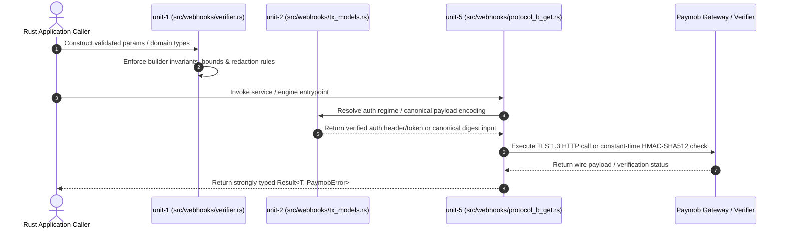

# User Story `US-7.1.0`: Constant-Time HMAC-SHA512 Core Verifier & Transaction Callbacks (Protocol A POST & Protocol B GET)

- **Module**: `module-7` ([Constant-Time Cryptographic Webhook Verification Engine (Protocols A–E & Idempotency Guard)](./README.md))
- **Story Branch**: `feat/us-7.1.0-webhook-verifier-transaction-protocols`
- **Field Profile**: `software` (`engineering,security,testing`)
- **Story Decomposition Score ($S_{\text{story}}$)**: `2.95` $\to$ **`5` Parallel Implementation Units (`unit-1..5`)**

---

## 1. Spec Kit Specifications

### 1.1 User Story Narrative
> **As a** Application Security & Payment Fulfillment Engineer verifying Paymob transaction webhooks,  
> **I want** a fail-closed, constant-time `HMAC-SHA512` verifier (`PaymobWebhookEngine`) for both Transaction Processed POST callbacks (Protocol A) and Transaction Response GET redirects (Protocol B),  
> **So that** forged or tampered payment notifications are rejected in constant time with zero state mutation, and Paymob's 20-key concatenation quirks (`error_occured` spelling, nested `obj.order.id`, and GET `order_id`/`order` query keys) are handled deterministically.

This User Story belongs to **Module 7 (Constant-Time Cryptographic Webhook Verification Engine (Protocols A–E & Idempotency Guard))** of [`some-paymob`](https://github.com/some-of-cs/some-paymob) as specified in [`docs/Paymob Rust SDK Architecture Research.md`](../../Paymob%20Rust%20SDK%20Architecture%20Research.md). It is decomposed into `5` strictly disjoint, 100% parallel Implementation Units (`unit-1..5`) that compile and verify independently inside isolated Git worktrees without inter-unit blocking.

#### 1.1.1 Preconditions
- Feature flag `webhooks` (alias `webhook-engine`, default on) enabled.
- Paymob [HMAC Transaction Callback](https://developers.paymob.com/paymob-docs/developers/webhook-callbacks-and-hmac/hmac/hmac-transaction-callback) and [Transaction Callbacks](https://developers.paymob.com/paymob-docs/developers/transaction-callbacks) specifications loaded.

#### 1.1.2 Postconditions
- `PaymobWebhookEngine::verify_concatenated_str` computes `Hmac<Sha512>` and compares digests in strict constant time (`subtle::ConstantTimeEq`).
- Protocol A (`verify_transaction_post`) extracts the 20 lexicographical keys from `body.obj` (including `error_occured` with one `'r'`) and verifies against `?hmac=` (passing Official Test Vector `192036465`).
- Protocol B (`verify_transaction_get`) extracts the 20 query parameters with `params.get("order_id").or_else(|| params.get("order"))` fallback (passing Official Redirect Test Vector `316004`).

### 1.2 Acceptance Criteria (Gherkin Scenarios)

```gherkin
Feature: US-7.1.0 — Constant-Time HMAC-SHA512 Core Verifier & Transaction Callbacks (Protocol A POST & Protocol B GET)

  Scenario: AC-1 — Protocol A: Transaction Processed POST 20-Key HMAC-SHA512 Verification
    Given Paymob's official Transaction Processed JSON payload (`obj.id = 192036465`, `obj.order.id = 217503754`, `amount_cents = 100000`, `currency = "EGP"`) and `query_hmac = "fa8ac0b7f3852e60c50e7fdd4ea5ef0bda96030c19dea1d55df8c76d6c08ab1877774662cbb04981dc84839ad4da560bcc8cb53b8973548657f7e8f8d2e79930"`
    When `engine.verify_transaction_post(raw_body, query_hmac)` is invoked
    Then the 20 lexicographical fields (`amount_cents` through `success`) are concatenated with lowercase booleans (`"true"`/`"false"`), verified in constant time, and returned as `Ok(TransactionProcessedEvent)`

  Scenario: AC-2 — Protocol B: Transaction Response GET Query Verification with order_id / order Fallback
    Given a client redirect query string emitting either `order_id=217503754` or `order=378804` alongside `?hmac=<digest>`
    When `engine.verify_transaction_get(&query_params)` is called
    Then key #14 resolves via `params.get("order_id").or_else(|| params.get("order"))` and verifies the 64-byte HMAC-SHA512 signature in constant time

  Scenario: AC-3 — Fail-Closed Constant-Time Rejection on Tampered Payload or Malformed Hex
    Given a POST callback where `amount_cents` was tampered from `100000` to `100` or `query_hmac` has invalid hex characters
    When `verify_transaction_post` executes
    Then it returns `Err(WebhookError::SignatureMismatch)` or `Err(WebhookError::MalformedSignatureHex)` in constant time without exposing the expected MAC

  Scenario: AC-4 — Secret Redaction, Zero Float & Cyclomatic Complexity Compliance
    Given all public types and functions implemented across unit-1..5 of US-7.1.0
    When formatted via Debug/Display and analyzed by Gate G2 and Gate G-Complexity
    Then zero raw secrets, API keys, tokens, or PANs appear in Debug output (all emit "[REDACTED]")
    And every monetary value uses integer minor units (u64) with Cyclomatic Complexity CC <= 6 and nesting depth <= 2
```

### 1.3 Test Cases & Traceability Matrix

| Test Case ID | Mapped AC | Owning Unit | Test Level (Unit / Integration / Property / Security) | Description & Input Vector | Expected Result & Pass Threshold |
| :--- | :---: | :---: | :---: | :--- | :--- |
| `TC-7.1.1` | `AC-1` | `unit-1` | Security / Negative | Validate `WebhookError` enum (`MalformedSignatureHex`, `InvalidSecretKeyLength`, `SignatureMismatch`, `MissingQueryHmac`, `MissingBodyHmac`, `MissingRequiredField`, `InvalidJsonPayload`) and `PaymobWebhookEngine::verify_concatenated_str` computing `Hmac<Sha512>` and comparing digests via `subtle::ConstantTimeEq` in `src/webhooks/verifier.rs` (positive, boundary, and malformed inputs) | 100% deterministic assertion pass; $\ge 90\%$ line & $\ge 85\%$ branch coverage |
| `TC-7.1.2` | `AC-2` | `unit-2` | Unit + Doc-Test | Validate `TransactionProcessedEvent`, `TransactionWebhookObj` (all 20 signed fields + `payment_key_claims`, `order`, `is_refunded`, `is_voided`, `is_captured`, `refunded_amount_cents`, `captured_amount`), and `TransactionSourceData` (`pan`, `sub_type`, `type`) in `src/webhooks/tx_models.rs` (positive, boundary, and malformed inputs) | 100% deterministic assertion pass; $\ge 90\%$ line & $\ge 85\%$ branch coverage |
| `TC-7.1.3` | `AC-3` | `unit-3` | Security / Negative | Validate Static `const TX_HMAC_KEYS: [&str; 20]` specification table and pre-sized `CanonicalTransactionConcatenator` (`CC <= 3`) formatting booleans as lowercase `"true"`/`"false"` without intermediate heap allocations in `src/webhooks/canonical_tx.rs` (positive, boundary, and malformed inputs) | 100% deterministic assertion pass; $\ge 90\%$ line & $\ge 85\%$ branch coverage |
| `TC-7.1.4` | `AC-3` | `unit-4` | Security / Negative | Validate Protocol A `verify_transaction_post(raw_body, query_hmac)` extracting the 20 lexicographical fields from `body.obj` (`amount_cents`, `created_at`, `currency`, `error_occured`, `has_parent_transaction`, `obj.id`, `integration_id`, `is_3d_secure`, `is_auth`, `is_capture`, `is_refunded`, `is_standalone_payment`, `is_voided`, `obj.order.id`, `owner`, `pending`, `source_data.pan`, `source_data.sub_type`, `source_data.type`, `success`) and verifying against Official Test Vector `192036465` (`fa8ac0b7...`) in `src/webhooks/protocol_a_post.rs` (positive, boundary, and malformed inputs) | 100% deterministic assertion pass; $\ge 90\%$ line & $\ge 85\%$ branch coverage |
| `TC-7.1.5` | `AC-3` | `unit-5` | Integration / Wire | Validate Protocol B `verify_transaction_get(query_params)` extracting the 20 query parameters with `params.get("order_id").or_else(|| params.get("order"))` fallback and verifying against Official Redirect Test Vector `316004` in `src/webhooks/protocol_b_get.rs` (positive, boundary, and malformed inputs) | 100% deterministic assertion pass; $\ge 90\%$ line & $\ge 85\%$ branch coverage |
| `TC-7.1.6` | `AC-4` | `unit-1..5` | Security / Property | Verify `[REDACTED]` `Debug` output, zero `f32`/`f64` floats, and `CC <= 6` across all units | 0 secret leaks in logs/panics; 0 Clippy warnings; all doctests pass |

---

## 2. Technical Implementation Plan

### 2.1 Domain Invariants & Storage Schema
- **Domain Invariants**:
  - **SHA-512 Only & Constant-Time Comparison**: Always uses `Hmac<Sha512>` (never SHA-256) and `subtle::ConstantTimeEq::ct_eq` on the 64-byte digest.
  - **Exact 20-Key Lexicographical Order**: `amount_cents`, `created_at`, `currency`, `error_occured` *(1 'r')*, `has_parent_transaction`, `obj.id`/`id`, `integration_id`, `is_3d_secure`, `is_auth`, `is_capture`, `is_refunded`, `is_standalone_payment`, `is_voided`, `order.id`/`order_id`*(or `order`)*, `owner`, `pending`, `source_data.pan`, `source_data.sub_type`, `source_data.type`, `success`.
- **Rust Type Definitions & Wire Protocol Schema**:

```rust
#![forbid(unsafe_code)]
use hmac::{Hmac, Mac};
use secrecy::{ExposeSecret, SecretString};
use sha2::Sha512;
use subtle::ConstantTimeEq;

pub const TX_HMAC_KEYS: [&str; 20] = [
    "amount_cents", "created_at", "currency", "error_occured",
    "has_parent_transaction", "id", "integration_id", "is_3d_secure",
    "is_auth", "is_capture", "is_refunded", "is_standalone_payment",
    "is_voided", "order_id", "owner", "pending",
    "source_data.pan", "source_data.sub_type", "source_data.type", "success",
];
```

### 2.2 Sequence Diagram



---

## 3. Expected Folder Architecture at the Project

All `5` Implementation Units in `US-7.1.0` own **100% disjoint files** so they execute concurrently in isolated `.worktrees/` with zero merge conflicts:

```text
some-paymob/
├── Cargo.toml                                  # Seeded on Module/Story base branch
├── src/
│   ├── lib.rs                                  # Seeded on Module base branch
│   ├── src/webhooks/verifier.rs                # Owned exclusively by unit-1 (feat/us-7.1.0/unit-1-webhook-error-and-core)
│   ├── src/webhooks/tx_models.rs               # Owned exclusively by unit-2 (feat/us-7.1.0/unit-2-transaction-webhook-models)
│   ├── src/webhooks/canonical_tx.rs            # Owned exclusively by unit-3 (feat/us-7.1.0/unit-3-canonical-20key-builder)
│   ├── src/webhooks/protocol_a_post.rs         # Owned exclusively by unit-4 (feat/us-7.1.0/unit-4-protocol-a-tx-post)
│   ├── src/webhooks/protocol_b_get.rs          # Owned exclusively by unit-5 (feat/us-7.1.0/unit-5-protocol-b-tx-get)
└── tests/
    └── webhook_verifier_transaction_protocols_integration.rs         # Executed by story-leader after unit-1..5 merge
```

---

## 4. Implementation Units in Detail & Specialist Agent Assignment

### 4.1 Story Decomposition Score ($S_{\text{story}}$) & Dynamic Unit Count ($K$)
- **$D_1$ (35% Functional Surface)**: `3` — 5 cryptographic & protocol components: `PaymobWebhookEngine::verify_concatenated_str`, `TransactionProcessedEvent` models, Protocol A POST 20-key extractor, Protocol B GET 20-key query extractor, and canonical 20-key formatter
- **$D_2$ (25% Artifact Volume)**: `2` — ~600 production LOC across 5 files under `src/webhooks/`
- **$D_3$ (20% Logic Complexity)**: `4` — Branchless `O(1)` `subtle::ConstantTimeEq` 64-byte `HMAC-SHA512` comparison, exact 20-key lexicographical extraction (`amount_cents`..`success`), `error_occured` single-'r' field preservation, lowercase boolean formatting (`"true"`/`"false"`), and GET `order_id` vs `order` fallback
- **$D_4$ (20% Orthogonal Boundaries)**: `3` — 5 independent files under `src/webhooks/` (`verifier.rs`, `tx_models.rs`, `canonical_tx.rs`, `protocol_a_post.rs`, `protocol_b_get.rs`)
- **Calculated Score**: $S_{\text{story}} = 0.35(3) + 0.25(2) + 0.20(4) + 0.20(3) = \mathbf{2.95}$ $\to$ **`5` Parallel Units**

### 4.2 Detailed Unit Specifications (`unit-1..5`)

- **`unit-1` (`feat/us-7.1.0/unit-1-webhook-error-and-core`)**:
  - **Deliverable Scope**: `WebhookError` enum (`MalformedSignatureHex`, `InvalidSecretKeyLength`, `SignatureMismatch`, `MissingQueryHmac`, `MissingBodyHmac`, `MissingRequiredField`, `InvalidJsonPayload`) and `PaymobWebhookEngine::verify_concatenated_str` computing `Hmac<Sha512>` and comparing digests via `subtle::ConstantTimeEq`
  - **Owned Files**: `src/webhooks/verifier.rs`
  - **Public Contract / Exports**: Public types, builders, and methods defined in `src/webhooks/verifier.rs` re-exported via parent `mod.rs`
  - **Unit Verification & Target Complexity**: Colocated `#[cfg(test)] mod tests` + runnable rustdoc examples (`TC-7.1.1`), Max Cyclomatic Complexity $CC \le 6$ (cap $\le 10$, nesting $\le 2$)
- **`unit-2` (`feat/us-7.1.0/unit-2-transaction-webhook-models`)**:
  - **Deliverable Scope**: `TransactionProcessedEvent`, `TransactionWebhookObj` (all 20 signed fields + `payment_key_claims`, `order`, `is_refunded`, `is_voided`, `is_captured`, `refunded_amount_cents`, `captured_amount`), and `TransactionSourceData` (`pan`, `sub_type`, `type`)
  - **Owned Files**: `src/webhooks/tx_models.rs`
  - **Public Contract / Exports**: Public types, builders, and methods defined in `src/webhooks/tx_models.rs` re-exported via parent `mod.rs`
  - **Unit Verification & Target Complexity**: Colocated `#[cfg(test)] mod tests` + runnable rustdoc examples (`TC-7.1.2`), Max Cyclomatic Complexity $CC \le 6$ (cap $\le 10$, nesting $\le 2$)
- **`unit-3` (`feat/us-7.1.0/unit-3-canonical-20key-builder`)**:
  - **Deliverable Scope**: Static `const TX_HMAC_KEYS: [&str; 20]` specification table and pre-sized `CanonicalTransactionConcatenator` (`CC <= 3`) formatting booleans as lowercase `"true"`/`"false"` without intermediate heap allocations
  - **Owned Files**: `src/webhooks/canonical_tx.rs`
  - **Public Contract / Exports**: Public types, builders, and methods defined in `src/webhooks/canonical_tx.rs` re-exported via parent `mod.rs`
  - **Unit Verification & Target Complexity**: Colocated `#[cfg(test)] mod tests` + runnable rustdoc examples (`TC-7.1.3`), Max Cyclomatic Complexity $CC \le 6$ (cap $\le 10$, nesting $\le 2$)
- **`unit-4` (`feat/us-7.1.0/unit-4-protocol-a-tx-post`)**:
  - **Deliverable Scope**: Protocol A `verify_transaction_post(raw_body, query_hmac)` extracting the 20 lexicographical fields from `body.obj` (`amount_cents`, `created_at`, `currency`, `error_occured`, `has_parent_transaction`, `obj.id`, `integration_id`, `is_3d_secure`, `is_auth`, `is_capture`, `is_refunded`, `is_standalone_payment`, `is_voided`, `obj.order.id`, `owner`, `pending`, `source_data.pan`, `source_data.sub_type`, `source_data.type`, `success`) and verifying against Official Test Vector `192036465` (`fa8ac0b7...`)
  - **Owned Files**: `src/webhooks/protocol_a_post.rs`
  - **Public Contract / Exports**: Public types, builders, and methods defined in `src/webhooks/protocol_a_post.rs` re-exported via parent `mod.rs`
  - **Unit Verification & Target Complexity**: Colocated `#[cfg(test)] mod tests` + runnable rustdoc examples (`TC-7.1.4`), Max Cyclomatic Complexity $CC \le 6$ (cap $\le 10$, nesting $\le 2$)
- **`unit-5` (`feat/us-7.1.0/unit-5-protocol-b-tx-get`)**:
  - **Deliverable Scope**: Protocol B `verify_transaction_get(query_params)` extracting the 20 query parameters with `params.get("order_id").or_else(|| params.get("order"))` fallback and verifying against Official Redirect Test Vector `316004`
  - **Owned Files**: `src/webhooks/protocol_b_get.rs`
  - **Public Contract / Exports**: Public types, builders, and methods defined in `src/webhooks/protocol_b_get.rs` re-exported via parent `mod.rs`
  - **Unit Verification & Target Complexity**: Colocated `#[cfg(test)] mod tests` + runnable rustdoc examples (`TC-7.1.5`), Max Cyclomatic Complexity $CC \le 6$ (cap $\le 10$, nesting $\le 2$)

### 4.3 Best-Fit Specialist Agents per Unit (`msitarzewski/agency-catalog` + Core Roster)

| Unit ID | Branch Name | Primary Implementer Agent(s) (`agency-catalog`) | Reviewing Council Agent(s) | Mandatory Skills Enforced |
| :--- | :--- | :--- | :--- | :--- |
| `unit-1` | `feat/us-7.1.0/unit-1-webhook-error-and-core` | `security-engineer` | `code-reviewer`, `security-engineer`, `api-tester` | `code-review-council`, `security-audit`, `cyclomatic-complexity` |
| `unit-2` | `feat/us-7.1.0/unit-2-transaction-webhook-models` | `backend-architect` | `code-reviewer`, `security-engineer`, `api-tester` | `code-review-council`, `security-audit`, `cyclomatic-complexity` |
| `unit-3` | `feat/us-7.1.0/unit-3-canonical-20key-builder` | `security-engineer` | `code-reviewer`, `security-engineer`, `api-tester` | `code-review-council`, `security-audit`, `cyclomatic-complexity` |
| `unit-4` | `feat/us-7.1.0/unit-4-protocol-a-tx-post` | `security-engineer` | `code-reviewer`, `security-engineer`, `api-tester` | `code-review-council`, `security-audit`, `cyclomatic-complexity` |
| `unit-5` | `feat/us-7.1.0/unit-5-protocol-b-tx-get` | `api-tester` | `code-reviewer`, `security-engineer`, `api-tester` | `code-review-council`, `security-audit`, `cyclomatic-complexity` |
| **Story Remediation** | `patch/us-7.1.0-webhook-verifier-transaction-protocols` | `patch-implementer` + `backend-architect` | `code-reviewer-council-president` | Full 6-Gate Re-Verification |

### 4.4 Parallel Execution & Zero-Blocking Contract Seeding Plan
1. **Base Contract Seeding**: Commit `src/webhooks/mod.rs` with `PaymobWebhookEngine` and `WebhookError` base definitions on `feat/us-7.1.0-webhook-verifier-transaction-protocols` before branching `unit-1..5`.
2. **Simultaneous Worktree Spawning**: All `5` units are provisioned in `.worktrees/feat-us-7.1.0-unit-1..5` and spawned simultaneously in Wave 2.
3. **Ordered Cascading Merge Sequence**: `unit-1` $\to$ `unit-2` $\to$ `unit-3` $\to$ `unit-4` $\to$ `unit-5` into `feat/us-7.1.0-webhook-verifier-transaction-protocols` via `gh pr merge <PR> --merge`.

---

## 5. Security Gateway (Powered by `security-audit` Skill)

### 5.1 Trust Boundaries & Security Actors
- **Security Actors**: Merchant backend services (`PaymobClient` callers), customer browsers/mobile apps (redirected via Unified Checkout / Pixel / Legacy Iframe), Paymob Acquiring & Payouts servers, and untrusted external webhook senders.
- **Trust Boundaries**:
  1. **Caller Input Boundary**: Untrusted builder inputs (phone numbers, amounts, frequencies, proof attachments, integration IDs) crossing into SDK request serializers.
  2. **Network Ingress / Deserialization Boundary**: Raw JSON/HTTP responses and incoming webhook payloads crossing into typed Rust domain models.
  3. **Credential & Telemetry Boundary**: Secret keys (`sk_*`), API keys, JWT/OAuth2 bearer tokens, saved card tokens, and HMAC secrets crossing into memory caches, HTTP headers, or diagnostic logs.

### 5.2 Threat Modeling & Abuse Matrix (STRIDE / OWASP ASVS)

| Threat ID | STRIDE Category | ASVS / CWE Ref | Attack Vector / Abuse Scenario | Impact | Required Mitigation & Code/Deliverable Control |
| :--- | :---: | :---: | :--- | :---: | :--- |
| `TM-1` | **S**poofing | ASVS V2 / CWE-287 | Wrong auth scheme (`Bearer` vs `Token`), expired 60-min JWT reuse, or forged webhook signature | Critical | Explicit `AuthStrategy` per endpoint, single-flight JWT/OAuth2 refresh, and constant-time `Hmac<Sha512>` + `subtle::ConstantTimeEq` verification |
| `TM-2` | **T**ampering | ASVS V5 / CWE-20 | Floating-point rounding manipulation, 100x currency unit errors, or tampered webhook query/body fields | Critical | `MinorUnitAmount(u64)` integer minor units (zero `f32`/`f64`), builder-time field validation, and fail-closed 20-key/8-key/body-HMAC verification |
| `TM-3` | **R**epudiation | ASVS V7 / CWE-778 | Duplicate transaction fulfillment on retried webhooks or unlogged state mutations | High | `IdempotentWebhookGuard` extracting `(obj.id, order.id)` and `(paymob_request_id, subscription_data.id)` + correlation logging |
| `TM-4` | **I**nformation Disclosure | ASVS V8 / CWE-200 | Secret key (`sk_*`), `client_secret`, JWT `auth_token`, or PAN/CVV leaked in `Debug` logs or panic traces | Critical | `secrecy::SecretString` + `ZeroizeOnDrop` on all credentials/tokens and custom `[REDACTED]` `Debug` implementations |
| `TM-5` | **D**enial of Service | ASVS V11 / CWE-400 | Thundering-herd token refresh storms on 1-hour JWT expiry or oversized (>2.8 MB) topup proof payloads | High | Lock-free `ArcSwapOption` + single-flight `tokio::sync::Mutex<()>` refresh guard, bounded timeouts, and `MAX_TOPUP_PROOF_BYTES` check |
| `TM-6` | **E**levation of Privilege | ASVS V4 / CWE-285 | Cross-merchant IDOR in Partner Onboarding (`with_merchant`) or mixing Test and Live integration IDs | Critical | Immutable `MerchantScopedClient` per `merchant_id` and strict `EnvironmentMode` (`Test` vs `Live`) parity enforcement |

### 5.3 Cryptography & Global Data Protection Controls (Worldwide Legal & Regulatory Compliance)
1. **Cryptographic Standards**:
   - **In Transit**: TLS 1.3 (`reqwest` with `rustls-tls`) enforced for all Accept Acquiring and Payouts connections.
   - **Signatures & Constant-Time MACs**: `HMAC-SHA512` (`hmac` + `sha2`) verified exclusively via branchless constant-time comparison (`subtle::ConstantTimeEq::ct_eq`); zero `SHA-1`/`MD5` or early-exit byte comparisons.
   - **Memory Hygiene**: All secret keys, API keys, JWTs, OAuth2 refresh tokens, card tokens, and HMAC secrets use `secrecy::SecretString` and `zeroize::ZeroizeOnDrop`.
2. **Global Multi-Jurisdictional Privacy & Financial Compliance**:
   - **PCI-DSS v4.0**: Raw PANs and CVVs are never stored or logged; card tokenization uses `masked_pan` (`xxxx-xxxx-xxxx-2346`) for display and `SecretString` for tokens; frontend checkout helpers accept only `PublicKey` (`pk_*`).
   - **MENA & Regional Central Bank Regulations (CBE Egypt, SAMA Saudi Arabia, CBUAE UAE, CBO Oman, SBP Pakistan)**: Regional host isolation via `PaymobRegion` ensures transaction and disbursement payloads remain routed to the designated sovereign regional gateway.
   - **GDPR / UK GDPR / CCPA / Egypt PDPL (Law No. 151 of 2020) / KSA PDPL**: Strict PII minimization and automatic `[REDACTED]` scrubbing of customer emails, phone numbers (`msisdn`), and bank account numbers in diagnostic traces.

### 5.4 Automated Security Verification Checklist (`security-audit` Skill)
- [ ] Applicable security playbooks reviewed (`WEB-PROTOCOL-AND-AUTH.md`, `MEMORY-SAFETY-AND-BINARY.md`, `SUPPLY-CHAIN-AND-RELEASE.md`).
- [ ] `#![forbid(unsafe_code)]` enforced at the crate root; all untrusted inputs validated for bounds, non-empty prefixes, and encoding prior to network dispatch.
- [ ] Zero secrets, API keys, JWTs, card tokens, or raw PII emitted in `Debug` formatting, logs, or error messages.
- [ ] Zero `f32`/`f64` floating-point types used for monetary amounts or fee calculations.

### 5.5 Security Gateway (Gate G2) Sign-Off Checklist
- [ ] **0 Critical / High / Medium** vulnerabilities in `security-audit` scan.
- [ ] All STRIDE / ASVS threat mitigations (`TM-1..TM-6`) implemented and covered by security/negative tests in Section 1.3 (`TC-7.1.1..6`).
- [ ] Regional host partitioning, PCI-DSS token redaction, and `ZeroizeOnDrop` controls verified.
- [ ] Independent Security Reviewer agent sign-off posted to the GitHub PR conversation.

---

## 6. Validation Gates & Acceptance Sign-Off

Every Unit PR (`feat/us-7.1.0-webhook-verifier-transaction-protocols/unit-1..5`) and the parent Story PR (`feat/us-7.1.0-webhook-verifier-transaction-protocols`) MUST pass all 6 Quality Gates and post the evidence directly to the GitHub PR conversation before `gh pr merge`:

| Gate | Gate Name | Pass Criteria for `US-7.1.0` | Verification Command / Evidence | Status |
| :--- | :--- | :--- | :--- | :---: |
| **Gate G0** | **Build, Lint & Format** | 0 errors, 0 warnings, 100% `rustfmt` & `clippy` compliance | `CARGO_BUILD_JOBS=1 cargo fmt --check && CARGO_BUILD_JOBS=1 cargo clippy --all-targets --all-features -- -D warnings` | `[ ]` |
| **Gate G1** | **Tests, Coverage & Traceability** | 100% of `AC-1..4` and `TC-7.1.1..6` passing ($\ge 90\%$ line, $\ge 85\%$ branch coverage) | `CARGO_BUILD_JOBS=1 cargo test --all-features` | `[ ]` |
| **Gate G2** | **Security Gateway (`security-audit`)** | All Section 5 STRIDE, constant-time crypto, and `[REDACTED]` checks pass (0 findings) | `security-audit` report on PR | `[ ]` |
| **Gate G-Complexity** | **Cyclomatic Complexity** | Every function $CC \le 6$ target ($CC \le 10$ ceiling, $CC > 15$ blocker, nesting $\le 2$) | `cyclomatic-complexity` table on PR | `[ ]` |
| **Gate G-Docs** | **Documentation & Examples** | 100% public symbols documented + runnable doc-tests + this spec synced | `CARGO_BUILD_JOBS=1 cargo test --doc --all-features` | `[ ]` |
| **Gate G-Review** | **Council President Sign-Off** | Independent Reviewing Council posts `GATE G-REVIEW APPROVED` on GitHub PR | `gh pr comment <PR>` | `[ ]` |

### Final Acceptance Sign-Off Block
- **Story Leader Verification**: All `5` units (`unit-1..5`) merged via cascading `gh pr merge`, story integration suite green, and zero unaddressed findings (or remediated via dedicated `patch-implementer` PRs).
- **Reviewing Council Verdict**: `PENDING` $\to$ `GATE G-REVIEW APPROVED`
