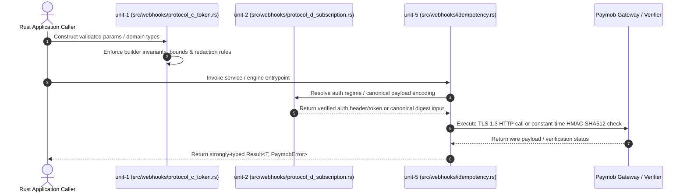

# User Story `US-7.2.0`: Card Token (Protocol C), Subscription (Protocol D), Payouts (Protocol E), Auto-Dispatcher & IdempotentWebhookGuard

- **Module**: `module-7` ([Constant-Time Cryptographic Webhook Verification Engine (Protocols A–E & Idempotency Guard)](./README.md))
- **Story Branch**: `feat/us-7.2.0-webhook-token-subscription-payout-idempotency`
- **Field Profile**: `software` (`engineering,security,testing`)
- **Story Decomposition Score ($S_{\text{story}}$)**: `2.75` $\to$ **`5` Parallel Implementation Units (`unit-1..5`)**

---

## 1. Spec Kit Specifications

### 1.1 User Story Narrative
> **As a** Backend Security Engineer handling saved-card tokens, recurring subscription webhooks, and payout callbacks,  
> **I want** a single `paymob.webhooks().construct_event(raw_body, query_hmac)` entrypoint that auto-detects and verifies Card Token (Protocol C), Subscription (Protocol D), Transaction (Protocol A), and Payouts (Protocol E) webhooks, paired with an `IdempotentWebhookGuard`,  
> **So that** every callback surface is verified in constant time using its exact concatenation rule (`8-key` vs `"{trigger_type}for{id}"` vs `20-key`) and deduplicated atomically on `obj.id` or `paymob_request_id`.

This User Story belongs to **Module 7 (Constant-Time Cryptographic Webhook Verification Engine (Protocols A–E & Idempotency Guard))** of [`some-paymob`](https://github.com/some-of-cs/some-paymob) as specified in [`docs/Paymob Rust SDK Architecture Research.md`](../../Paymob%20Rust%20SDK%20Architecture%20Research.md). It is decomposed into `5` strictly disjoint, 100% parallel Implementation Units (`unit-1..5`) that compile and verify independently inside isolated Git worktrees without inter-unit blocking.

#### 1.1.1 Preconditions
- `US-7.1.0` `PaymobWebhookEngine` and `WebhookError` available in `src/webhooks/`.
- Paymob [HMAC Card Token Callback](https://developers.paymob.com/paymob-docs/developers/webhook-callbacks-and-hmac/hmac/hmac-for-card-tokens), [Subscription Callback and HMAC Calculation](https://developers.paymob.com/paymob-docs/developers/subscription/hmac-calculation-for-subscription-callback), and [Payout Callbacks](https://developers.paymob.com/paymob-docs/developers/payouts-apis/payout-callbacks) specifications loaded.

#### 1.1.2 Postconditions
- Protocol C (`verify_card_token`) verifies the 8 lexicographical keys of `{"type": "TOKEN", "obj": {...}}` against `?hmac=` (passing Official Test Vector `15978654` -> `4c0480c8...`).
- Protocol D (`verify_subscription`) verifies `"{trigger_type}for{subscription_data.id}"` against `body.hmac` across all 12 `SubscriptionTriggerType` variants (passing Official Test Vector `"suspendedfor1264"` -> `dd5b3018...`).
- Protocol E deserializes `DisbursementCallback` and `TopupCallback` with optional Payouts HMAC verification, and `IdempotentWebhookGuard` extracts `(idempotency_key, correlation_id)`.

### 1.2 Acceptance Criteria (Gherkin Scenarios)

```gherkin
Feature: US-7.2.0 — Card Token (Protocol C), Subscription (Protocol D), Payouts (Protocol E), Auto-Dispatcher & IdempotentWebhookGuard

  Scenario: AC-1 — Protocol C: Card Token 8-Key HMAC-SHA512 Verification
    Given Paymob's official Card Token callback (`id: 15978654`, `masked_pan: "xxxx-xxxx-xxxx-2346"`, `order_id: "593881581"`) and digest `4c0480c8c5afdba5294dee8ec01e5aa0203c5df0a8b3a45eadf11f2b01c974725d205587dabba70709f3ac2d0c7d7ec93fe69ec462b5a3018190bfd681ebf1d3`
    When `engine.construct_event(raw_body, Some(query_hmac))` is called
    Then it auto-detects `type == "TOKEN"`, concatenates the 8 keys (`card_subtype`, `created_at`, `email`, `id`, `masked_pan`, `merchant_id`, `order_id`, `token`), verifies in constant time, and returns `Ok(WebhookEvent::CardTokenSaved(evt))`

  Scenario: AC-2 — Protocol D: Subscription Callback Body-HMAC Verification & 12 Trigger Types
    Given a Subscription callback JSON with `trigger_type: "suspended"`, `subscription_data.id: 1264`, and `body.hmac: "dd5b3018888d9f98574cd180793db10d969b522e08c62baf2ea33357d1546b567b7fd79760e90046e90eaacf30024ede5539cbd0748bd9e6c005faf5117e0e7b"`
    When `engine.construct_event(raw_body, None)` is called
    Then it forms `"suspendedfor1264"`, verifies `body.hmac` in constant time without requiring `query_hmac`, and parses all 12 `SubscriptionTriggerType` variants (including `"add_secondry_card"`)

  Scenario: AC-3 — Atomic Database Idempotency Extraction (IdempotentWebhookGuard)
    Given any verified `WebhookEvent` (Transaction or Subscription)
    When `event.idempotency_tuple()` is called
    Then it returns `(obj.id.to_string(), obj.order.id.to_string())` for transactions and `(paymob_request_id, subscription_data.id.to_string())` for subscriptions

  Scenario: AC-4 — Secret Redaction, Zero Float & Cyclomatic Complexity Compliance
    Given all public types and functions implemented across unit-1..5 of US-7.2.0
    When formatted via Debug/Display and analyzed by Gate G2 and Gate G-Complexity
    Then zero raw secrets, API keys, tokens, or PANs appear in Debug output (all emit "[REDACTED]")
    And every monetary value uses integer minor units (u64) with Cyclomatic Complexity CC <= 6 and nesting depth <= 2
```

### 1.3 Test Cases & Traceability Matrix

| Test Case ID | Mapped AC | Owning Unit | Test Level (Unit / Integration / Property / Security) | Description & Input Vector | Expected Result & Pass Threshold |
| :--- | :---: | :---: | :---: | :--- | :--- |
| `TC-7.2.1` | `AC-1` | `unit-1` | Security / Negative | Validate Protocol C `CardTokenWebhookEvent` (`type: "TOKEN"`, `obj`) and 8-key lexicographical concatenator (`card_subtype`, `created_at`, `email`, `id`, `masked_pan`, `merchant_id`, `order_id`, `token`), verified against Official Test Vector `15978654` (`4c0480c8c5afdba5...`) in `src/webhooks/protocol_c_token.rs` (positive, boundary, and malformed inputs) | 100% deterministic assertion pass; $\ge 90\%$ line & $\ge 85\%$ branch coverage |
| `TC-7.2.2` | `AC-2` | `unit-2` | Security / Negative | Validate Protocol D `SubscriptionWebhookEvent`, 12-variant `SubscriptionTriggerType` enum backed by `const KNOWN_SUBSCRIPTION_TRIGGERS: &[(&str, SubscriptionTriggerType)]` (`CC <= 3`, preserving exact wire strings `"Subscription Created"`, `"add_secondry_card"`, `"Failed Overdue Transaction"`, etc.), and `"{trigger_type}for{subscription_data.id}"` body-`hmac` verifier tested against Official Test Vector `"suspendedfor1264"` (`dd5b3018888d9f98...`) in `src/webhooks/protocol_d_subscription.rs` (positive, boundary, and malformed inputs) | 100% deterministic assertion pass; $\ge 90\%$ line & $\ge 85\%$ branch coverage |
| `TC-7.2.3` | `AC-3` | `unit-3` | Unit + Doc-Test | Validate Protocol E `DisbursementCallback` (`bank_card`, `bank_wallet`, `instant_bank`) and `TopupCallback` (`Approved` | `Rejected`) models plus configurable Payouts account-wide HMAC verifier hook in `src/webhooks/protocol_e_payouts.rs` (positive, boundary, and malformed inputs) | 100% deterministic assertion pass; $\ge 90\%$ line & $\ge 85\%$ branch coverage |
| `TC-7.2.4` | `AC-3` | `unit-4` | Security / Negative | Validate `WebhookEvent` enum (`TransactionProcessed`, `TransactionResponseRedirect`, `CardTokenSaved`, `SubscriptionLifecycle`, `PayoutDisbursement`, `PayoutTopup`) and `PaymobWebhookEngine::construct_event(raw_body, query_hmac)` fail-closed auto-dispatcher in `src/webhooks/dispatcher.rs` (positive, boundary, and malformed inputs) | 100% deterministic assertion pass; $\ge 90\%$ line & $\ge 85\%$ branch coverage |
| `TC-7.2.5` | `AC-3` | `unit-5` | Integration / Wire | Validate `IdempotentWebhookGuard` trait extracting `(idempotency_key, order_correlation_id)` (`(obj.id.to_string(), obj.order.id.to_string())` for transactions and `(paymob_request_id, subscription_data.id.to_string())` for subscriptions) plus thread-safe `InMemoryWebhookDeduplicator` in `src/webhooks/idempotency.rs` (positive, boundary, and malformed inputs) | 100% deterministic assertion pass; $\ge 90\%$ line & $\ge 85\%$ branch coverage |
| `TC-7.2.6` | `AC-4` | `unit-1..5` | Security / Property | Verify `[REDACTED]` `Debug` output, zero `f32`/`f64` floats, and `CC <= 6` across all units | 0 secret leaks in logs/panics; 0 Clippy warnings; all doctests pass |

---

## 2. Technical Implementation Plan

### 2.1 Domain Invariants & Storage Schema
- **Domain Invariants**:
  - **Static Lookup Slice for 12 Subscription Trigger Types**: `SubscriptionTriggerType` maps all 12 wire strings (including Paymob's exact spelling `"add_secondry_card"`) via `const KNOWN_SUBSCRIPTION_TRIGGERS: &[(&str, SubscriptionTriggerType)]` so `CC <= 3`.
  - **Verify-Before-Trust**: `construct_event` never returns a domain event struct unless the HMAC-SHA512 check succeeds in constant time.
- **Rust Type Definitions & Wire Protocol Schema**:

```rust
#![forbid(unsafe_code)]
use serde::{Deserialize, Serialize};

#[derive(Debug, Clone, PartialEq, Eq, Serialize, Deserialize)]
pub enum SubscriptionTriggerType {
    Created,                   // "Subscription Created"
    Suspended,                 // "suspended"
    Canceled,                  // "canceled"
    Resumed,                   // "resumed"
    Updated,                   // "updated"
    SecondaryCardAdded,        // "add_secondry_card"
    PrimaryCardChanged,        // "change_primary_card"
    SecondaryCardDeleted,      // "delete_card"
    WebhookRegistered,         // "register_webhook"
    SuccessfulTransaction,     // "Successful Transaction"
    FailedTransaction,         // "Failed Transaction"
    FailedOverdueTransaction,  // "Failed Overdue Transaction"
    Unknown(String),
}

pub trait IdempotentWebhookGuard {
    fn idempotency_tuple(&self) -> (String, String);
}
```

### 2.2 Sequence Diagram



---

## 3. Expected Folder Architecture at the Project

All `5` Implementation Units in `US-7.2.0` own **100% disjoint files** so they execute concurrently in isolated `.worktrees/` with zero merge conflicts:

```text
some-paymob/
├── Cargo.toml                                  # Seeded on Module/Story base branch
├── src/
│   ├── lib.rs                                  # Seeded on Module base branch
│   ├── src/webhooks/protocol_c_token.rs        # Owned exclusively by unit-1 (feat/us-7.2.0/unit-1-protocol-c-card-token)
│   ├── src/webhooks/protocol_d_subscription.rs # Owned exclusively by unit-2 (feat/us-7.2.0/unit-2-protocol-d-subscription)
│   ├── src/webhooks/protocol_e_payouts.rs      # Owned exclusively by unit-3 (feat/us-7.2.0/unit-3-protocol-e-payouts)
│   ├── src/webhooks/dispatcher.rs              # Owned exclusively by unit-4 (feat/us-7.2.0/unit-4-webhook-event-dispatcher)
│   ├── src/webhooks/idempotency.rs             # Owned exclusively by unit-5 (feat/us-7.2.0/unit-5-idempotent-webhook-guard)
└── tests/
    └── webhook_token_subscription_payout_idempotency_integration.rs         # Executed by story-leader after unit-1..5 merge
```

---

## 4. Implementation Units in Detail & Specialist Agent Assignment

### 4.1 Story Decomposition Score ($S_{\text{story}}$) & Dynamic Unit Count ($K$)
- **$D_1$ (35% Functional Surface)**: `3` — 5 webhook components: Protocol C 8-key Card Token verifier, Protocol D `{trigger_type}for{id}` Subscription verifier + 12 `SubscriptionTriggerType` variants, Protocol E Payouts callbacks, `construct_event` auto-router, and `IdempotentWebhookGuard`
- **$D_2$ (25% Artifact Volume)**: `2` — ~610 production LOC across 5 files under `src/webhooks/`
- **$D_3$ (20% Logic Complexity)**: `3` — Auto-detection of callback protocol shape prior to deserializing untrusted payloads, body-embedded `hmac` verification for Subscriptions, static 12-variant `SubscriptionTriggerType` lookup table (`CC <= 3`, preserving `"add_secondry_card"`), and atomic `(idempotency_key, correlation_id)` extraction
- **$D_4$ (20% Orthogonal Boundaries)**: `3` — 5 independent files under `src/webhooks/` (`protocol_c_token.rs`, `protocol_d_subscription.rs`, `protocol_e_payouts.rs`, `dispatcher.rs`, `idempotency.rs`)
- **Calculated Score**: $S_{\text{story}} = 0.35(3) + 0.25(2) + 0.20(3) + 0.20(3) = \mathbf{2.75}$ $\to$ **`5` Parallel Units**

### 4.2 Detailed Unit Specifications (`unit-1..5`)

- **`unit-1` (`feat/us-7.2.0/unit-1-protocol-c-card-token`)**:
  - **Deliverable Scope**: Protocol C `CardTokenWebhookEvent` (`type: "TOKEN"`, `obj`) and 8-key lexicographical concatenator (`card_subtype`, `created_at`, `email`, `id`, `masked_pan`, `merchant_id`, `order_id`, `token`), verified against Official Test Vector `15978654` (`4c0480c8c5afdba5...`)
  - **Owned Files**: `src/webhooks/protocol_c_token.rs`
  - **Public Contract / Exports**: Public types, builders, and methods defined in `src/webhooks/protocol_c_token.rs` re-exported via parent `mod.rs`
  - **Unit Verification & Target Complexity**: Colocated `#[cfg(test)] mod tests` + runnable rustdoc examples (`TC-7.2.1`), Max Cyclomatic Complexity $CC \le 6$ (cap $\le 10$, nesting $\le 2$)
- **`unit-2` (`feat/us-7.2.0/unit-2-protocol-d-subscription`)**:
  - **Deliverable Scope**: Protocol D `SubscriptionWebhookEvent`, 12-variant `SubscriptionTriggerType` enum backed by `const KNOWN_SUBSCRIPTION_TRIGGERS: &[(&str, SubscriptionTriggerType)]` (`CC <= 3`, preserving exact wire strings `"Subscription Created"`, `"add_secondry_card"`, `"Failed Overdue Transaction"`, etc.), and `"{trigger_type}for{subscription_data.id}"` body-`hmac` verifier tested against Official Test Vector `"suspendedfor1264"` (`dd5b3018888d9f98...`)
  - **Owned Files**: `src/webhooks/protocol_d_subscription.rs`
  - **Public Contract / Exports**: Public types, builders, and methods defined in `src/webhooks/protocol_d_subscription.rs` re-exported via parent `mod.rs`
  - **Unit Verification & Target Complexity**: Colocated `#[cfg(test)] mod tests` + runnable rustdoc examples (`TC-7.2.2`), Max Cyclomatic Complexity $CC \le 6$ (cap $\le 10$, nesting $\le 2$)
- **`unit-3` (`feat/us-7.2.0/unit-3-protocol-e-payouts`)**:
  - **Deliverable Scope**: Protocol E `DisbursementCallback` (`bank_card`, `bank_wallet`, `instant_bank`) and `TopupCallback` (`Approved` | `Rejected`) models plus configurable Payouts account-wide HMAC verifier hook
  - **Owned Files**: `src/webhooks/protocol_e_payouts.rs`
  - **Public Contract / Exports**: Public types, builders, and methods defined in `src/webhooks/protocol_e_payouts.rs` re-exported via parent `mod.rs`
  - **Unit Verification & Target Complexity**: Colocated `#[cfg(test)] mod tests` + runnable rustdoc examples (`TC-7.2.3`), Max Cyclomatic Complexity $CC \le 6$ (cap $\le 10$, nesting $\le 2$)
- **`unit-4` (`feat/us-7.2.0/unit-4-webhook-event-dispatcher`)**:
  - **Deliverable Scope**: `WebhookEvent` enum (`TransactionProcessed`, `TransactionResponseRedirect`, `CardTokenSaved`, `SubscriptionLifecycle`, `PayoutDisbursement`, `PayoutTopup`) and `PaymobWebhookEngine::construct_event(raw_body, query_hmac)` fail-closed auto-dispatcher
  - **Owned Files**: `src/webhooks/dispatcher.rs`
  - **Public Contract / Exports**: Public types, builders, and methods defined in `src/webhooks/dispatcher.rs` re-exported via parent `mod.rs`
  - **Unit Verification & Target Complexity**: Colocated `#[cfg(test)] mod tests` + runnable rustdoc examples (`TC-7.2.4`), Max Cyclomatic Complexity $CC \le 6$ (cap $\le 10$, nesting $\le 2$)
- **`unit-5` (`feat/us-7.2.0/unit-5-idempotent-webhook-guard`)**:
  - **Deliverable Scope**: `IdempotentWebhookGuard` trait extracting `(idempotency_key, order_correlation_id)` (`(obj.id.to_string(), obj.order.id.to_string())` for transactions and `(paymob_request_id, subscription_data.id.to_string())` for subscriptions) plus thread-safe `InMemoryWebhookDeduplicator`
  - **Owned Files**: `src/webhooks/idempotency.rs`
  - **Public Contract / Exports**: Public types, builders, and methods defined in `src/webhooks/idempotency.rs` re-exported via parent `mod.rs`
  - **Unit Verification & Target Complexity**: Colocated `#[cfg(test)] mod tests` + runnable rustdoc examples (`TC-7.2.5`), Max Cyclomatic Complexity $CC \le 6$ (cap $\le 10$, nesting $\le 2$)

### 4.3 Best-Fit Specialist Agents per Unit (`msitarzewski/agency-catalog` + Core Roster)

| Unit ID | Branch Name | Primary Implementer Agent(s) (`agency-catalog`) | Reviewing Council Agent(s) | Mandatory Skills Enforced |
| :--- | :--- | :--- | :--- | :--- |
| `unit-1` | `feat/us-7.2.0/unit-1-protocol-c-card-token` | `security-engineer` | `code-reviewer`, `security-engineer`, `api-tester` | `code-review-council`, `security-audit`, `cyclomatic-complexity` |
| `unit-2` | `feat/us-7.2.0/unit-2-protocol-d-subscription` | `security-engineer` | `code-reviewer`, `security-engineer`, `api-tester` | `code-review-council`, `security-audit`, `cyclomatic-complexity` |
| `unit-3` | `feat/us-7.2.0/unit-3-protocol-e-payouts` | `backend-architect` | `code-reviewer`, `security-engineer`, `api-tester` | `code-review-council`, `security-audit`, `cyclomatic-complexity` |
| `unit-4` | `feat/us-7.2.0/unit-4-webhook-event-dispatcher` | `security-engineer` | `code-reviewer`, `security-engineer`, `api-tester` | `code-review-council`, `security-audit`, `cyclomatic-complexity` |
| `unit-5` | `feat/us-7.2.0/unit-5-idempotent-webhook-guard` | `api-tester` | `code-reviewer`, `security-engineer`, `api-tester` | `code-review-council`, `security-audit`, `cyclomatic-complexity` |
| **Story Remediation** | `patch/us-7.2.0-webhook-token-subscription-payout-idempotency` | `patch-implementer` + `backend-architect` | `code-reviewer-council-president` | Full 6-Gate Re-Verification |

### 4.4 Parallel Execution & Zero-Blocking Contract Seeding Plan
1. **Base Contract Seeding**: Commit `WebhookEvent`, `SubscriptionTriggerType`, and `IdempotentWebhookGuard` trait declarations in `src/webhooks/mod.rs` on `feat/us-7.2.0-webhook-token-subscription-payout-idempotency` before branching `unit-1..5`.
2. **Simultaneous Worktree Spawning**: All `5` units are provisioned in `.worktrees/feat-us-7.2.0-unit-1..5` and spawned simultaneously in Wave 2.
3. **Ordered Cascading Merge Sequence**: `unit-1` $\to$ `unit-2` $\to$ `unit-3` $\to$ `unit-4` $\to$ `unit-5` into `feat/us-7.2.0-webhook-token-subscription-payout-idempotency` via `gh pr merge <PR> --merge`.

---

## 5. Security Gateway (Powered by `security-audit` Skill)

### 5.1 Trust Boundaries & Security Actors
- **Security Actors**: Merchant backend services (`PaymobClient` callers), customer browsers/mobile apps (redirected via Unified Checkout / Pixel / Legacy Iframe), Paymob Acquiring & Payouts servers, and untrusted external webhook senders.
- **Trust Boundaries**:
  1. **Caller Input Boundary**: Untrusted builder inputs (phone numbers, amounts, frequencies, proof attachments, integration IDs) crossing into SDK request serializers.
  2. **Network Ingress / Deserialization Boundary**: Raw JSON/HTTP responses and incoming webhook payloads crossing into typed Rust domain models.
  3. **Credential & Telemetry Boundary**: Secret keys (`sk_*`), API keys, JWT/OAuth2 bearer tokens, saved card tokens, and HMAC secrets crossing into memory caches, HTTP headers, or diagnostic logs.

### 5.2 Threat Modeling & Abuse Matrix (STRIDE / OWASP ASVS)

| Threat ID | STRIDE Category | ASVS / CWE Ref | Attack Vector / Abuse Scenario | Impact | Required Mitigation & Code/Deliverable Control |
| :--- | :---: | :---: | :--- | :---: | :--- |
| `TM-1` | **S**poofing | ASVS V2 / CWE-287 | Wrong auth scheme (`Bearer` vs `Token`), expired 60-min JWT reuse, or forged webhook signature | Critical | Explicit `AuthStrategy` per endpoint, single-flight JWT/OAuth2 refresh, and constant-time `Hmac<Sha512>` + `subtle::ConstantTimeEq` verification |
| `TM-2` | **T**ampering | ASVS V5 / CWE-20 | Floating-point rounding manipulation, 100x currency unit errors, or tampered webhook query/body fields | Critical | `MinorUnitAmount(u64)` integer minor units (zero `f32`/`f64`), builder-time field validation, and fail-closed 20-key/8-key/body-HMAC verification |
| `TM-3` | **R**epudiation | ASVS V7 / CWE-778 | Duplicate transaction fulfillment on retried webhooks or unlogged state mutations | High | `IdempotentWebhookGuard` extracting `(obj.id, order.id)` and `(paymob_request_id, subscription_data.id)` + correlation logging |
| `TM-4` | **I**nformation Disclosure | ASVS V8 / CWE-200 | Secret key (`sk_*`), `client_secret`, JWT `auth_token`, or PAN/CVV leaked in `Debug` logs or panic traces | Critical | `secrecy::SecretString` + `ZeroizeOnDrop` on all credentials/tokens and custom `[REDACTED]` `Debug` implementations |
| `TM-5` | **D**enial of Service | ASVS V11 / CWE-400 | Thundering-herd token refresh storms on 1-hour JWT expiry or oversized (>2.8 MB) topup proof payloads | High | Lock-free `ArcSwapOption` + single-flight `tokio::sync::Mutex<()>` refresh guard, bounded timeouts, and `MAX_TOPUP_PROOF_BYTES` check |
| `TM-6` | **E**levation of Privilege | ASVS V4 / CWE-285 | Cross-merchant IDOR in Partner Onboarding (`with_merchant`) or mixing Test and Live integration IDs | Critical | Immutable `MerchantScopedClient` per `merchant_id` and strict `EnvironmentMode` (`Test` vs `Live`) parity enforcement |

### 5.3 Cryptography & Global Data Protection Controls (Worldwide Legal & Regulatory Compliance)
1. **Cryptographic Standards**:
   - **In Transit**: TLS 1.3 (`reqwest` with `rustls-tls`) enforced for all Accept Acquiring and Payouts connections.
   - **Signatures & Constant-Time MACs**: `HMAC-SHA512` (`hmac` + `sha2`) verified exclusively via branchless constant-time comparison (`subtle::ConstantTimeEq::ct_eq`); zero `SHA-1`/`MD5` or early-exit byte comparisons.
   - **Memory Hygiene**: All secret keys, API keys, JWTs, OAuth2 refresh tokens, card tokens, and HMAC secrets use `secrecy::SecretString` and `zeroize::ZeroizeOnDrop`.
2. **Global Multi-Jurisdictional Privacy & Financial Compliance**:
   - **PCI-DSS v4.0**: Raw PANs and CVVs are never stored or logged; card tokenization uses `masked_pan` (`xxxx-xxxx-xxxx-2346`) for display and `SecretString` for tokens; frontend checkout helpers accept only `PublicKey` (`pk_*`).
   - **MENA & Regional Central Bank Regulations (CBE Egypt, SAMA Saudi Arabia, CBUAE UAE, CBO Oman, SBP Pakistan)**: Regional host isolation via `PaymobRegion` ensures transaction and disbursement payloads remain routed to the designated sovereign regional gateway.
   - **GDPR / UK GDPR / CCPA / Egypt PDPL (Law No. 151 of 2020) / KSA PDPL**: Strict PII minimization and automatic `[REDACTED]` scrubbing of customer emails, phone numbers (`msisdn`), and bank account numbers in diagnostic traces.

### 5.4 Automated Security Verification Checklist (`security-audit` Skill)
- [ ] Applicable security playbooks reviewed (`WEB-PROTOCOL-AND-AUTH.md`, `MEMORY-SAFETY-AND-BINARY.md`, `SUPPLY-CHAIN-AND-RELEASE.md`).
- [ ] `#![forbid(unsafe_code)]` enforced at the crate root; all untrusted inputs validated for bounds, non-empty prefixes, and encoding prior to network dispatch.
- [ ] Zero secrets, API keys, JWTs, card tokens, or raw PII emitted in `Debug` formatting, logs, or error messages.
- [ ] Zero `f32`/`f64` floating-point types used for monetary amounts or fee calculations.

### 5.5 Security Gateway (Gate G2) Sign-Off Checklist
- [ ] **0 Critical / High / Medium** vulnerabilities in `security-audit` scan.
- [ ] All STRIDE / ASVS threat mitigations (`TM-1..TM-6`) implemented and covered by security/negative tests in Section 1.3 (`TC-7.2.1..6`).
- [ ] Regional host partitioning, PCI-DSS token redaction, and `ZeroizeOnDrop` controls verified.
- [ ] Independent Security Reviewer agent sign-off posted to the GitHub PR conversation.

---

## 6. Validation Gates & Acceptance Sign-Off

Every Unit PR (`feat/us-7.2.0-webhook-token-subscription-payout-idempotency/unit-1..5`) and the parent Story PR (`feat/us-7.2.0-webhook-token-subscription-payout-idempotency`) MUST pass all 6 Quality Gates and post the evidence directly to the GitHub PR conversation before `gh pr merge`:

| Gate | Gate Name | Pass Criteria for `US-7.2.0` | Verification Command / Evidence | Status |
| :--- | :--- | :--- | :--- | :---: |
| **Gate G0** | **Build, Lint & Format** | 0 errors, 0 warnings, 100% `rustfmt` & `clippy` compliance | `CARGO_BUILD_JOBS=1 cargo fmt --check && CARGO_BUILD_JOBS=1 cargo clippy --all-targets --all-features -- -D warnings` | `[ ]` |
| **Gate G1** | **Tests, Coverage & Traceability** | 100% of `AC-1..4` and `TC-7.2.1..6` passing ($\ge 90\%$ line, $\ge 85\%$ branch coverage) | `CARGO_BUILD_JOBS=1 cargo test --all-features` | `[ ]` |
| **Gate G2** | **Security Gateway (`security-audit`)** | All Section 5 STRIDE, constant-time crypto, and `[REDACTED]` checks pass (0 findings) | `security-audit` report on PR | `[ ]` |
| **Gate G-Complexity** | **Cyclomatic Complexity** | Every function $CC \le 6$ target ($CC \le 10$ ceiling, $CC > 15$ blocker, nesting $\le 2$) | `cyclomatic-complexity` table on PR | `[ ]` |
| **Gate G-Docs** | **Documentation & Examples** | 100% public symbols documented + runnable doc-tests + this spec synced | `CARGO_BUILD_JOBS=1 cargo test --doc --all-features` | `[ ]` |
| **Gate G-Review** | **Council President Sign-Off** | Independent Reviewing Council posts `GATE G-REVIEW APPROVED` on GitHub PR | `gh pr comment <PR>` | `[ ]` |

### Final Acceptance Sign-Off Block
- **Story Leader Verification**: All `5` units (`unit-1..5`) merged via cascading `gh pr merge`, story integration suite green, and zero unaddressed findings (or remediated via dedicated `patch-implementer` PRs).
- **Reviewing Council Verdict**: `PENDING` $\to$ `GATE G-REVIEW APPROVED`
