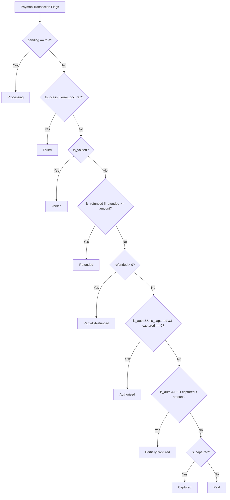

# User Story `US-9.1.0`: Paymob Pre-Integration Hardening (`PaymobRegion`, Dual-Auth Single-Flight Manager, Integration Routing, `transaction_id` & Status Synthesizer)

- **Module**: `module-9-some-payment-alignment` (`some-payment` Orchestrator Alignment & Optional Adapter)
- **Story Branch**: `feat/us-9.1.0-paymob-region-dual-auth-and-status-synthesizer`
- **Field Profile**: `software`
- **Story Decomposition Score ($S_{\text{story}}$)**: `2.85` $\to$ **`5` Parallel Implementation Units (`unit-1..5`)**

---

## 1. Spec Kit Specifications

### 1.1 User Story Narrative
> **As a** `some-payment` integrator routing Egypt/KSA/UAE/Oman/Pakistan payments through `some-paymob`,  
> **I want** `PaymobRegion` host routing, a single-flight dual-auth manager (`Token <sk>` + 60-min `auth_token`), fail-closed `auth_integration_id` routing, conditional Intention pre-flight checks, `transaction_id` + full-refund resolution, and deterministic boolean-flag status synthesis,  
> **So that** Paymob's dual auth schemes, numeric `transaction_id` requirements, and multi-flag transaction objects normalize reliably into `some-payment`.

Implements all P0 and P1 core alignment requirements for `some-paymob` from `some-payment/docs/sdk-implementation.md`.

#### 1.1.1 Preconditions
- `some-paymob` Modules 1–8 are merged on `main`.

#### 1.1.2 Postconditions
- `PaymobRegion` supports Egypt (`https://accept.paymob.com` + `eg.checkout.paymob.com` override), KSA, UAE, Oman, Pakistan, and Custom hosts.
- `AuthTokenManager` refreshes 60-min `auth_token` proactively at 50m with single-flight lock and retries once on HTTP 401.
- `CaptureMode::Manual` without `auth_integration_id` fails closed with `ConfigurationError`.
- Full refund (`amount: None`) resolves `amount_cents - refunded_amount_cents` via `GET /api/acceptance/transactions/{id}`.
- Boolean-flag status synthesizer evaluates the exact 9-step precedence order and distinguishes child flags (`is_void`, `is_refund`, `is_capture`) from parent-state flags (`is_voided`, `is_refunded`, `is_captured`).

### 1.2 Acceptance Criteria (Gherkin Scenarios)
```gherkin
Feature: some-paymob Pre-Integration Core Hardening

  Scenario: AC-1 — PaymobRegion routing and Unified Checkout / Pixel builders
    Given PaymobRegion::Egypt, Ksa, Uae, Oman, Pakistan, or Custom with optional checkout_base_url
    When Unified Checkout URL is built from public_key and client_secret
    Then it targets the exact regional host (or checkout_base_url override) with zero hardcoded Egypt-only URLs

  Scenario: AC-2 — Concurrency-safe single-flight dual-auth manager
    Given 20 concurrent inquiry requests when the cached 60-min auth_token passes 50 minutes
    When AuthTokenManager refreshes via POST /api/auth/tokens
    Then exactly 1 refresh request is dispatched and HTTP 401 triggers 1 automatic retry

  Scenario: AC-3 — Fail-closed Manual capture routing and conditional Intention validation
    Given capture_mode == Manual without auth_integration_id, or billing_data without phone_number, or items missing name/amount
    When validated pre-flight
    Then it fails closed locally with ConfigurationError / ValidationError and 0 HTTP calls

  Scenario: AC-4 — Correlate numeric transaction_id, resolve full refund amount, and synthesize canonical status
    Given a Paymob transaction object with pending, success, error_occured, is_voided, is_refunded, refunded_amount_cents, is_auth, is_captured, captured_amount
    When status_synthesizer and full-refund resolver run
    Then canonical PaymentStatus matches the exact 9-step precedence and full refund sends amount_cents - refunded_amount_cents
```

### 1.3 Test Cases & Traceability Matrix

| Test Case ID | Mapped AC | Owning Unit | Test Level | Description & Input Vector | Expected Result & Pass Threshold |
| :--- | :---: | :---: | :---: | :--- | :--- |
| `TC-9.1.1` | `AC-1` | `unit-1` | Unit | `PaymobRegion` URLs (EG/KSA/UAE/OM/PK/Custom) + `checkout_base_url` override | Exact regional endpoints & Unified Checkout URL |
| `TC-9.1.2` | `AC-2` | `unit-2` | Concurrency | 20 concurrent tasks hitting expired token + single HTTP 401 retry | Exactly 1 `POST /api/auth/tokens` call via single-flight lock |
| `TC-9.1.3` | `AC-3` | `unit-3` | Boundary | Manual without `auth_integration_id`; `items` missing name/amount; `billing_data` missing `phone_number`; `special_reference` = `order_id` | Fails closed pre-flight; `special_reference` mapped |
| `TC-9.1.4` | `AC-4` | `unit-4` | Integration | `transaction_inquiry` fallback resolution + `amount_cents - refunded_amount_cents` full refund lookup | Numeric `transaction_id` and exact remaining refund resolved |
| `TC-9.1.5` | `AC-4` | `unit-5` | Unit | All 9 boolean-flag precedence branches + `error_occured` spelling + parent vs child flags | Deterministic `PaymentStatus` & `parent_transaction` correlation |

---

## 2. Technical Implementation Plan

### 2.1 Domain Invariants & Storage Schema
- **Dual Auth Split**: `Authorization: Token <sk>` for Intention/Void/Refund; cached 60-min `auth_token` for Inquiry/Capture/Card-Token-Inquiry.
- **Exact Spelling**: Deserialize Paymob's single-`r` `error_occured` field.

### 2.2 Activity Diagram


---

## 3. Expected Folder Architecture at the Project

```text
src/alignment/
├── mod.rs                      # Seeded on Module 9 base branch
├── region_checkout.rs          # Owned exclusively by unit-1
├── dual_auth.rs                # Owned exclusively by unit-2
├── integration_validation.rs   # Owned exclusively by unit-3
├── tx_correlation.rs           # Owned exclusively by unit-4
└── status_synthesizer.rs       # Owned exclusively by unit-5
```

---

## 4. Implementation Units in Detail & Specialist Agent Assignment

### 4.1 Story Decomposition Score ($S_{\text{story}}$) & Dynamic Unit Count ($K$)
- **$D_1$ (35% Surface)**: `3` — 5 P0/P1 subsystems (`PaymobRegion` + Unified Intention/Checkout, dual-auth single-flight token manager, `auth_integration_id` & conditional validation, `transaction_id` & full-refund lookup, boolean-flag status synthesizer)
- **$D_2$ (25% Volume)**: `3` — ~750–950 production LOC + unit tests
- **$D_3$ (20% Complexity)**: `3` — Single-flight 60-min `auth_token` refresh at 50m + 401 retry, strict 9-step boolean status precedence, parent vs child flag correlation
- **$D_4$ (20% Boundaries)**: `2` — 5 disjoint files under `src/alignment/`
- **Calculated Score**: $S_{\text{story}} = 0.35(3) + 0.25(3) + 0.20(3) + 0.20(2) = \mathbf{2.85}$ $\to$ **`5` Parallel Units**

### 4.2 Detailed Unit Specifications (`unit-1..5`)
- **`unit-1` (`feat/us-9.1.0/unit-1-region-checkout`)**:
  - **Deliverable Scope**: `PaymobRegion` host router (EG/KSA/UAE/OM/PK/Custom) & Unified Checkout / Pixel URL builders
  - **Owned Files**: `src/alignment/region_checkout.rs`
  - **Public Contract / Exports**: `PaymobRegion`, `build_unified_checkout_url`
  - **Unit Verification & Target Complexity**: Unit tests + doc-tests for `src/alignment/region_checkout.rs`, Max Cyclomatic Complexity $CC \le 6$ (cap $\le 10$, nesting $\le 2$)
- **`unit-2` (`feat/us-9.1.0/unit-2-dual-auth`)**:
  - **Deliverable Scope**: Single-flight `AuthTokenManager` (60-min TTL, 50-min proactive refresh, single 401 retry) + `Token <sk>` scheme router
  - **Owned Files**: `src/alignment/dual_auth.rs`
  - **Public Contract / Exports**: `AuthTokenManager`, `PaymobAuthScheme`
  - **Unit Verification & Target Complexity**: Unit tests + doc-tests for `src/alignment/dual_auth.rs`, Max Cyclomatic Complexity $CC \le 6$ (cap $\le 10$, nesting $\le 2$)
- **`unit-3` (`feat/us-9.1.0/unit-3-integration-validation`)**:
  - **Deliverable Scope**: `auth_integration_id` Manual-capture guard, named aliases, conditional `items`/`billing_data.phone_number` validation & `special_reference` mapping
  - **Owned Files**: `src/alignment/integration_validation.rs`
  - **Public Contract / Exports**: `IntegrationRoutingConfig`, `validate_intention_preflight`
  - **Unit Verification & Target Complexity**: Unit tests + doc-tests for `src/alignment/integration_validation.rs`, Max Cyclomatic Complexity $CC \le 6$ (cap $\le 10$, nesting $\le 2$)
- **`unit-4` (`feat/us-9.1.0/unit-4-tx-correlation`)**:
  - **Deliverable Scope**: Numeric `transaction_id` fallback resolution via `transaction_inquiry` & full-refund remaining amount (`amount_cents - refunded_amount_cents`) lookup
  - **Owned Files**: `src/alignment/tx_correlation.rs`
  - **Public Contract / Exports**: `resolve_transaction_id`, `resolve_full_refund_amount`
  - **Unit Verification & Target Complexity**: Unit tests + doc-tests for `src/alignment/tx_correlation.rs`, Max Cyclomatic Complexity $CC \le 6$ (cap $\le 10$, nesting $\le 2$)
- **`unit-5` (`feat/us-9.1.0/unit-5-status-synthesizer`)**:
  - **Deliverable Scope**: Deterministic 9-step boolean-flag `PaymentStatus` synthesizer & child vs parent transaction correlation
  - **Owned Files**: `src/alignment/status_synthesizer.rs`
  - **Public Contract / Exports**: `synthesize_paymob_status`, `extract_parent_correlation`
  - **Unit Verification & Target Complexity**: Unit tests + doc-tests for `src/alignment/status_synthesizer.rs`, Max Cyclomatic Complexity $CC \le 6$ (cap $\le 10$, nesting $\le 2$)

### 4.3 Best-Fit Specialist Agents per Unit (`msitarzewski/agency-agents` + Core Roster)

| Unit ID | Branch Name | Primary Implementer Agent(s) (`agency-catalog`) | Reviewing Council Agent(s) | Mandatory Skills Enforced |
| :--- | :--- | :--- | :--- | :--- |
| `unit-1` | `feat/us-9.1.0/unit-1-region-checkout` | `backend-architect` | `code-reviewer`, `application-security-engineer`, `test-automation-engineer` | `code-review-council`, `security-audit`, `cyclomatic-complexity` |
| `unit-2` | `feat/us-9.1.0/unit-2-dual-auth` | `security-engineer` | `code-reviewer`, `penetration-tester`, `test-automation-engineer` | `code-review-council`, `security-audit`, `cyclomatic-complexity` |
| `unit-3` | `feat/us-9.1.0/unit-3-integration-validation` | `api-platform-engineer` | `code-reviewer`, `security-architect`, `test-automation-engineer` | `code-review-council`, `security-audit`, `cyclomatic-complexity` |
| `unit-4` | `feat/us-9.1.0/unit-4-tx-correlation` | `backend-architect` | `code-reviewer`, `application-security-engineer`, `test-automation-engineer` | `code-review-council`, `security-audit`, `cyclomatic-complexity` |
| `unit-5` | `feat/us-9.1.0/unit-5-status-synthesizer` | `backend-architect` | `code-reviewer`, `security-architect`, `test-automation-engineer` | `code-review-council`, `security-audit`, `cyclomatic-complexity` |
| **Story Remediation** | `patch/us-9.1.0-fixes` | `patch-implementer` | `code-reviewer-council-president` | Full 6-Gate Re-Verification |

### 4.4 Parallel Execution & Zero-Blocking Contract Seeding Plan
1. **Base Contract Seeding**: Seed `src/alignment/mod.rs` on `feat/module-9-some-payment-alignment` before branching.
2. **Simultaneous Worktree Spawning**: All 5 units are provisioned in `.worktrees/feat-us-9.1.0-paymob-region-dual-auth-and-status-synthesizer-unit-1..5` and spawned simultaneously in Wave 2.
3. **Ordered Cascading Merge Sequence**: `unit-1` $\to$ `unit-2` $\to$ `unit-3` $\to$ `unit-4` $\to$ `unit-5` into `feat/us-9.1.0-paymob-region-dual-auth-and-status-synthesizer` via `gh pr merge <PR> --merge`.

---

## 5. Security Gateway (Powered by `security-audit` Skill)

### 5.1 Trust Boundaries & Security Actors
- **Security Actors**: Merchants operating in Egypt, KSA, UAE, Oman, and Pakistan via `some-paymob` or `some-payment`.
- **Trust Boundaries**: Dual credential manager (`secret_key`, `api_key`, `auth_token`); regional host URL construction.

### 5.2 Threat Modeling & Abuse Matrix (STRIDE / OWASP ASVS)

| Threat ID | STRIDE Category | ASVS / CWE Ref | Attack Vector / Abuse Scenario | Impact | Required Mitigation & Code Control |
| :--- | :---: | :---: | :--- | :---: | :--- |
| `TM-1` | **S**poofing | ASVS V2 / CWE-918 | SSRF via untrusted custom region URL | High | Require HTTPS scheme and valid host on `PaymobRegion::Custom` |
| `TM-2` | **T**ampering | ASVS V5 / CWE-190 | Underflow when computing `amount_cents - refunded_amount_cents` | High | Use `checked_sub` and reject zero remaining refundable balance |
| `TM-3` | **R**epudiation | ASVS V7 / CWE-778 | Child refund callback overwriting parent payment ID | High | Correlate child actions via `parent_transaction` to parent record |
| `TM-4` | **I**nformation Disclosure | ASVS V8 / CWE-200 | Leaking `secret_key`, `api_key`, or cached `auth_token` in logs | Critical | `secrecy`/`zeroize` + custom `[REDACTED]` `Debug` |
| `TM-5` | **D**enial of Service | ASVS V11 / CWE-400 | Thundering herd of auth token refreshes on expiry | High | Single-flight mutex/watch lock in `AuthTokenManager` |
| `TM-6` | **E**levation of Privilege | ASVS V4 / CWE-285 | Manual capture silently falling back to auto-capture integration ID | High | Fail closed with `ConfigurationError` when `auth_integration_id` is absent |

### 5.3 Cryptography & Global Data Protection Controls (Worldwide Legal & Regulatory Compliance)
1. **Cryptographic Standards**: TLS 1.2/1.3+ in transit; constant-time comparison (`subtle::ConstantTimeEq`) for all HMAC digests and secret tokens; `SHA-256`/`SHA-512` only; zero hardcoded secrets or weak hashes (`MD5`/`SHA-1`).
2. **Global Multi-Jurisdictional Privacy & Legal Compliance**: Supports PCI-DSS v4.0 (zero raw PANs in logs/errors/server-side defaults), GDPR / UK GDPR, CCPA/CPRA, and regional MENA payment sovereignty (SA/EG/AE/OM/PK) via automatic `[REDACTED]` PII/secret scrubbing across UTF-8 logs and telemetry.

### 5.4 Automated Security Verification Checklist (`cloudflare/security-audit-skill`)
- [ ] Applicable `skills/security-audit/playbooks/` reviewed (`WEB-PROTOCOL-AND-AUTH.md`, `MEMORY-SAFETY-AND-BINARY.md`, `SUPPLY-CHAIN-AND-RELEASE.md`).
- [ ] All untrusted inputs validated for type, length, range, and encoding prior to domain processing.
- [ ] Zero secrets, API keys, private keys, or raw PII emitted in `Debug` formatting, logs, or error messages.
- [ ] Zero `unsafe` blocks and zero `f32`/`f64` floats for monetary calculations.

### 5.5 Security Gateway (Gate G2) Sign-Off Checklist
- [ ] **0 Critical / High / Medium** vulnerabilities in `security-audit` scan.
- [ ] All STRIDE / ASVS threat mitigations (`TM-1..TM-6`) implemented and covered by negative/security test cases in Section 1.3.
- [ ] Independent Security Reviewer agent sign-off posted to the GitHub PR conversation.

---

## 6. Validation Gates & Acceptance Sign-Off

| Gate | Gate Name | Pass Criteria for `US-9.1.0` | Verification Command / Evidence | Status |
| :--- | :--- | :--- | :--- | :---: |
| **Gate G0** | **Build, Lint & Format** | 0 errors, 0 warnings, 100% `rustfmt` compliance | `CARGO_BUILD_JOBS=1 cargo fmt --check && cargo clippy --all-targets -- -D warnings` | `[ ]` |
| **Gate G1** | **Tests, Coverage & Traceability** | 100% of `AC-*` and `TC-*` passing ($\ge 90\%$ line, $\ge 85\%$ branch coverage) | `CARGO_BUILD_JOBS=1 cargo test` | `[ ]` |
| **Gate G2** | **Security Gateway (`security-audit`)** | All Section 5 STRIDE, crypto, and global compliance checks pass (0 findings) | `security-audit` report on PR | `[ ]` |
| **Gate G-Complexity** | **Cyclomatic Complexity** | Every function $CC \le 6$ target ($CC \le 10$ ceiling, $CC > 15$ blocker, nesting $\le 2$) | `cyclomatic-complexity` table on PR | `[ ]` |
| **Gate G-Docs** | **Documentation & Doc-Tests** | 100% public symbols documented + runnable doc-tests pass | `CARGO_BUILD_JOBS=1 cargo test --doc` | `[ ]` |
| **Gate G-Review** | **Council President Sign-Off** | Independent Reviewing Council posts `GATE G-REVIEW APPROVED` on GitHub PR | `gh pr comment <PR>` | `[ ]` |

### Final Acceptance Sign-Off Block
- **Story Leader Verification**: All 5 units merged via cascading `gh pr merge`, story integration suite green, and zero unaddressed findings.
- **Reviewing Council Verdict**: `PENDING` $\to$ `GATE G-REVIEW APPROVED`
