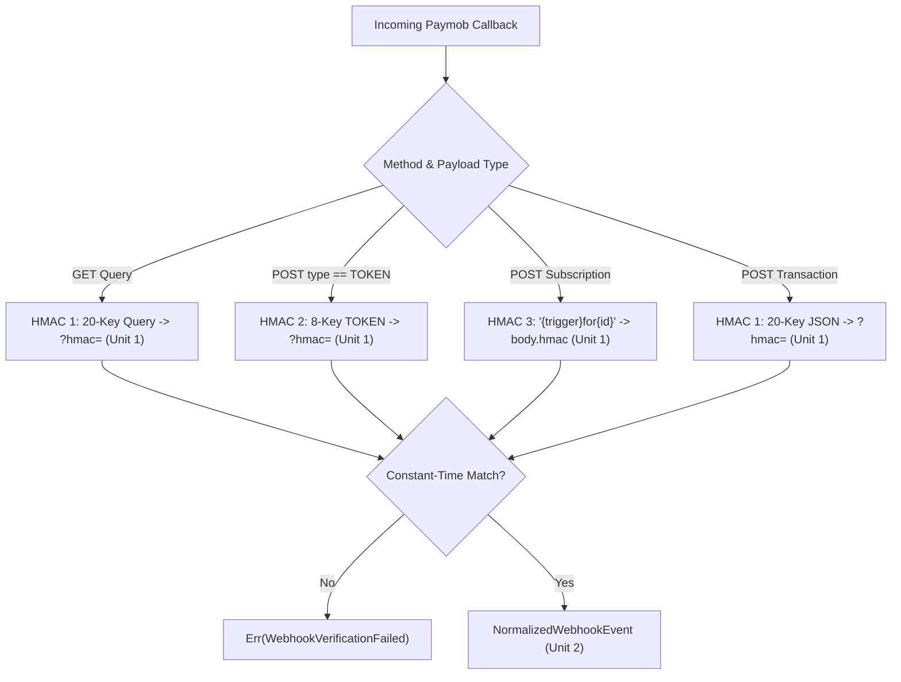

# User Story `US-9.2.0`: Triple Constant-Time HMAC-SHA512 Verifiers (Transaction, `TOKEN`, Subscription) & Optional `some-payment-adapter`

- **Module**: `module-9-some-payment-alignment` (`some-payment` Orchestrator Alignment & Optional Adapter)
- **Story Branch**: `feat/us-9.2.0-paymob-triple-hmac-and-adapter`
- **Field Profile**: `software`
- **Story Decomposition Score ($S_{\text{story}}$)**: `2.50` $\to$ **`4` Parallel Implementation Units (`unit-1..4`)**

---

## 1. Spec Kit Specifications

### 1.1 User Story Narrative
> **As a** `some-payment` orchestrator consumer receiving Paymob transaction, saved-card `TOKEN`, and subscription callbacks,  
> **I want** all three constant-time HMAC-SHA512 verifiers and an optional `#[cfg(feature = "some-payment-adapter")]` `PaymobProvider` implementing `some_payment_core::PaymentProvider`,  
> **So that** every callback type hitting `notification_url` is cryptographically verified and `some-paymob` plugs directly into `some-payment`.

Implements the exact triple HMAC-SHA512 specification from `some-payment/docs/sdk-implementation.md` and exposes `PaymobProvider` behind `some-payment-adapter` depending only on `some-payment-core`.

#### 1.1.1 Preconditions
- `some-payment` Module 1 (`some-payment-core`) is available.
- `US-9.1.0` alignment is seeded/merged on `feat/module-9-some-payment-alignment`.

#### 1.1.2 Postconditions
- HMAC 1 verifies 20 lexicographically sorted keys (POST JSON & GET query) with lowercase booleans against `?hmac=`.
- HMAC 2 verifies 8 lexicographically sorted keys for `type == "TOKEN"` against `?hmac=`.
- HMAC 3 verifies `"{trigger_type}for{subscription_data.id}"` against the `hmac` field inside the JSON body.
- `PaymobProvider` implements `PaymentProvider` behind `#[cfg(feature = "some-payment-adapter")]` with `NATIVE_MUTATION_IDEMPOTENCY = false`.

### 1.2 Acceptance Criteria (Gherkin Scenarios)
```gherkin
Feature: Paymob Triple HMAC-SHA512 Verifiers & some-payment-adapter

  Scenario: AC-1 — Verify 20-key Transaction Callback (POST JSON and GET Query)
    Given a Paymob POST JSON or GET query callback with valid ?hmac= SHA-512 hex
    When triple_hmac verifies it in constant time
    Then verification succeeds and tampered fields or uppercase booleans fail with WebhookVerificationFailed

  Scenario: AC-2 — Verify 8-key Card Token Callback (type == "TOKEN")
    Given a Paymob TOKEN callback arriving at the same notification_url with valid ?hmac=
    When callback_dispatcher routes it to HMAC 2
    Then verification succeeds and returns normalized card-token metadata

  Scenario: AC-3 — Verify Subscription Callback against JSON body hmac field
    Given a Paymob subscription callback with trigger_type "suspended", subscription_data.id 1264, and body hmac
    When callback_dispatcher routes it to HMAC 3
    Then it computes HMAC-SHA512("suspendedfor1264") and compares in constant time against body.hmac

  Scenario: AC-4 — Optional some-payment-adapter implements PaymentProvider
    Given feature "some-payment-adapter" enabled
    When PaymobProvider is registered in PaymentOrchestrator
    Then capabilities, create_payment, create_checkout, get_payment, capture, void_payment, refund, and parse_and_verify_webhook pass conformance tests
```

### 1.3 Test Cases & Traceability Matrix

| Test Case ID | Mapped AC | Owning Unit | Test Level | Description & Input Vector | Expected Result & Pass Threshold |
| :--- | :---: | :---: | :---: | :--- | :--- |
| `TC-9.2.1` | `AC-1..AC-3` | `unit-1` | Security | Golden & tampered fixtures for HMAC 1 (POST & GET), HMAC 2 (`TOKEN`), and HMAC 3 (Subscription body `hmac`) | All valid pass; every 1-byte tamper rejected in constant time |
| `TC-9.2.2` | `AC-2, AC-3` | `unit-2` | Unit | Dispatcher routing transaction vs `TOKEN` vs subscription on shared `notification_url` | Zero cross-type confusion; `hmac_secret` never logged |
| `TC-9.2.3` | `AC-4` | `unit-3` | Integration | `PaymobProvider` implementing `PaymentProvider` behind `some-payment-adapter` | Compiles with and without `some-payment-adapter` |
| `TC-9.2.4` | `AC-4` | `unit-4` | Integration | Offline `wiremock` conformance tests for `PaymobProvider` | Passes region, dual-auth, status synthesizer, triple HMAC, and redaction tests |

---

## 2. Technical Implementation Plan

### 2.1 Domain Invariants & Storage Schema
- **Constant-Time SHA-512**: All three HMAC verifiers MUST decode hex and compare digests via `subtle::ConstantTimeEq`.
- **Lowercase Booleans**: Serialize booleans strictly as `"true"`/`"false"` during 20-key concatenation.

### 2.2 Activity Diagram


---

## 3. Expected Folder Architecture at the Project

```text
src/
├── alignment/
│   ├── triple_hmac.rs              # Owned exclusively by unit-1
│   └── callback_dispatcher.rs      # Owned exclusively by unit-2
└── adapter/
    ├── paymob_provider.rs          # Owned exclusively by unit-3
    └── conformance_tests.rs        # Owned exclusively by unit-4
```

---

## 4. Implementation Units in Detail & Specialist Agent Assignment

### 4.1 Story Decomposition Score ($S_{\text{story}}$) & Dynamic Unit Count ($K$)
- **$D_1$ (35% Surface)**: `3` — 3 HMAC-SHA512 verifiers, unified callback dispatcher, `PaymobProvider` adapter, conformance tests
- **$D_2$ (25% Volume)**: `2` — ~550–700 production LOC
- **$D_3$ (20% Complexity)**: `3` — Exact 20-key POST/GET concatenation, 8-key `TOKEN` concatenation, body-hmac subscription concatenation, constant-time SHA-512
- **$D_4$ (20% Boundaries)**: `2` — 4 disjoint files under `src/alignment/` and `src/adapter/`
- **Calculated Score**: $S_{\text{story}} = 0.35(3) + 0.25(2) + 0.20(3) + 0.20(2) = \mathbf{2.50}$ $\to$ **`4` Parallel Units**

### 4.2 Detailed Unit Specifications (`unit-1..4`)
- **`unit-1` (`feat/us-9.2.0/unit-1-triple-hmac`)**:
  - **Deliverable Scope**: Constant-time HMAC-SHA512 verifiers for Transaction (20-key POST/GET), Card `TOKEN` (8-key), and Subscription (body `hmac`)
  - **Owned Files**: `src/alignment/triple_hmac.rs`
  - **Public Contract / Exports**: `verify_tx_hmac`, `verify_token_hmac`, `verify_subscription_hmac`
  - **Unit Verification & Target Complexity**: Unit tests + doc-tests for `src/alignment/triple_hmac.rs`, Max Cyclomatic Complexity $CC \le 6$ (cap $\le 10$, nesting $\le 2$)
- **`unit-2` (`feat/us-9.2.0/unit-2-callback-dispatcher`)**:
  - **Deliverable Scope**: Shared `notification_url` dispatcher routing Transaction, `TOKEN`, and Subscription payloads into `NormalizedWebhookEvent`
  - **Owned Files**: `src/alignment/callback_dispatcher.rs`
  - **Public Contract / Exports**: `dispatch_and_verify_paymob_callback`
  - **Unit Verification & Target Complexity**: Unit tests + doc-tests for `src/alignment/callback_dispatcher.rs`, Max Cyclomatic Complexity $CC \le 6$ (cap $\le 10$, nesting $\le 2$)
- **`unit-3` (`feat/us-9.2.0/unit-3-paymob-provider`)**:
  - **Deliverable Scope**: `#[cfg(feature = "some-payment-adapter")] pub struct PaymobProvider` implementing `PaymentProvider`
  - **Owned Files**: `src/adapter/paymob_provider.rs`
  - **Public Contract / Exports**: `PaymobProvider`
  - **Unit Verification & Target Complexity**: Unit tests + doc-tests for `src/adapter/paymob_provider.rs`, Max Cyclomatic Complexity $CC \le 6$ (cap $\le 10$, nesting $\le 2$)
- **`unit-4` (`feat/us-9.2.0/unit-4-paymob-conformance`)**:
  - **Deliverable Scope**: Offline `wiremock` conformance suite for `PaymobProvider`
  - **Owned Files**: `src/adapter/conformance_tests.rs`
  - **Public Contract / Exports**: Integration test suite
  - **Unit Verification & Target Complexity**: Unit tests + doc-tests for `src/adapter/conformance_tests.rs`, Max Cyclomatic Complexity $CC \le 6$ (cap $\le 10$, nesting $\le 2$)

### 4.3 Best-Fit Specialist Agents per Unit (`msitarzewski/agency-agents` + Core Roster)

| Unit ID | Branch Name | Primary Implementer Agent(s) (`agency-catalog`) | Reviewing Council Agent(s) | Mandatory Skills Enforced |
| :--- | :--- | :--- | :--- | :--- |
| `unit-1` | `feat/us-9.2.0/unit-1-triple-hmac` | `security-engineer` | `code-reviewer`, `penetration-tester`, `test-automation-engineer` | `code-review-council`, `security-audit`, `cyclomatic-complexity` |
| `unit-2` | `feat/us-9.2.0/unit-2-callback-dispatcher` | `backend-architect` | `code-reviewer`, `application-security-engineer`, `test-automation-engineer` | `code-review-council`, `security-audit`, `cyclomatic-complexity` |
| `unit-3` | `feat/us-9.2.0/unit-3-paymob-provider` | `backend-architect` | `code-reviewer`, `security-architect`, `test-automation-engineer` | `code-review-council`, `security-audit`, `cyclomatic-complexity` |
| `unit-4` | `feat/us-9.2.0/unit-4-paymob-conformance` | `test-automation-engineer` | `code-reviewer`, `application-security-engineer`, `test-automation-engineer` | `code-review-council`, `security-audit`, `cyclomatic-complexity` |
| **Story Remediation** | `patch/us-9.2.0-fixes` | `patch-implementer` | `code-reviewer-council-president` | Full 6-Gate Re-Verification |

### 4.4 Parallel Execution & Zero-Blocking Contract Seeding Plan
1. **Base Contract Seeding**: Add optional `some-payment-core` dependency & `some-payment-adapter` feature in `Cargo.toml` on `feat/module-9-some-payment-alignment`.
2. **Simultaneous Worktree Spawning**: All 4 units are provisioned in `.worktrees/feat-us-9.2.0-paymob-triple-hmac-and-adapter-unit-1..4` and spawned simultaneously in Wave 2.
3. **Ordered Cascading Merge Sequence**: `unit-1` $\to$ `unit-2` $\to$ `unit-3` $\to$ `unit-4` into `feat/us-9.2.0-paymob-triple-hmac-and-adapter` via `gh pr merge <PR> --merge`.

---

## 5. Security Gateway (Powered by `security-audit` Skill)

### 5.1 Trust Boundaries & Security Actors
- **Security Actors**: Paymob callback servers and `some-payment` orchestrator.
- **Trust Boundaries**: Shared `notification_url` ingress receiving 3 distinct HMAC-SHA512 schemes.

### 5.2 Threat Modeling & Abuse Matrix (STRIDE / OWASP ASVS)

| Threat ID | STRIDE Category | ASVS / CWE Ref | Attack Vector / Abuse Scenario | Impact | Required Mitigation & Code Control |
| :--- | :---: | :---: | :--- | :---: | :--- |
| `TM-1` | **S**poofing | ASVS V2 / CWE-345 | Forged `TOKEN` callback bypassing transaction HMAC verifier | Critical | Explicitly dispatch & verify all 3 HMAC schemes; reject unknown types |
| `TM-2` | **T**ampering | ASVS V5 / CWE-345 | Timing attack on hex string comparison | High | Decode hex bytes and compare with `subtle::ConstantTimeEq` |
| `TM-3` | **R**epudiation | ASVS V7 / CWE-778 | Customer GET return URL treated as authoritative payment settlement | Critical | Tag GET return callbacks clearly vs authoritative POST webhooks |
| `TM-4` | **I**nformation Disclosure | ASVS V8 / CWE-200 | Leaking `hmac_secret` or card `token` in debug logs | Critical | Redact `hmac_secret` and card tokens in `raw_redacted` & `Debug` |
| `TM-5` | **D**enial of Service | ASVS V11 / CWE-400 | Malformed hex in `?hmac=` causing panic | Medium | Return `WebhookVerificationFailed` on hex decode error without panicking |
| `TM-6` | **E**levation of Privilege | ASVS V4 / CWE-285 | Subscription callback checked against empty query `?hmac=` instead of body `hmac` | Critical | HMAC 3 reads `hmac` strictly from JSON body |

### 5.3 Cryptography & Global Data Protection Controls (Worldwide Legal & Regulatory Compliance)
1. **Cryptographic Standards**: TLS 1.2/1.3+ in transit; constant-time comparison (`subtle::ConstantTimeEq`) for all HMAC digests and secret tokens; `SHA-256`/`SHA-512` only; zero hardcoded secrets or weak hashes (`MD5`/`SHA-1`).
2. **Global Multi-Jurisdictional Privacy & Legal Compliance**: Supports PCI-DSS v4.0 (zero raw PANs in logs/errors/server-side defaults), GDPR / UK GDPR, CCPA/CPRA, and regional MENA payment sovereignty (SA/EG/AE/OM/PK) via automatic `[REDACTED]` PII/secret scrubbing across UTF-8 logs and telemetry.

### 5.4 Automated Security Verification Checklist (`cloudflare/security-audit-skill`)
- [ ] Applicable `skills/security-audit/playbooks/` reviewed (`WEB-PROTOCOL-AND-AUTH.md`, `MEMORY-SAFETY-AND-BINARY.md`, `SUPPLY-CHAIN-AND-RELEASE.md`).
- [ ] All untrusted inputs validated for type, length, range, and encoding prior to domain processing.
- [ ] Zero secrets, API keys, private keys, or raw PII emitted in `Debug` formatting, logs, or error messages.
- [ ] Zero `unsafe` blocks and zero `f32`/`f64` floats for monetary calculations.

### 5.5 Security Gateway (Gate G2) Sign-Off Checklist
- [ ] **0 Critical / High / Medium** vulnerabilities in `security-audit` scan.
- [ ] All STRIDE / ASVS threat mitigations (`TM-1..TM-6`) implemented and covered by negative/security test cases in Section 1.3.
- [ ] Independent Security Reviewer agent sign-off posted to the GitHub PR conversation.

---

## 6. Validation Gates & Acceptance Sign-Off

| Gate | Gate Name | Pass Criteria for `US-9.2.0` | Verification Command / Evidence | Status |
| :--- | :--- | :--- | :--- | :---: |
| **Gate G0** | **Build, Lint & Format** | 0 errors, 0 warnings, 100% `rustfmt` compliance | `CARGO_BUILD_JOBS=1 cargo fmt --check && cargo clippy --all-features --all-targets -- -D warnings` | `[ ]` |
| **Gate G1** | **Tests, Coverage & Traceability** | 100% of `AC-*` and `TC-*` passing ($\ge 90\%$ line, $\ge 85\%$ branch coverage) | `CARGO_BUILD_JOBS=1 cargo test --no-default-features --features core && cargo test --features some-payment-adapter` | `[ ]` |
| **Gate G2** | **Security Gateway (`security-audit`)** | All Section 5 STRIDE, crypto, and global compliance checks pass (0 findings) | `security-audit` report on PR | `[ ]` |
| **Gate G-Complexity** | **Cyclomatic Complexity** | Every function $CC \le 6$ target ($CC \le 10$ ceiling, $CC > 15$ blocker, nesting $\le 2$) | `cyclomatic-complexity` table on PR | `[ ]` |
| **Gate G-Docs** | **Documentation & Doc-Tests** | 100% public symbols documented + runnable doc-tests pass | `CARGO_BUILD_JOBS=1 cargo test --doc --features some-payment-adapter` | `[ ]` |
| **Gate G-Review** | **Council President Sign-Off** | Independent Reviewing Council posts `GATE G-REVIEW APPROVED` on GitHub PR | `gh pr comment <PR>` | `[ ]` |

### Final Acceptance Sign-Off Block
- **Story Leader Verification**: All 4 units merged via cascading `gh pr merge`, story integration suite green, and zero unaddressed findings.
- **Reviewing Council Verdict**: `PENDING` $\to$ `GATE G-REVIEW APPROVED`
